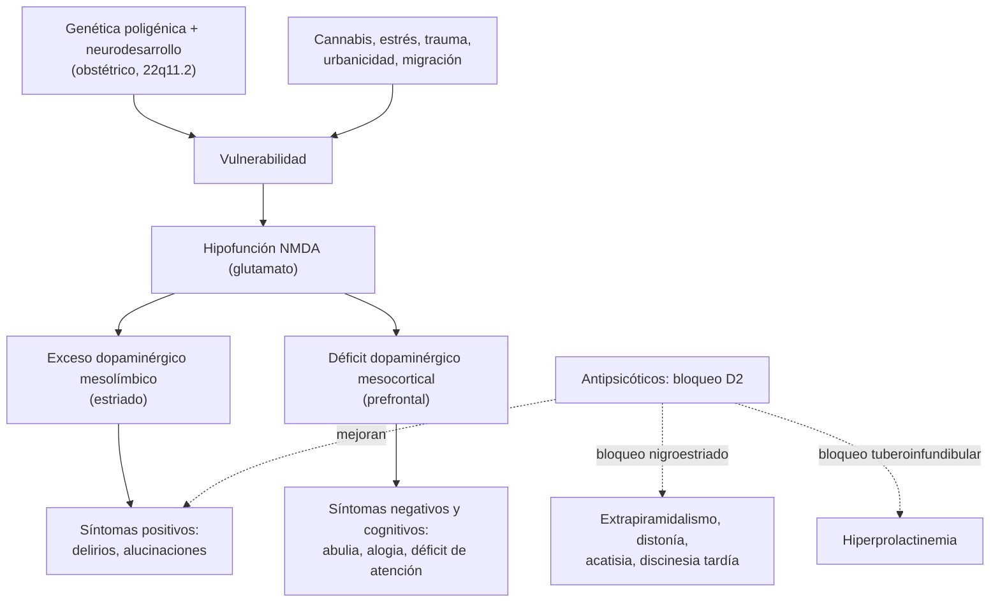

---
tags:
  - Psiquiatría
  - GES
  - Urgencia
---

# Esquizofrenia y otros trastornos psicóticos

**Subespecialidad**
Psiquiatría

**Guías principales**
APA 2020: tratamiento de la esquizofrenia (3.ª edición) · MINSAL: guía clínica GES de tratamiento de personas desde el primer episodio de esquizofrenia · NICE CG178 (2014): psicosis y esquizofrenia en adultos · Consenso TRRIP 2017: esquizofrenia resistente al tratamiento · Criterios DSM-5-TR (2022)

**Otras fuentes**
Revisión de la esquizofrenia (Jauhar, *Lancet* 2022) · Metaanálisis en red de 32 antipsicóticos orales (Huhn, *Lancet* 2019) · Metaanálisis de la duración de la psicosis no tratada (Penttilä, *Br J Psychiatry* 2014) · Ver [trastorno bipolar](trastorno-bipolar.md), [agitación psicomotora](../geriatria/agitacion-psicomotora-y-agresividad.md), [delirium](../geriatria/delirium.md) y [trastornos del movimiento por fármacos](../neurologia/trastornos-del-movimiento-por-farmacos.md)

**GES**
Sí: **esquizofrenia** (N.° 15): evaluación diagnóstica y tratamiento **desde el primer episodio**.

**EUNACOM**
5.01.1.010 Esquizofrenia y otros trastornos psicóticos (sospecha, inicial, derivar)

**Revisado**
Octubre 2026

!!! abstract "Resumen en 60 segundos"
    - **Psicosis** = pérdida del juicio de realidad: **ideas delirantes**, **alucinaciones** (sobre todo auditivas), **pensamiento y conducta desorganizados**.
    - **Esquizofrenia**: psicosis con **≥ 2** síntomas (al menos uno de delirios, alucinaciones o lenguaje desorganizado) por **≥ 1 mes** en fase activa y **≥ 6 meses** de alteración total, con **deterioro funcional**. Prevalencia **~ 0,3–0,7 %**; inicio en la **adolescencia tardía o adultez joven** (antes en hombres).
    - **Síntomas positivos** (delirios, alucinaciones), **negativos** (abulia, alogia, aplanamiento afectivo, aislamiento) y **cognitivos** (atención, memoria de trabajo): los negativos y cognitivos determinan el pronóstico funcional.
    - **Primer episodio psicótico**: descartar **causas médicas y sustancias** (cannabis, cocaína, anfetaminas, delirium, epilepsia temporal, encefalitis autoinmune, tumores, VIH, sífilis).
    - **Tratamiento**: **antipsicóticos** (risperidona, aripiprazol, olanzapina, quetiapina; haloperidol) + **intervenciones psicosociales** (psicoeducación familiar, rehabilitación). Acortar la **psicosis no tratada** mejora el pronóstico.
    - **Esquizofrenia resistente** (falla de **2** antipsicóticos en dosis y tiempo adecuados): **clozapina**, con control del **recuento de neutrófilos** (agranulocitosis) y vigilancia de **miocarditis**.
    - Vigilar los efectos adversos: **extrapiramidales**, **síndrome neuroléptico maligno**, **síndrome metabólico**, hiperprolactinemia, QT largo. GES N.° 15 desde el primer episodio.

## Definición

- **Psicosis**: alteración del **juicio de realidad**. Sus síntomas centrales son:
    - **Ideas delirantes**: creencias **falsas, firmes e irreductibles** a la argumentación, no compartidas por el grupo cultural (persecución, referencia, grandeza, control, celotipia, somáticas).
    - **Alucinaciones**: percepciones **sin objeto** (auditivas las más frecuentes: voces que comentan o dialogan; las **visuales** sugieren una causa orgánica o tóxica).
    - **Lenguaje desorganizado**: descarrilamiento, tangencialidad, incoherencia.
    - **Conducta muy desorganizada o catatónica**.
    - **Síntomas negativos**: **abulia**, **alogia**, **aplanamiento** afectivo, **anhedonia**, **asociabilidad**.
- **Esquizofrenia** (DSM-5-TR): **≥ 2** de los 5 síntomas anteriores durante **≥ 1 mes** (al menos uno de los tres primeros), con **≥ 6 meses** de signos continuos (incluidas fases prodrómica o residual) y **deterioro** laboral, social o del autocuidado; se excluyen los trastornos del ánimo con psicosis, las sustancias y las causas médicas.
- **Síntomas de primer rango de Schneider** (históricos): voces que dialogan o comentan, **eco o difusión del pensamiento**, **inserción o robo** del pensamiento, vivencias de **control** externo, percepción delirante.

## Epidemiología

### Mundial

- **Prevalencia** de vida **~ 0,3–0,7 %**; incidencia ~ 15 por 100 000 al año. Unas **24 millones** de personas en el mundo.
- **Inicio**: hombres **18–25 años**; mujeres **25–35 años** (segundo pico después de los 45 en mujeres).
- Algo más frecuente en **hombres**, en **zonas urbanas**, en **migrantes** y en quienes consumen **cannabis** de alta potencia.
- Esperanza de vida reducida en **15–20 años**: enfermedad **cardiovascular** y metabólica, **tabaquismo** (hasta 60–80 % fuma) y **suicidio** (~ 5 %).

### Chile

!!! chile "Datos nacionales"
    - La **esquizofrenia** es GES (**N.° 15**) desde 2005: confirmación diagnóstica por especialista, tratamiento farmacológico y psicosocial **desde el primer episodio**, y acceso a **clozapina** en la esquizofrenia resistente.
    - El modelo chileno es **comunitario**: centros de salud mental comunitaria (**COSAM**), hospitales de día, hogares protegidos y unidades de **corta estadía** en los hospitales generales.
    - La **Ley 21.331** (2021) regula los derechos de las personas con enfermedades mentales, el **consentimiento informado** y la **internación no voluntaria**, que debe ser excepcional y notificarse.

## Etiología y factores de riesgo

- **Genética**: heredabilidad **~ 80 %**; poligénica. Riesgo **~ 10 %** si un padre la tiene y **~ 40–50 %** si ambos o en el gemelo monocigótico. Síndrome de **deleción 22q11.2** (~ 25 % desarrolla psicosis).
- **Neurodesarrollo**: complicaciones **obstétricas** (hipoxia), infecciones prenatales, nacimiento en invierno o primavera, edad paterna avanzada.
- **Ambientales**: **cannabis** (sobre todo en la adolescencia y de alta potencia: dosis-dependiente), **urbanicidad**, **migración**, **trauma infantil**, aislamiento social.
- **Pródromos**: deterioro funcional, aislamiento, ideas raras, síntomas psicóticos atenuados (estados mentales de **alto riesgo**: ~ 20–30 % evoluciona a psicosis en 2–3 años).

## Fisiopatología

- **Hipótesis dopaminérgica**:
    - **Exceso de dopamina en la vía mesolímbica** (estriado asociativo) → síntomas **positivos** (base del efecto de los antipsicóticos, que bloquean los receptores **D2**).
    - **Déficit dopaminérgico mesocortical** (corteza prefrontal) → síntomas **negativos y cognitivos**.
    - Bloqueo de la vía **nigroestriada** → síntomas **extrapiramidales**; de la vía **tuberoinfundibular** → **hiperprolactinemia**.
- **Hipótesis glutamatérgica**: hipofunción del receptor **NMDA** (la ketamina y la fenciclidina producen síntomas positivos y negativos).
- **Neurodesarrollo**: poda sináptica excesiva en la adolescencia, menor volumen de sustancia gris, ventrículos aumentados.
- **Nuevo mecanismo**: los agonistas **muscarínicos** (xanomelina con trospio, aprobado por la FDA en 2024) reducen la liberación de dopamina sin bloquear los D2.

*Figura 1. Fisiopatología de la esquizofrenia: vías dopaminérgicas, síntomas y efectos de los antipsicóticos. Esquema propio basado en Jauhar (2022) y APA 2020.*

## Clasificación

| Trastorno (DSM-5-TR) | Duración | Claves |
|---|---|---|
| **Trastorno psicótico breve** | **1 día a < 1 mes**, con retorno completo | A menudo tras un estresor o en el posparto |
| **Trastorno esquizofreniforme** | **1 a 6 meses** | Como la esquizofrenia, sin completar 6 meses |
| **Esquizofrenia** | **≥ 6 meses** | Deterioro funcional |
| **Trastorno esquizoafectivo** | — | Episodio afectivo mayor **concurrente** con la psicosis + **≥ 2 semanas** de psicosis **sin** síntomas afectivos |
| **Trastorno delirante** | **≥ 1 mes** | **Solo delirios** (no extravagantes), sin otros síntomas de esquizofrenia; funcionamiento relativamente conservado |
| **Psicosis inducida por sustancias o fármacos** | Variable | Cannabis, cocaína, anfetaminas, alucinógenos, corticoides, levodopa |
| **Psicosis debida a otra afección médica** | Variable | Epilepsia, tumores, encefalitis, lupus, tiroides, VIH, sífilis |
| **Catatonía** | — | Asociada a trastornos psiquiátricos o médicos (ver abajo) |

- La **CIE-11** eliminó los **subtipos** clásicos (paranoide, hebefrénica, catatónica) y usa descriptores de síntomas.

## Clínica

- **Fase prodrómica**: meses a años de aislamiento, baja del rendimiento, irritabilidad, ideas raras, abandono de la higiene.
- **Fase aguda**: delirios **persecutorios** y de **referencia** ("la televisión habla de mí"), **voces** que insultan o dan órdenes (**alucinaciones de comando**: riesgo de violencia o suicidio), desorganización, agitación o retraimiento.
- **Fase residual**: predominio de síntomas **negativos** y **cognitivos**.
- **Examen mental**: afecto **aplanado** o inapropiado, pensamiento desorganizado, **introspección** (*insight*) **pobre**; conciencia y orientación **conservadas** (si están alteradas, pensar en **delirium**).
- **Catatonía**: **estupor**, mutismo, **negativismo**, **catalepsia** y flexibilidad cérea, posturas, ecolalia, ecopraxia, excitación sin propósito. Puede ser **maligna** (fiebre, disautonomía). Responde a **lorazepam** y a la **TEC**. Escala Bush-Francis.

!!! alarma "Signos de alarma"
    - **Alucinaciones de comando** o delirios persecutorios con **riesgo de heteroagresión**; **ideación suicida** (sobre todo en el primer episodio y tras el alta).
    - **Fiebre, rigidez, alteración de conciencia y CK elevada** en un paciente con antipsicóticos: **síndrome neuroléptico maligno**.
    - **Primer episodio** con **alteración de conciencia**, fluctuación, **alucinaciones visuales**, déficit focal, crisis convulsivas, fiebre o inicio después de los **40 años**: causa **orgánica** hasta demostrar lo contrario (delirium, encefalitis).
    - Con **clozapina**: fiebre o dolor de garganta (**neutropenia**), dolor torácico o taquicardia en las primeras semanas (**miocarditis**), constipación grave (íleo).
    - **Catatonía** con rechazo de alimentos o líquidos.

## Diagnóstico

!!! guia "Puntos clave (DSM-5-TR; APA 2020; guía GES)"
    - Diagnóstico **clínico** por **psiquiatra** (GES), basado en la historia, el **examen mental** y la información de **familiares**.
    - En el **primer episodio**, estudio para descartar causas **médicas** y **tóxicas** (ver laboratorio e imágenes).
    - Evaluar el **riesgo suicida** y de **violencia**, el **consumo de sustancias**, la **comorbilidad** médica y el **soporte** familiar.
    - Ante **síntomas afectivos** prominentes, considerar el trastorno **bipolar** con psicosis o el **esquizoafectivo**.
    - Registrar la **línea de base** metabólica antes de iniciar antipsicóticos.

## Laboratorio

**Primer episodio** (descartar causas secundarias y obtener la línea de base):

| Examen | Para qué |
|---|---|
| **Hemograma**, **electrolitos**, calcio, **glicemia**, **función renal y hepática** | Causas metabólicas; línea de base |
| **TSH** | Hipertiroidismo o hipotiroidismo |
| **Tóxicos en orina** (cannabis, cocaína, anfetaminas) | Psicosis inducida |
| **VIH** y **VDRL o RPR** | Infecciones del SNC |
| **β-hCG** | Embarazo (elección del fármaco) |
| **Perfil lipídico**, **HbA1c**, peso, IMC, cintura, PA | **Línea de base metabólica** |
| **Prolactina** | Si hay síntomas de hiperprolactinemia |
| **ECG** | **QT** basal (antipsicóticos) |
| Según la clínica: **B12**, ceruloplasmina (Wilson en < 40 años con síntomas motores o hepáticos), ANA, **punción lumbar** y anticuerpos **anti-NMDAR** (encefalitis autoinmune: psicosis + crisis, discinesias, disautonomía, alteración de conciencia), **EEG** (epilepsia temporal, estado no convulsivo) | Causas orgánicas |

## Imágenes

- **RM cerebral** (o TC) en el **primer episodio**, sobre todo si hay signos neurológicos, inicio atípico o tardío, deterioro cognitivo, cefalea, crisis convulsivas o falta de respuesta. Muchos protocolos la piden en todo primer episodio.
- En la esquizofrenia puede verse **aumento de los ventrículos** y menor volumen cortical, sin valor diagnóstico.

## Diagnóstico diferencial

| Diagnóstico | Claves |
|---|---|
| **Delirium** | **Alteración de la conciencia y la atención**, inicio agudo, **fluctuación**, alucinaciones **visuales**, causa médica |
| **Psicosis por sustancias** | Cannabis, cocaína, anfetaminas, alucinógenos; tóxicos positivos; resolución con la abstinencia (días a semanas) |
| **Abstinencia alcohólica** (*delirium tremens*) | Alucinaciones visuales o táctiles, temblor, disautonomía, 48–96 horas tras dejar de beber |
| **Trastorno bipolar** y **depresión con psicosis** | La psicosis ocurre **solo durante** los episodios afectivos |
| **Demencia** (Lewy, Alzheimer) | Adulto mayor, deterioro cognitivo; en la **demencia por cuerpos de Lewy**, alucinaciones visuales precoces y **hipersensibilidad a los antipsicóticos** |
| **Epilepsia del lóbulo temporal** | Episodios estereotipados, automatismos; EEG |
| **Encefalitis autoinmune** (anti-NMDAR) | Mujer joven, crisis, discinesias, disautonomía, LCR y anticuerpos |
| **Endocrinometabólicas** | Tiroides, Cushing, hipoglicemia, hiponatremia, Wilson, porfiria |
| **Fármacos** | **Corticoides**, levodopa, agonistas dopaminérgicos, isoniazida, anticolinérgicos |
| **Trastornos de personalidad** (esquizotípica, paranoide) | Rasgos crónicos sin psicosis franca persistente |
| **TOC con introspección ausente**, TEA | Contexto y evolución |

## Tratamiento

### Principios

- **Tratar pronto**: la **duración de la psicosis no tratada** se asocia a peor pronóstico.
- **Antipsicótico** + **intervenciones psicosociales**: psicoeducación del paciente y la familia, **intervención familiar**, TCC para la psicosis, entrenamiento en habilidades sociales, **rehabilitación** laboral y apoyo al empleo, manejo del consumo de sustancias.
- **Monoterapia** en la **menor dosis eficaz**; evaluar la respuesta en **2–6 semanas** con una dosis adecuada.
- Elegir según el **perfil de efectos adversos** (todas las moléculas, salvo la clozapina, tienen eficacia parecida).
- **Antipsicóticos de depósito** (inyectables de acción prolongada) si hay **mala adherencia** o preferencia del paciente: reducen las recaídas.
- **Mantención**: tras un primer episodio, **≥ 1–2 años**; tras varios episodios, **indefinida**. La suspensión aumenta mucho las recaídas.
- Cuidado **médico integral**: dejar de **fumar**, control **metabólico**, actividad física, salud dental.

!!! guia "Esquema según la etapa (APA 2020; consenso TRRIP 2017)"
    - **Primer episodio**: antipsicótico de segunda generación en **dosis bajas** (los pacientes son más sensibles a los efectos adversos y responden con dosis menores).
    - **Sin respuesta** tras 2–6 semanas en dosis adecuada y con buena adherencia: subir la dosis o **cambiar** a otro antipsicótico.
    - **Resistencia** (falla de **2 antipsicóticos** en dosis y tiempo adecuados, con adherencia confirmada): **clozapina** (APA 2020: recomendación fuerte). También indicada si hay **riesgo suicida** persistente o **agresividad** a pesar del tratamiento.
    - **TEC**: en la catatonía, la esquizofrenia resistente a la clozapina o el riesgo vital.

!!! dosis "Antipsicóticos frecuentes (adulto)"
    | Fármaco | Dosis habitual | Efectos adversos principales |
    |---|---|---|
    | **Risperidona** | 2–6 mg/día | Extrapiramidales (dosis dependientes), **hiperprolactinemia** |
    | **Aripiprazol** | 10–30 mg/día | **Acatisia**, insomnio; bajo riesgo metabólico y de prolactina |
    | **Olanzapina** | 10–20 mg/día | **Aumento de peso**, diabetes, dislipidemia, sedación |
    | **Quetiapina** | 300–800 mg/día | Sedación, **hipotensión ortostática**, metabólicos |
    | **Ziprasidona** | 80–160 mg/día (con comida) | **QT largo** |
    | **Haloperidol** (1.ª generación) | 2–10 mg/día | **Extrapiramidales** marcados, discinesia tardía, QT (EV) |
    | **Clozapina** | 12,5 mg/día → subir lento a 300–450 mg/día | **Agranulocitosis** (~ 1 %), **miocarditis**, **convulsiones**, **sialorrea**, **constipación e íleo**, sedación, aumento de peso, hipotensión |
    | Depósito: **palmitato de paliperidona**, aripiprazol, **decanoato de haloperidol** o de **flufenazina** | Mensual o trimestral (paliperidona) | Los del oral; dolor en el sitio de inyección |

!!! alarma "Clozapina: controles obligatorios"
    - **Recuento absoluto de neutrófilos** antes de iniciar, **semanal** las primeras **18 semanas** y luego **mensual** mientras dure el tratamiento (según el protocolo vigente). **Suspender** si los neutrófilos caen bajo el umbral del protocolo.
    - **Miocarditis** (primeras 4–8 semanas): fiebre, taquicardia, dolor torácico → **troponina y PCR**.
    - Subir la dosis **lentamente** (hipotensión, convulsiones). Ojo con el **tabaco**: dejar de fumar **aumenta** los niveles de clozapina.
    - **Constipación**: laxantes preventivos (riesgo de **íleo** y perforación).

### Efectos adversos de los antipsicóticos

- **Extrapiramidales**: **distonía aguda** (horas a días: tortícolis, crisis oculógiras; tratar con **biperideno** o difenhidramina), **acatisia** (inquietud; bajar la dosis, propranolol), **parkinsonismo** (semanas), **discinesia tardía** (meses a años; considerar valbenazina o deutetrabenazina). Ver [trastornos del movimiento por fármacos](../neurologia/trastornos-del-movimiento-por-farmacos.md).
- **Síndrome neuroléptico maligno**: fiebre, **rigidez en tubo de plomo**, alteración de conciencia, disautonomía, **CK muy elevada**. Suspender el antipsicótico, medidas de soporte, **dantroleno** o **bromocriptina** en los graves.
- **Metabólicos**: aumento de peso, **diabetes**, dislipidemia (olanzapina y clozapina las de más riesgo). Control de **peso, PA, glicemia y lípidos** al inicio, a las 12 semanas y anual. **Metformina** puede atenuar el aumento de peso.
- **Hiperprolactinemia**: amenorrea, galactorrea, disfunción sexual, osteoporosis (risperidona, paliperidona, primera generación).
- **QT largo** (ziprasidona, haloperidol EV), **hipotensión ortostática**, **sedación**, efectos **anticolinérgicos**.
- En los **adultos mayores con demencia**: mayor **mortalidad** y ACV.

## Complicaciones

- **Suicidio** (~ 5 % a lo largo de la vida; mayor riesgo en el primer episodio, tras el alta y con depresión).
- **Recaídas** (sobre todo por abandono del tratamiento), **hospitalizaciones** repetidas.
- **Consumo de sustancias** (tabaco, cannabis, alcohol).
- **Enfermedad cardiovascular**, **diabetes**, obesidad (enfermedad, fármacos y estilo de vida).
- Deterioro **funcional**, desempleo, situación de calle, estigma y **victimización** (son más a menudo víctimas que agresores).
- Efectos adversos de los antipsicóticos (discinesia tardía, síndrome neuroléptico maligno).

## Pronóstico y seguimiento

- **Curso heterogéneo**: ~ 20 % tiene un solo episodio o recuperación completa; la mayoría tiene **recaídas** con distinto grado de deterioro; ~ 15–20 % sigue un curso crónico grave.
- **Buen pronóstico**: inicio **agudo** y **tardío**, desencadenante claro, **sexo femenino**, buen funcionamiento **premórbido**, predominio de síntomas **positivos**, síntomas **afectivos**, buen **apoyo** familiar, tratamiento **precoz** y adherencia.
- **Mal pronóstico**: inicio **insidioso** y **precoz**, síntomas **negativos**, deterioro cognitivo, consumo de sustancias, larga **psicosis no tratada**.
- **Seguimiento**: controles con el equipo de salud mental (GES), adherencia, efectos adversos (escala de movimientos involuntarios anormales), **control metabólico** anual, **riesgo suicida**, consumo de sustancias e integración social y laboral.

## Perlas para el internado

!!! perla "Para recordar en la sala y el turno"
    - **Alucinaciones visuales + alteración de la conciencia** = **delirium** u otra causa orgánica, no esquizofrenia.
    - **Tiempos**: psicótico breve **< 1 mes**; esquizofreniforme **1–6 meses**; esquizofrenia **≥ 6 meses**.
    - **Esquizoafectivo**: psicosis **≥ 2 semanas sin** síntomas afectivos. **Bipolar con psicosis**: psicosis **solo** dentro de los episodios.
    - **Primer episodio**: TSH, tóxicos, VIH, sífilis, neuroimagen; dosis **bajas** de antipsicótico.
    - **Clozapina** si fallan **2** antipsicóticos. Neutrófilos semanales las primeras 18 semanas; ojo con la miocarditis y el íleo.
    - **Fiebre + rigidez + confusión + CK alta** con antipsicóticos = **síndrome neuroléptico maligno**.
    - **Distonía aguda**: biperideno 2–5 mg IM o EV.
    - Línea de base metabólica **antes** de iniciar el antipsicótico.

## Preguntas de repaso

??? repaso "1. Hombre de 20 años, consumidor de cannabis, con 8 meses de aislamiento progresivo, abandono de los estudios y, desde hace 2 meses, voces que comentan lo que hace y la idea de que sus vecinos lo vigilan con cámaras. Orientado, lúcido. ¿Diagnóstico probable y estudio?"
    **Esquizofrenia** probable (≥ 6 meses de alteración con fase activa de delirios y alucinaciones auditivas, deterioro funcional). Estudio del primer episodio: hemograma, ELP, glicemia, función renal y hepática, **TSH**, **tóxicos en orina**, **VIH**, **VDRL o RPR**, perfil lipídico, ECG y **neuroimagen**. Derivar a psiquiatría (GES N.° 15). El cannabis es un factor de riesgo y hay que abordarlo.

??? repaso "2. Paciente con haloperidol hace 3 días que llega con tortícolis y desviación de los ojos hacia arriba. ¿Qué tiene y cómo lo trata?"
    **Distonía aguda** (crisis oculógira y tortícolis) por bloqueo D2 nigroestriado. Tratamiento: **biperideno 2–5 mg IM o EV** (o difenhidramina), y considerar un anticolinérgico oral por algunos días o cambiar a un antipsicótico con menos efectos extrapiramidales.

??? repaso "3. Paciente con risperidona que presenta fiebre de 39,5 °C, rigidez generalizada, sopor, PA lábil y CK de 12 000 U/L. ¿Diagnóstico y manejo?"
    **Síndrome neuroléptico maligno**. Suspender el antipsicótico, **hospitalizar** (idealmente en UCI), hidratación EV, enfriamiento, corregir los electrolitos, prevenir la falla renal por rabdomiólisis; **benzodiacepinas**, y en los casos graves **dantroleno** o **bromocriptina**.

??? repaso "4. Hombre de 30 años con esquizofrenia que no respondió a risperidona ni a olanzapina en dosis y tiempo adecuados, con buena adherencia. ¿Qué indica y qué controla?"
    **Esquizofrenia resistente**: iniciar **clozapina** con subida lenta. Controlar el **recuento de neutrófilos** (semanal las primeras 18 semanas, luego mensual), vigilar la **miocarditis** en las primeras semanas (troponina, PCR), las **convulsiones**, la **constipación** (laxantes) y el **síndrome metabólico**.

??? repaso "5. Mujer de 22 años con psicosis de inicio agudo, crisis convulsivas, movimientos orofaciales anormales y fluctuación de conciencia. ¿Qué sospecha?"
    **Encefalitis autoinmune anti-NMDAR** (a menudo asociada a un **teratoma ovárico**). Estudio: **punción lumbar** (pleocitosis, anticuerpos anti-NMDAR en el LCR), **EEG**, **RM**, y ecografía o RM pélvica. Tratamiento con inmunoterapia y resección del tumor. Los antipsicóticos pueden empeorar el cuadro (riesgo de síndrome neuroléptico maligno).

??? repaso "6. ¿Qué factores indican buen pronóstico en la esquizofrenia?"
    Inicio **agudo** y tardío, desencadenante identificable, buen funcionamiento **premórbido**, sexo femenino, predominio de síntomas **positivos** y afectivos, buen **apoyo** familiar, corta **duración de la psicosis no tratada** y **adherencia** al tratamiento.

## Referencias

1. Keepers GA, Fochtmann LJ, Anzia JM, et al. The American Psychiatric Association practice guideline for the treatment of patients with schizophrenia. *Am J Psychiatry.* 2020;177(9):868–872. doi:[10.1176/appi.ajp.2020.177901](https://doi.org/10.1176/appi.ajp.2020.177901)
2. Ministerio de Salud de Chile. Guía clínica GES: tratamiento de personas desde el primer episodio de esquizofrenia. Santiago: MINSAL. [diprece.minsal.cl](https://diprece.minsal.cl/le-informamos/auge/acceso-guias-clinicas/guias-clinicas-auge/)
3. National Institute for Health and Care Excellence. Psychosis and schizophrenia in adults: prevention and management. Clinical guideline CG178. Londres: NICE; 2014. [nice.org.uk](https://www.nice.org.uk/guidance/cg178)
4. Howes OD, McCutcheon R, Agid O, et al. Treatment-resistant schizophrenia: Treatment Response and Resistance in Psychosis (TRRIP) Working Group consensus guidelines on diagnosis and terminology. *Am J Psychiatry.* 2017;174(3):216–229. doi:[10.1176/appi.ajp.2016.16050503](https://doi.org/10.1176/appi.ajp.2016.16050503)
5. Jauhar S, Johnstone M, McKenna PJ. Schizophrenia. *Lancet.* 2022;399(10323):473–486. doi:[10.1016/S0140-6736(21)01730-X](https://doi.org/10.1016/S0140-6736(21)01730-X)
6. Huhn M, Nikolakopoulou A, Schneider-Thoma J, et al. Comparative efficacy and tolerability of 32 oral antipsychotics for the acute treatment of adults with multi-episode schizophrenia: a systematic review and network meta-analysis. *Lancet.* 2019;394(10202):939–951. doi:[10.1016/S0140-6736(19)31135-3](https://doi.org/10.1016/S0140-6736(19)31135-3)
7. Penttilä M, Jääskeläinen E, Hirvonen N, et al. Duration of untreated psychosis as predictor of long-term outcome in schizophrenia: systematic review and meta-analysis. *Br J Psychiatry.* 2014;205(2):88–94. doi:[10.1192/bjp.bp.113.127753](https://doi.org/10.1192/bjp.bp.113.127753)
8. Chile. Ley 21.331 del reconocimiento y protección de los derechos de las personas en la atención de salud mental. *Diario Oficial*, 11 de mayo de 2021. [diariooficial.interior.gob.cl](https://www.diariooficial.interior.gob.cl/publicaciones/2021/05/11/42951/01/1942112.pdf)
9. American Psychiatric Association. *Diagnostic and Statistical Manual of Mental Disorders, Fifth Edition, Text Revision (DSM-5-TR).* Washington, DC: APA; 2022.
