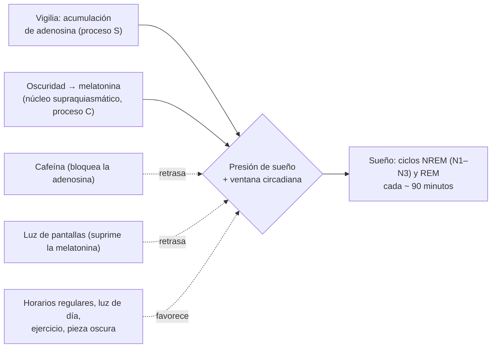

---
tags:
  - Psiquiatría
---

# Fundamentos de psiquiatría: clasificaciones, examen mental, desarrollo a lo largo del ciclo vital e higiene del sueño y de la alimentación

**Subespecialidad**
Psiquiatría · Psicología médica · Pediatría · Medicina familiar · Salud pública

**Guías principales**
DSM-5-TR (APA, 2022) · CIE-11 (OMS, vigente desde 2022) · AASM 2015 y 2016: horas de sueño recomendadas en adultos y en la población pediátrica · MINSAL 2022: Guías Alimentarias para Chile

**Otras fuentes**
Innovaciones de la CIE-11 en los trastornos mentales (Reed, *World Psychiatry* 2019) · Teorías del desarrollo de Piaget, Erikson, Freud, Bowlby y Ainsworth, y Kohlberg · Ley 20.606 de composición nutricional de los alimentos (2012) · Ver [trastornos del sueño](../respiratorio/apnea-del-sueno-y-trastornos-del-sueno.md), [trastornos de la conducta alimentaria](../endocrinologia/trastornos-de-la-conducta-alimentaria.md), [obesidad](../endocrinologia/obesidad-y-sindrome-metabolico.md), [trastornos de la personalidad](trastornos-de-la-personalidad.md) y [trastornos del neurodesarrollo](trastornos-del-neurodesarrollo.md)

**GES**
No aplica.

**EUNACOM**
5.01.3.001 Clasificaciones en psiquiatría · 5.01.3.003 Desarrollo cognitivo, afectivo y social a lo largo del ciclo vital · 5.01.3.004 Higiene de la alimentación · 5.01.3.005 Higiene del sueño

**Revisado**
Octubre 2026

!!! abstract "Resumen en 60 segundos"
    - **Clasificaciones**: el **DSM-5-TR** (APA, 2022) y la **CIE-11** (OMS, vigente desde 2022; en Chile aún se usa mucho la **CIE-10** en los registros y el GES). Son **categoriales** y **descriptivas** (ateóricas), con criterios operativos, y avanzan hacia modelos **dimensionales**.
    - **Examen mental**: aspecto, conducta y actitud, **conciencia**, **orientación**, **atención**, **memoria**, **afectividad** (ánimo y afecto), **pensamiento** (curso y contenido), **sensopercepción**, inteligencia, **juicio** e **introspección**. La **conciencia** alterada orienta a un **delirium** (causa orgánica).
    - Distinguir: **idea delirante** (falsa e irreductible), **idea sobrevalorada**, **obsesión** (egodistónica); **alucinación** (sin objeto), **ilusión** (percepción deformada de un objeto real), **pseudoalucinación**.
    - **Desarrollo**: **Piaget** (sensoriomotor 0–2 años, preoperacional 2–7, operaciones concretas 7–11, operaciones formales ≥ 11–12); **Erikson** (8 crisis psicosociales, de confianza frente a desconfianza a integridad frente a desesperación); **apego** (Bowlby y Ainsworth: seguro, evitativo, ambivalente, desorganizado).
    - **Higiene del sueño**: horarios **regulares**, pieza oscura, silenciosa y fresca, evitar **pantallas**, cafeína, alcohol y comidas pesadas en la noche, actividad física de día. Horas recomendadas: **adultos ≥ 7 h**, adolescentes **8–10 h**, escolares **9–12 h**, preescolares **10–13 h**.
    - **Higiene de la alimentación**: horarios **regulares**, comer **en familia** y **sin pantallas**, alimentos **frescos** y poco procesados, preferir el **agua**, evitar los productos con sellos **"ALTO EN"**, no usar la comida como premio o castigo (Guías Alimentarias para Chile 2022).

## Definición

- **Clasificación psiquiátrica**: sistema que ordena los trastornos mentales en categorías con **criterios diagnósticos** explícitos para mejorar la **confiabilidad** del diagnóstico, la comunicación, la investigación y la planificación de la atención.
- **Trastorno mental** (DSM-5-TR): síndrome con alteración **clínicamente significativa** de la cognición, la regulación emocional o la conducta, que refleja una disfunción de los procesos psicológicos, biológicos o del desarrollo, y que se asocia a **malestar** o **discapacidad**. Una respuesta **esperable** a un estresor común (como el duelo) o una conducta socialmente desviada **no** son por sí solas trastornos mentales.
- **Examen mental**: evaluación **estructurada** del funcionamiento psíquico **actual** del paciente, equivalente al examen físico en la psiquiatría.
- **Desarrollo psicológico**: cambios cognitivos, afectivos y sociales a lo largo de la vida, resultado de la interacción entre la **maduración biológica** y el **ambiente**.
- **Higiene del sueño**: conjunto de **hábitos y condiciones ambientales** que favorecen un sueño de buena calidad y cantidad.
- **Higiene de la alimentación**: hábitos, horarios y contextos que promueven una alimentación **saludable**, una relación sana con la comida y la prevención de la **obesidad** y de los **trastornos de la conducta alimentaria**.

## Epidemiología

### Mundial

- Los trastornos mentales afectan a **~ 1 de cada 8** personas en el mundo (OMS, 2019); la **depresión** y la **ansiedad** son los más frecuentes y están entre las primeras causas de **años vividos con discapacidad**.
- La mitad de los trastornos mentales comienza antes de los **14 años** y tres cuartos antes de los **24**: de ahí la importancia del **desarrollo** y la **prevención**.
- El **sueño insuficiente** es muy frecuente en los adolescentes (uso de pantallas, horarios escolares) y en los adultos (trabajo por turnos).

### Chile

!!! chile "Datos nacionales"
    - En el **Estudio Chileno de Prevalencia Psiquiátrica** (Vicente 2006), un **31,5 %** de las personas ≥ 15 años tuvo un trastorno psiquiátrico en la vida; en los **niños y adolescentes**, el **22,5 %** en el último año (Vicente 2012).
    - Los registros clínicos, las licencias médicas y el GES usan la **CIE-10**; la transición a la **CIE-11** es gradual.
    - **Guías Alimentarias para Chile** (MINSAL, 2022, elaboradas con el INTA): **10 mensajes** que promueven alimentos frescos de ferias y mercados, frutas y verduras, **legumbres**, el **agua** en vez de jugos y bebidas azucaradas, cocinar y comer en compañía, con identidad territorial y sustentabilidad.
    - **Ley 20.606** (2012, en vigor desde 2016): **sellos de advertencia "ALTO EN"** (calorías, azúcares, sodio, grasas saturadas), prohíbe su venta en los colegios y su publicidad dirigida a los niños.
    - Chile tiene una de las **prevalencias de obesidad infantil** más altas de la región (Mapa Nutricional de la JUNAEB).

## Etiología y factores de riesgo

**Modelo biopsicosocial** (Engel): los trastornos mentales resultan de la interacción de factores:

| Dimensión | Ejemplos |
|---|---|
| **Biológica** | Genética, neurodesarrollo, enfermedades médicas, sustancias, fármacos |
| **Psicológica** | Temperamento, estilos de apego, esquemas cognitivos, mecanismos de afrontamiento, trauma |
| **Social** | Familia, pobreza, violencia, educación, redes de apoyo, cultura, discriminación |

**Determinantes del sueño y la alimentación**: horarios familiares y escolares, **pantallas**, trabajo por turnos, publicidad y disponibilidad de alimentos ultraprocesados, nivel socioeconómico, estrés.

## Fisiopatología

### Bases del sueño

- **Regulación del sueño** (modelo de Borbély): **proceso homeostático** (proceso S: la **adenosina** se acumula durante la vigilia y genera presión de sueño; la **cafeína** la bloquea) y **proceso circadiano** (proceso C: el **núcleo supraquiasmático** sincronizado por la **luz**; la **melatonina** se secreta en la oscuridad; la **luz azul** de las pantallas la suprime).
- **Arquitectura**: ciclos de **~ 90 minutos** de sueño **NREM** (N1, N2, N3: sueño profundo o de ondas lentas, predominante al inicio de la noche) y **REM** (ensueños, atonía muscular, predominante al final).
- **Cambios con la edad**: los **recién nacidos** duermen 16–18 horas (50 % REM); los **adolescentes** tienen un **retraso de fase** fisiológico (se duermen y despiertan más tarde); los **adultos mayores** tienen menos sueño profundo, más despertares y **adelanto de fase**.

*Figura 1. Regulación del sueño por los procesos homeostático y circadiano, y factores que la alteran o favorecen. Esquema propio basado en el modelo de Borbély y las recomendaciones de la AASM.*

### Bases de la regulación del apetito

- **Hambre y saciedad**: el **hipotálamo** integra señales de **grelina** (hambre), **leptina** (tejido adiposo), **insulina**, GLP-1 y PYY (saciedad); el sistema de **recompensa** (dopamina) explica el comer "hedónico" (alimentos ultraprocesados, comer frente a pantallas, comer emocional).
- La **privación de sueño** aumenta la grelina y reduce la leptina: favorece la **obesidad**.

## Clasificación

### Sistemas de clasificación

| Aspecto | **DSM-5-TR** (APA) | **CIE-11** (OMS) | **CIE-10** (OMS) |
|---|---|---|---|
| Año | 2013 (DSM-5); revisión de texto **2022** | Aprobada en 2019; vigente desde **2022** | 1992 (aún muy usada en Chile) |
| Uso | Clínico e investigación (sobre todo en los EE. UU. y la academia) | **Oficial** para las estadísticas de salud mundiales | Registros, licencias, GES |
| Enfoque | Categorial con especificadores; modelo dimensional alternativo de la personalidad | Categorial con más **dimensiones**; descripciones clínicas más flexibles | Categorial |
| Ejemplos de cambios | Trastorno del **espectro** autista; **duelo prolongado** (2022); trastornos de **síntomas somáticos** | Trastorno de la personalidad **dimensional**; **TEPT complejo**; trastorno de **distrés corporal**; **incongruencia de género** fuera de los trastornos mentales; trastorno por **videojuegos** | — |

- Ambas son **descriptivas** y **ateóricas**: se basan en síntomas observables, no en la causa.
- Los **diagnósticos multiaxiales** (ejes I a V del DSM-IV) se eliminaron en el DSM-5.

### Grandes grupos de trastornos (DSM-5-TR)

Neurodesarrollo · espectro de la esquizofrenia y otros psicóticos · bipolares · depresivos · ansiedad · obsesivo-compulsivo y relacionados · relacionados con traumas y estrés · disociativos · síntomas somáticos · conducta alimentaria · eliminación · sueño-vigilia · disfunciones sexuales · disforia de género · disruptivos, del control de impulsos y de la conducta · relacionados con sustancias y adictivos · **neurocognitivos** (delirium, demencias) · personalidad · parafílicos.

### Examen mental

| Componente | Qué evaluar | Hallazgos de ejemplo |
|---|---|---|
| **Aspecto** | Vestimenta, higiene, edad aparente, facies | Descuido (depresión, esquizofrenia), extravagancia (manía) |
| **Conducta y psicomotricidad** | Actividad, gestos, contacto visual, actitud ante el entrevistador | Agitación, inhibición, catatonía, estereotipias, suspicacia |
| **Conciencia** | Nivel (vigil, somnoliento, sopor, coma) y **claridad** | **Alterada → delirium** (causa orgánica) |
| **Orientación** | Tiempo, espacio, persona | Desorientación en el delirium y la demencia |
| **Atención** | Capacidad de concentrarse (meses al revés, serie de 7) | Distraibilidad (manía, TDAH), inatención (delirium) |
| **Memoria** | Inmediata, reciente, remota | Amnesia anterógrada (Korsakoff), fallas recientes (demencia) |
| **Lenguaje** | Fluidez, comprensión, repetición, nominación | Afasias (orgánico), mutismo |
| **Afectividad** | **Ánimo** (lo que refiere) y **afecto** (lo que se observa): tono, rango, congruencia, reactividad | Ánimo deprimido, eufórico; afecto aplanado, lábil, incongruente |
| **Pensamiento: curso o forma** | Velocidad y organización | **Taquipsiquia** y **fuga de ideas** (manía), bradipsiquia (depresión), **disgregación**, descarrilamiento, tangencialidad, circunstancialidad, **bloqueo**, perseveración |
| **Pensamiento: contenido** | Temas predominantes | **Ideas delirantes**, ideas sobrevaloradas, **obsesiones**, fobias, **ideación suicida u homicida**, culpa, ruina |
| **Sensopercepción** | Alucinaciones, ilusiones | **Auditivas** (esquizofrenia), **visuales** (delirium, sustancias, demencia por Lewy), táctiles (abstinencia, cocaína) |
| **Inteligencia** | Estimación clínica | Discapacidad intelectual |
| **Juicio** | Capacidad de evaluar situaciones y tomar decisiones | Juicio alterado en la psicosis y la manía |
| **Introspección** (*insight*) | Conciencia de enfermedad | Ausente en la psicosis y la manía; presente en el TOC con buena introspección |

### Términos de la semiología

| Término | Definición |
|---|---|
| **Idea delirante** | Creencia **falsa**, **firme** e **irreductible** a la argumentación, no compartida por el grupo cultural |
| **Idea sobrevalorada** | Creencia **exagerada** y cargada de afecto, pero con **algo** de flexibilidad (ej. preocupación por la figura en la anorexia) |
| **Obsesión** | Pensamiento **intrusivo**, **egodistónico**, reconocido como **propio** pero absurdo |
| **Alucinación** | Percepción **sin objeto**, vivida como real |
| **Pseudoalucinación** | Percepción sin objeto vivida "dentro de la cabeza" o reconocida como irreal |
| **Ilusión** | Percepción **deformada** de un objeto **real** (ej. ver un animal en una sombra) |
| **Alucinación hipnagógica e hipnopómpica** | Al dormirse o despertar; normales (frecuentes en la narcolepsia) |
| **Despersonalización** y **desrealización** | Sensación de irrealidad de uno mismo o del entorno, con juicio de realidad **conservado** |

### Desarrollo a lo largo del ciclo vital

**Desarrollo cognitivo (Piaget)**:

| Etapa | Edad | Logros |
|---|---|---|
| **Sensoriomotora** | **0–2 años** | Reflejos → acciones intencionales; **permanencia del objeto** (~ 8–12 meses); imitación |
| **Preoperacional** | **2–7 años** | Lenguaje y **juego simbólico**; **egocentrismo**; pensamiento mágico; animismo; aún sin **conservación** |
| **Operaciones concretas** | **7–11 años** | **Conservación**, reversibilidad, clasificación, lógica sobre lo **concreto** |
| **Operaciones formales** | **≥ 11–12 años** | Pensamiento **abstracto** e **hipotético-deductivo** |

**Desarrollo psicosocial (Erikson)**:

| Etapa | Edad aproximada | Crisis | Logro |
|---|---|---|---|
| 1 | 0–1 año | **Confianza** frente a desconfianza | Esperanza |
| 2 | 1–3 años | **Autonomía** frente a vergüenza y duda | Voluntad |
| 3 | 3–6 años | **Iniciativa** frente a culpa | Propósito |
| 4 | 6–12 años | **Laboriosidad** frente a inferioridad | Competencia |
| 5 | Adolescencia | **Identidad** frente a confusión de roles | Fidelidad |
| 6 | Adulto joven | **Intimidad** frente a aislamiento | Amor |
| 7 | Adulto medio | **Generatividad** frente a estancamiento | Cuidado |
| 8 | Adulto mayor | **Integridad** frente a desesperación | Sabiduría |

**Desarrollo psicosexual (Freud)**: oral (0–1), anal (1–3), fálica o edípica (3–6), latencia (6–pubertad), genital (adolescencia).

**Apego (Bowlby; "situación extraña" de Ainsworth)**:

| Tipo | Conducta del niño | Cuidador |
|---|---|---|
| **Seguro** (~ 60 %) | Explora, se angustia en la separación y se **consuela** al reencuentro | Sensible y disponible |
| **Inseguro evitativo** | Poca angustia y **evita** al cuidador en el reencuentro | Rechazante o distante |
| **Inseguro ambivalente** (resistente) | Mucha angustia, difícil de consolar, busca y rechaza al cuidador | Inconsistente |
| **Desorganizado** | Conductas contradictorias, temor al cuidador | **Maltrato**, trauma, cuidador atemorizante (mayor riesgo de psicopatología) |

**Hitos afectivos y sociales**: sonrisa social (~ 6–8 semanas), angustia ante extraños (~ 8 meses), angustia de separación (~ 10–18 meses), juego paralelo (2–3 años) y cooperativo (3–4 años), identidad de género (~ 3 años), desarrollo **moral** (Kohlberg: preconvencional, convencional, posconvencional).

**Adolescencia**: búsqueda de **identidad**, autonomía de los padres, importancia de los **pares**, pensamiento abstracto, conductas de riesgo (la corteza prefrontal madura hasta los ~ 25 años).

**Adultez y vejez**: tareas de la intimidad, la generatividad (trabajo, crianza), la **crisis de la mitad de la vida**, la **jubilación**, las pérdidas y el **duelo**; en la vejez, la **integridad** y la adaptación a los cambios físicos y sociales.

**Duelo normal** (modelo de Kübler-Ross, no lineal): negación, ira, negociación, depresión, aceptación. El **duelo prolongado** (DSM-5-TR) persiste ≥ 12 meses con deterioro.

## Clínica

### Higiene del sueño: horas recomendadas (AASM)

| Edad | Horas en 24 horas |
|---|---|
| 4–12 meses | **12–16** (con siestas) |
| 1–2 años | **11–14** (con siestas) |
| 3–5 años | **10–13** (con siestas) |
| 6–12 años | **9–12** |
| 13–18 años | **8–10** |
| Adultos | **≥ 7** |

- **Consecuencias del sueño insuficiente**: somnolencia, problemas de **atención** y memoria, irritabilidad, **accidentes**, obesidad, diabetes, HTA, depresión, menor rendimiento escolar y laboral.

### Higiene de la alimentación: señales de alerta

- Comer **frente a pantallas**, saltarse el desayuno, **picoteo** continuo, bebidas azucaradas, uso de la comida como **premio o castigo**, restricción y comentarios sobre el peso en la familia (riesgo de TCA), **atracones**, comer emocional.

!!! alarma "Cuándo derivar"
    - **Insomnio crónico** (≥ 3 noches por semana por ≥ 3 meses) con deterioro: TCC para el insomnio (la higiene del sueño **sola no basta**).
    - **Ronquido** con apneas, **somnolencia diurna** excesiva, cataplejía: estudio del sueño.
    - **Conductas alimentarias de riesgo**: restricción, purgas, atracones, baja de peso, preocupación excesiva por la figura (TCA).
    - **Obesidad** con comorbilidades.

## Diagnóstico

!!! guia "La entrevista psiquiátrica"
    - **Motivo de consulta** y enfermedad actual (inicio, evolución, desencadenantes, impacto).
    - **Antecedentes**: psiquiátricos (episodios, tratamientos, hospitalizaciones, **intentos de suicidio**), médicos, **fármacos**, **consumo** de sustancias, familiares (psiquiátricos y suicidio).
    - **Historia personal y del desarrollo**: embarazo y parto, hitos del desarrollo, escolaridad, relaciones, trabajo, sexualidad, **trauma**.
    - **Examen mental** completo.
    - **Evaluación del riesgo**: suicida, de heteroagresión y de autocuidado.
    - **Diagnóstico** multidimensional: trastorno (DSM-5-TR o CIE), enfermedades médicas, factores psicosociales y nivel de funcionamiento; y **formulación** biopsicosocial.

## Laboratorio

- En la evaluación psiquiátrica inicial, según la clínica: **hemograma**, **TSH**, **glicemia**, electrolitos, función renal y hepática, **B12**, **VIH**, **VDRL o RPR**, **tóxicos**, β-hCG; para **descartar causas médicas** de los síntomas psiquiátricos.

## Imágenes

- **Neuroimagen** si hay signos neurológicos, un primer episodio psicótico o un deterioro cognitivo, un inicio tardío o una presentación atípica.

## Diagnóstico diferencial

- **Normalidad** (reacciones esperables al estrés, el duelo y las etapas del desarrollo) frente a **trastorno** (malestar o deterioro significativos).
- **Causa médica** o **sustancia** frente a **trastorno psiquiátrico primario**: pensar en lo orgánico ante la alteración de **conciencia**, el **inicio tardío** o brusco, las alucinaciones **visuales** o táctiles, los signos neurológicos y la falta de antecedentes.
- **Variación cultural** frente a síntoma (creencias religiosas o culturales compartidas no son delirios).

## Tratamiento

### Higiene del sueño (recomendaciones)

1. **Horarios regulares** para acostarse y levantarse, **también el fin de semana**.
2. **Exposición a la luz** natural en la mañana; **oscuridad** en la noche.
3. **Pieza oscura, silenciosa y fresca**; la cama solo para dormir (y la actividad sexual).
4. **Sin pantallas** al menos **1 hora** antes de dormir; dispositivos fuera de la pieza (sobre todo en niños y adolescentes).
5. Evitar la **cafeína** después del almuerzo, el **alcohol** (fragmenta el sueño), la **nicotina** y las comidas abundantes en la noche.
6. **Actividad física** regular, no en las 2–3 horas previas a dormir.
7. **Rutina** relajante antes de dormir (en los niños: baño, cuento, misma secuencia).
8. **Siestas** breves (< 30 minutos) y no tarde en el día en los adultos.
9. Si no se duerme en ~ 20 minutos: **levantarse**, hacer algo tranquilo con luz tenue y volver cuando tenga sueño (control de estímulos).
10. No mirar el reloj durante la noche.

### Higiene de la alimentación (Guías Alimentarias 2022 y recomendaciones generales)

1. **Horarios regulares** (desayuno, almuerzo, once o cena), sin picoteo.
2. Comer **en familia**, en la mesa, **sin pantallas**, a un ritmo tranquilo.
3. Preferir alimentos **frescos y naturales** (frutas, verduras, **legumbres**, pescado, cereales integrales) y **cocinar** en casa.
4. Beber **agua**; evitar las **bebidas azucaradas** y los jugos.
5. Elegir productos **sin sellos "ALTO EN"** (Ley 20.606).
6. En los niños: el adulto decide **qué** y **cuándo** se come; el niño decide **cuánto** (división de responsabilidades); **no** usar la comida como **premio o castigo**; no forzar a comer.
7. **No** hacer comentarios sobre el peso o la figura; promover una **imagen corporal** positiva (prevención de los TCA).
8. Combinar con **actividad física** y **sueño** suficiente.

## Complicaciones

- **Diagnóstico erróneo** por un examen mental incompleto (pasar por alto un delirium o una causa médica).
- **Estigma** y **sobrediagnóstico** o **medicalización** de reacciones normales.
- **Sueño insuficiente**: accidentes, obesidad, enfermedades cardiometabólicas, depresión, bajo rendimiento.
- **Malos hábitos alimentarios**: **obesidad**, diabetes, dislipidemia, **trastornos de la conducta alimentaria**.

## Pronóstico y seguimiento

- La **detección precoz** de las alteraciones del desarrollo y de los trastornos mentales mejora el pronóstico.
- Los **hábitos** de sueño y alimentación se forman en la **infancia** y tienden a mantenerse: la intervención familiar temprana es la más eficaz.

## Perlas para el internado

!!! perla "Para recordar"
    - **Conciencia alterada** en el examen mental = pensar en **delirium**, no en un trastorno psiquiátrico primario.
    - **Ánimo** es lo que el paciente refiere; **afecto** es lo que se observa.
    - **Delirio** (irreductible) ≠ **idea sobrevalorada** ≠ **obsesión** (egodistónica).
    - **Alucinación** (sin objeto) ≠ **ilusión** (objeto real deformado).
    - **Piaget**: sensoriomotor 0–2, preoperacional 2–7, concretas 7–11, formales ≥ 11–12. **Permanencia del objeto** ~ 8–12 meses; **conservación** ~ 7 años.
    - **Erikson** adolescencia = **identidad** frente a confusión de roles; vejez = **integridad** frente a desesperación.
    - **Apego desorganizado**: asociado a **maltrato**, mayor riesgo de psicopatología.
    - Sueño: adultos **≥ 7 h**, adolescentes **8–10 h**; **sin pantallas** 1 hora antes de dormir.
    - Alimentación: comer **en familia y sin pantallas**, agua, alimentos frescos, evitar sellos "ALTO EN"; la comida **no** es premio ni castigo.

## Preguntas de repaso

??? repaso "1. Paciente de 70 años, hospitalizado por neumonía, que ve 'animales en la pared', está desorientado y fluctúa durante el día. ¿Qué componente del examen mental orienta el diagnóstico?"
    La **alteración de la conciencia y la atención** con **fluctuación** y alucinaciones **visuales** orienta a un **delirium** (causa orgánica: la neumonía), no a una psicosis primaria. Tratar la causa y aplicar medidas no farmacológicas.

??? repaso "2. ¿Qué diferencia una idea delirante de una idea sobrevalorada y de una obsesión?"
    La **idea delirante** es falsa, firme e **irreductible** a la argumentación, y no la comparte el grupo cultural. La **idea sobrevalorada** es una creencia exagerada y cargada de afecto, pero con cierta **flexibilidad** (por ejemplo, la preocupación por la figura en la anorexia). La **obsesión** es un pensamiento **intrusivo** y **egodistónico**, que el paciente reconoce como propio pero absurdo (TOC).

??? repaso "3. Niño de 5 años que cree que la luna lo sigue y que el agua cambia de cantidad al pasarla a un vaso más alto. ¿En qué etapa de Piaget está?"
    En la **etapa preoperacional** (2–7 años): pensamiento **mágico** y **animista**, **egocentrismo** y **ausencia de conservación**. La conservación aparece en la etapa de las **operaciones concretas** (~ 7 años).

??? repaso "4. Adolescente de 15 años que duerme 5 horas los días de semana porque usa el celular hasta las 2 de la mañana, con somnolencia en clases y bajo rendimiento. ¿Qué recomienda?"
    **Higiene del sueño**: horarios regulares (también el fin de semana), **sin pantallas** al menos 1 hora antes de dormir y **celular fuera de la pieza**, luz natural en la mañana, evitar la cafeína en la tarde, actividad física de día. Recordar que los adolescentes necesitan **8–10 horas** y tienen un **retraso de fase** fisiológico. Evaluar depresión, ansiedad y consumo.

??? repaso "5. ¿Qué tipos de apego describe Ainsworth y cuál se asocia al maltrato?"
    **Seguro**, **inseguro evitativo**, **inseguro ambivalente** (resistente) y **desorganizado**. El **desorganizado** se asocia al **maltrato**, al trauma y a cuidadores atemorizantes, y aumenta el riesgo de psicopatología posterior.

??? repaso "6. ¿Qué recomendaciones de higiene de la alimentación daría a la familia de un escolar con sobrepeso?"
    Horarios **regulares**, comer **en familia** y **sin pantallas**, preferir alimentos **frescos** (frutas, verduras, legumbres) y cocinados en casa, **agua** en vez de bebidas azucaradas, evitar los productos con sellos **"ALTO EN"**, no usar la comida como **premio o castigo**, evitar los comentarios sobre el peso y promover la **actividad física** y el **sueño** suficiente. El adulto decide qué y cuándo; el niño, cuánto.

## Referencias

1. American Psychiatric Association. *Diagnostic and Statistical Manual of Mental Disorders, Fifth Edition, Text Revision (DSM-5-TR).* Washington, DC: APA; 2022.
2. Organización Mundial de la Salud. *Clasificación Internacional de Enfermedades, 11.ª revisión (CIE-11).* Ginebra: OMS; 2022. [icd.who.int](https://icd.who.int/)
3. Reed GM, First MB, Kogan CS, et al. Innovations and changes in the ICD-11 classification of mental, behavioural and neurodevelopmental disorders. *World Psychiatry.* 2019;18(1):3–19. doi:[10.1002/wps.20611](https://doi.org/10.1002/wps.20611)
4. Watson NF, Badr MS, Belenky G, et al. Recommended amount of sleep for a healthy adult: a joint consensus statement of the American Academy of Sleep Medicine and Sleep Research Society. *Sleep.* 2015;38(6):843–844. doi:[10.5665/sleep.4716](https://doi.org/10.5665/sleep.4716)
5. Paruthi S, Brooks LJ, D'Ambrosio C, et al. Recommended amount of sleep for pediatric populations: a consensus statement of the American Academy of Sleep Medicine. *J Clin Sleep Med.* 2016;12(6):785–786. doi:[10.5664/jcsm.5866](https://doi.org/10.5664/jcsm.5866)
6. Ministerio de Salud de Chile. Ministerio de Salud presenta actualización de las Guías Alimentarias para Chile (2022). [minsal.cl](https://www.minsal.cl/ministerio-de-salud-presenta-actualizacion-de-las-guias-alimentarias-para-chile/)
7. Chile. Ley 20.606 sobre composición nutricional de los alimentos y su publicidad (2012). [bcn.cl](https://www.bcn.cl/leychile/)
8. Vicente B, Kohn R, Rioseco P, et al. Lifetime and 12-month prevalence of DSM-III-R disorders in the Chile psychiatric prevalence study. *Am J Psychiatry.* 2006;163(8):1362–1370. doi:[10.1176/ajp.2006.163.8.1362](https://doi.org/10.1176/ajp.2006.163.8.1362)
