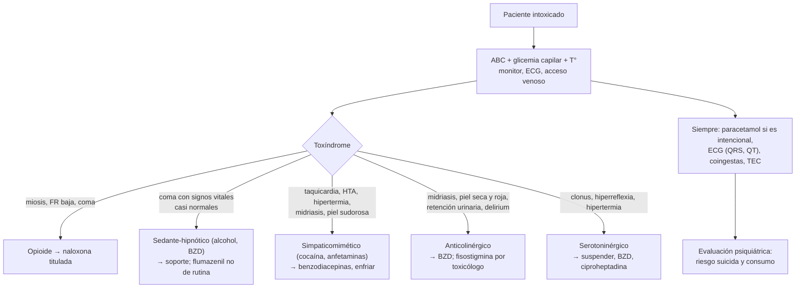

---
tags:
  - Psiquiatría
  - Urgencia
  - Frecuente en sala
---

# Intoxicación por sustancias psicoactivas

**Subespecialidad**
Medicina de urgencia · Toxicología · Psiquiatría

**Guías principales**
AHA 2023: actualización focalizada del manejo del paro cardíaco o la toxicidad grave por intoxicaciones · AHA 2008: dolor torácico e infarto asociados a cocaína · EXTRIP 2015: tratamiento extracorpóreo en la intoxicación por litio

**Otras fuentes**
Metaanálisis de eventos adversos del flumazenil (Penninga 2016) · Ver [consumo de alcohol, tabaco y drogas](consumo-de-alcohol-tabaco-y-drogas.md), [abstinencia alcohólica y Wernicke](../neurologia/abstinencia-alcoholica-y-wernicke.md), [agitación psicomotora](../geriatria/agitacion-psicomotora-y-agresividad.md), [encefalopatías tóxico-metabólicas](../neurologia/encefalopatias-toxico-metabolicas.md), [síndrome serotoninérgico y neuroléptico maligno](../neurologia/trastornos-del-movimiento-por-farmacos.md), [intoxicación por CO](../respiratorio/intoxicacion-por-co-ahogamiento-y-cuerpo-extrano.md) y [trastorno bipolar (litio)](trastorno-bipolar.md)

**GES**
No. Si la intoxicación es un **intento de suicidio**, activar el manejo de la conducta suicida.

**EUNACOM**
5.01.2.003 Intoxicación por sustancias psicoactivas (sospecha, inicial, derivar)

**Revisado**
Octubre 2026

!!! abstract "Resumen en 60 segundos"
    - **Primero el ABC**: vía aérea, ventilación, circulación, **glicemia capilar** y temperatura. Pocos tóxicos tienen antídoto; el **soporte** salva a la mayoría.
    - Reconocer el **toxíndrome**: **simpaticomimético** (cocaína, anfetaminas: taquicardia, HTA, hipertermia, **midriasis**, sudor), **anticolinérgico** (midriasis, piel **seca** y roja, retención urinaria, delirium), **opioide** (**miosis**, depresión respiratoria, coma), **sedante-hipnótico** (alcohol, benzodiacepinas: coma con signos vitales casi normales), **colinérgico** y **serotoninérgico**.
    - **Opioides**: **naloxona** titulada (0,04–0,4 mg EV y repetir) buscando una **respiración adecuada**, no que despierte del todo.
    - **Benzodiacepinas**: soporte; el **flumazenil no es de rutina** (convulsiones en los consumidores crónicos o con coingesta de proconvulsivantes como los tricíclicos).
    - **Cocaína y anfetaminas**: **benzodiacepinas** para la agitación, la HTA y la taquicardia; **enfriar** la hipertermia; evitar los **β-bloqueadores** puros en la fase aguda. Dolor torácico: ECG, troponina, aspirina, nitratos.
    - **Alcohol**: glicemia, **tiamina** antes de la glucosa, buscar **TEC** e hipotermia; una alcoholemia baja con coma = **otra causa**.
    - **Siempre**: pensar en **coingesta** (paracetamol: medir su nivel en toda intoxicación intencional), **intento de suicidio** y llamar al **centro de información toxicológica**.

## Definición

- **Intoxicación por sustancias** (DSM-5-TR): síndrome **reversible** específico de una sustancia, por su ingestión o exposición reciente, con cambios **conductuales o psicológicos** problemáticos (agresividad, labilidad, deterioro del juicio) y signos físicos característicos, no explicados por otra afección.
- **Sustancias psicoactivas**: las que actúan en el SNC y alteran la conciencia, el ánimo, la percepción o la conducta: **depresores** (alcohol, benzodiacepinas, opioides, GHB, inhalantes), **estimulantes** (cocaína, pasta base, anfetaminas, MDMA, catinonas sintéticas), **cannabinoides** y **alucinógenos** (LSD, psilocibina, ketamina).
- **Toxíndrome**: conjunto de signos y síntomas que orienta a una **clase** de tóxico.

## Epidemiología

### Mundial

- Las intoxicaciones son una causa frecuente de consulta en la **urgencia** y de **ingreso a la UCI**.
- Las **sobredosis por opioides** (sobre todo **fentanilo** y sus análogos) son la principal causa de muerte por drogas en Norteamérica.
- Las **nuevas sustancias psicoactivas** (cannabinoides sintéticos, catinonas, opioides sintéticos) cambian rápido y no se detectan en los tóxicos habituales.

### Chile

!!! chile "Datos nacionales"
    - El **CITUC** (Centro de Información Toxicológica de la Pontificia Universidad Católica) orienta a profesionales y a la comunidad en las intoxicaciones, con decenas de miles de consultas al año.
    - Las intoxicaciones **intencionales** con **medicamentos** (benzodiacepinas, antidepresivos, paracetamol) son frecuentes en los **intentos de suicidio**, sobre todo en mujeres jóvenes y adolescentes.
    - El **alcohol** está presente en una gran proporción de las consultas por traumatismos y violencia; en Chile predomina el patrón de **embriaguez** (consumo episódico excesivo).
    - La **pasta base** y la **cocaína** son los estimulantes más usados; el uso de **tranquilizantes sin receta** está en alza (SENDA 2024).

## Etiología y factores de riesgo

- **Consumo recreativo** o episódico excesivo (fiestas, adolescentes).
- **Trastorno por consumo** de sustancias (tolerancia, pérdida de control; recaída tras un período de abstinencia: **pérdida de la tolerancia** y sobredosis).
- **Intento de suicidio** (sobredosis de fármacos).
- **Intoxicación accidental** en **niños** (medicamentos o drogas de los adultos, comestibles con cannabis).
- **Iatrogenia** y **polifarmacia** (opioides, benzodiacepinas en el adulto mayor).
- **Mezclas**: alcohol + benzodiacepinas u opioides (depresión respiratoria sinérgica); cocaína + alcohol (**cocaetileno**, más cardiotóxico).
- **Adulteración** de las drogas (fentanilo en otras sustancias, levamisol en la cocaína).

## Fisiopatología

| Sustancia | Mecanismo | Consecuencia |
|---|---|---|
| **Alcohol** | Potencia **GABA-A**, inhibe **NMDA** | Sedación, ataxia, depresión respiratoria; hipoglicemia (inhibe la gluconeogénesis) |
| **Benzodiacepinas** | Moduladores positivos del **GABA-A** | Sedación con poca depresión respiratoria **si se usan solas** |
| **Opioides** | Agonistas **μ** | **Depresión respiratoria**, miosis, coma; edema pulmonar no cardiogénico |
| **Cocaína** | Bloquea la recaptación de **dopamina, noradrenalina y serotonina**; bloquea los canales de **sodio** | Exceso simpático, **vasoespasmo coronario**, trombosis, arritmias, QRS ancho |
| **Anfetaminas, MDMA** | **Liberan** monoaminas | Simpaticomimético; la MDMA además **serotoninérgica** e **hiponatremia** (ADH y polidipsia) |
| **Cannabis** | Agonista **CB1** | Ansiedad, taquicardia, psicosis; hiperémesis en el uso crónico |
| **Alucinógenos** (LSD, psilocibina) | Agonistas **5-HT2A** | Alteraciones perceptivas, ansiedad ("mal viaje") |
| **Ketamina**, fenciclidina | Antagonistas **NMDA** | Disociación, nistagmo, HTA |
| **Anticolinérgicos** (antihistamínicos, tricíclicos, *Datura*) | Bloqueo **muscarínico** | Toxíndrome anticolinérgico |

*Figura 1. Enfoque inicial del paciente intoxicado según el toxíndrome. Esquema propio basado en la AHA 2023 y en la práctica toxicológica habitual.*

## Clasificación

| Toxíndrome | Pupilas | FC y PA | T° | Piel | Otros | Ejemplos |
|---|---|---|---|---|---|---|
| **Simpaticomimético** | **Midriasis** | ↑↑ | ↑ | **Sudorosa** | Agitación, temblor, convulsiones | Cocaína, pasta base, anfetaminas, MDMA |
| **Anticolinérgico** | **Midriasis** | ↑ | ↑ | **Seca y roja** | **Delirium**, **retención urinaria**, íleo, mioclonías | Antihistamínicos, tricíclicos, *Datura* (floripondio), escopolamina |
| **Colinérgico** | **Miosis** | ↓ (o ↑) | = | **Sudorosa** | **Broncorrea**, salivación, lagrimeo, diarrea, fasciculaciones | Organofosforados, carbamatos |
| **Opioide** | **Miosis** puntiforme | ↓ | ↓ | Normal | **Depresión respiratoria**, coma | Morfina, heroína, fentanilo, tramadol, metadona |
| **Sedante-hipnótico** | Normal o miosis | = o ↓ | = o ↓ | Normal | Coma con signos vitales casi normales, ataxia, disartria | Alcohol, benzodiacepinas, barbitúricos, GHB |
| **Serotoninérgico** | Midriasis | ↑ | ↑ | Sudorosa | **Clonus** (más en las piernas), **hiperreflexia**, temblor, diarrea | ISRS + tramadol, linezolid, MDMA, IMAO |
| **Alucinógeno** | Midriasis | ↑ | = o ↑ | Normal | Alucinaciones, desrealización, ansiedad | LSD, psilocibina, mescalina |

- **Truco**: simpaticomimético y anticolinérgico se parecen; el **sudor** los distingue (sudoroso el primero, **seco** el segundo).

## Clínica

### Alcohol (intoxicación etílica aguda)

- Euforia, desinhibición, **ataxia**, disartria, nistagmo, vómitos, somnolencia → **coma**, depresión respiratoria, **hipotermia**, **hipoglicemia** (sobre todo en niños y desnutridos).
- Riesgo de **aspiración** y de **TEC** oculto (el estado de conciencia debe mejorar a medida que baja la alcoholemia; si no, **TC cerebral**).
- Diferenciar de la intoxicación por **metanol** o **etilenglicol** (brecha osmolar y acidosis con **anión gap** elevado, alteración visual en el metanol).

### Benzodiacepinas

- Somnolencia, disartria, ataxia, coma con **signos vitales casi normales**. La depresión respiratoria grave ocurre sobre todo con **coingesta** (alcohol, opioides) o en adultos mayores.

### Opioides

- Tríada: **coma**, **miosis puntiforme** y **depresión respiratoria** (FR < 12). Otros: hipotensión, bradicardia, hipotermia, **edema pulmonar**, rabdomiólisis por inmovilidad. **Tramadol**: convulsiones y síndrome serotoninérgico. **Metadona**: QT largo y efecto prolongado.

### Cocaína y pasta base

- Euforia, agitación, paranoia, **psicosis**, taquicardia, **HTA**, midriasis, sudoración, **hipertermia**, convulsiones.
- **Dolor torácico** (vasoespasmo, IAM, **disección aórtica**), arritmias, **ACV** (isquémico o hemorrágico), neumotórax y "pulmón de crack" (inhalada), isquemia mesentérica, **rabdomiólisis**, LRA.

### Anfetaminas y MDMA ("éxtasis")

- Como la cocaína, más prolongado. MDMA: **hipertermia** grave, **hiponatremia** (por ADH y consumo de agua), síndrome serotoninérgico, bruxismo.

### Cannabis

- Euforia, risa, ojos rojos, **taquicardia**, ansiedad o crisis de pánico, **psicosis** aguda. Los **comestibles** tienen inicio tardío y efecto prolongado: en **niños** producen somnolencia, ataxia y coma.
- **Síndrome de hiperémesis cannabinoide** (consumo crónico intenso): náuseas y vómitos cíclicos que **alivian las duchas calientes**; mejora con la suspensión, **capsaicina tópica** y haloperidol o droperidol.

### Alucinógenos y otros

- **LSD, hongos**: alucinaciones visuales, sinestesias, ansiedad, "mal viaje"; riesgo por accidentes.
- **Ketamina**: disociación, **nistagmo**, HTA, taquicardia.
- **GHB**: coma brusco con despertar rápido, bradicardia, mioclonías.
- **Inhalantes** (solventes): euforia, ataxia, **arritmias** ("muerte súbita del inhalador").

!!! alarma "Signos de gravedad"
    - **Compromiso de conciencia** (Glasgow ≤ 8: proteger la vía aérea), **depresión respiratoria**, **hipoxemia**.
    - **Hipertermia > 40 °C** (cocaína, anfetaminas, MDMA, síndrome serotoninérgico o anticolinérgico): enfriar de inmediato.
    - **Convulsiones**, **arritmias**, **QRS > 100 ms** (bloqueo de los canales de sodio: cocaína, tricíclicos) o **QT largo**.
    - **Dolor torácico** o déficit neurológico (cocaína: IAM, disección, ACV).
    - **Hiponatremia** sintomática (MDMA), **rabdomiólisis**, acidosis metabólica grave.
    - Intoxicación **intencional** (riesgo suicida) y coingesta de **paracetamol**.

## Diagnóstico

!!! guia "Enfoque diagnóstico"
    - **Historia**: qué, cuánto, cuándo, cómo (vía), con qué (coingestas); pedir los **envases**; información de acompañantes y de la ambulancia; **intencionalidad**.
    - **Examen**: signos vitales (incluida la **temperatura**), **pupilas**, **piel** (sudor, marcas de punción), **ruidos intestinales**, globo vesical, **tono y reflejos** (clonus), signos de **TEC**.
    - **Identificar el toxíndrome** y orientar el manejo **sin esperar** los exámenes.
    - **Centro de información toxicológica**: ante dudas de dosis tóxicas, antídotos o descontaminación.
    - **Tóxicos en orina**: apoyo, pero con **falsos positivos y negativos**; no detectan el fentanilo ni muchas sustancias nuevas en los paneles básicos. No cambian el manejo inicial.

## Laboratorio

| Examen | Para qué |
|---|---|
| **Glicemia capilar** | **Hipoglicemia** (alcohol, en todo compromiso de conciencia) |
| **ECG** | **QRS** (> 100 ms: bloqueo de sodio), **QT**, isquemia (cocaína), arritmias |
| **Gases y electrolitos**, anión gap, **osmolalidad** (brecha osmolar) | Acidosis, alcoholes tóxicos, hiponatremia |
| **Nivel de paracetamol** (y salicilatos según disponibilidad) | **En toda intoxicación intencional** (coingesta silenciosa y tratable) |
| **Alcoholemia** | Correlacionar con la clínica; valor médico-legal |
| **CK**, creatinina, función hepática | Rabdomiólisis, LRA, hepatotoxicidad |
| **Troponina** | Dolor torácico (cocaína) |
| **Niveles específicos** | **Litio**, digoxina, anticonvulsivantes, según el caso |
| **β-hCG** | Mujeres en edad fértil |
| Tóxicos en orina | Apoyo diagnóstico |

## Imágenes

- **TC cerebral**: compromiso de conciencia que **no se explica** o **no mejora**, TEC, déficit focal, convulsiones (cocaína: hemorragia).
- **Radiografía de tórax**: aspiración, edema pulmonar (opioides), neumotórax (cocaína inhalada).
- **Angio-TC de aorta** en el dolor torácico grave por cocaína si se sospecha disección.
- **Radiografía o TC de abdomen** en los "**body packers**" (portadores de paquetes de droga).

## Diagnóstico diferencial

| Diagnóstico | Claves |
|---|---|
| **Hipoglicemia** | Glicemia capilar (siempre) |
| **TEC**, hemorragia intracraneana | Trauma, focalidad; conciencia que no mejora |
| **Infección del SNC** (meningitis, encefalitis) | Fiebre, rigidez de nuca, LCR |
| **Estado epiléptico no convulsivo** y estado posictal | EEG |
| **Encefalopatía metabólica** (hepática, urémica, hiponatremia) | Laboratorio |
| **Abstinencia** (alcohol, benzodiacepinas) | Temblor, sudoración, taquicardia **sin** consumo reciente |
| **Golpe de calor** | Exposición ambiental |
| **Síndrome neuroléptico maligno** | Rigidez en tubo de plomo, uso de antipsicóticos, inicio en días |
| **Tirotoxicosis** | Bocio, oftalmopatía, TSH |
| **Psicosis primaria** o manía | Sin signos físicos de intoxicación; persiste tras la eliminación |

## Tratamiento

### Medidas generales

1. **ABC**: oxígeno, **vía aérea** si Glasgow ≤ 8 o no la protege; acceso venoso, **monitor** y ECG.
2. **Glicemia capilar**; si es baja, glucosa (en el alcohólico, **tiamina 100 mg EV antes**).
3. **Temperatura**: enfriamiento activo en la hipertermia (no sirven los antipiréticos); calentar en la hipotermia.
4. **Descontaminación**: **carbón activado** 1 g/kg (máximo 50 g) solo si la ingesta fue reciente (en general **< 1 hora**), el tóxico se adsorbe y la vía aérea está **protegida**. **No** sirve en el alcohol, el **litio**, el hierro ni los cáusticos. El **lavado gástrico** casi nunca está indicado.
5. **Antídotos** específicos cuando corresponda.
6. **Agitación**: **benzodiacepinas** de primera línea en las intoxicaciones por estimulantes y en la abstinencia; evitar la contención física prolongada (hipertermia, rabdomiólisis, muerte súbita).
7. **Observación**: la mayoría se resuelve en horas; vigilar más tiempo las sustancias de **liberación prolongada** (metadona, comestibles con cannabis).
8. **Evaluación psiquiátrica** antes del alta en toda intoxicación **intencional** y en el consumo problemático.

!!! dosis "Antídotos y fármacos clave"
    | Situación | Tratamiento | Comentario |
    |---|---|---|
    | **Opioides** | **Naloxona** 0,04–0,4 mg EV (hasta 2 mg), IM o intranasal; repetir cada 2–3 min | Titular hasta una **FR adecuada**. Vida media corta (30–90 min): **puede reaparecer** la depresión respiratoria (infusión si es metadona o un opioide de acción larga). En dependientes precipita abstinencia |
    | **Benzodiacepinas** | **Soporte** | **Flumazenil** 0,2 mg EV solo en casos seleccionados (sedación iatrogénica en un paciente sin uso crónico ni coingesta proconvulsivante) |
    | **Cocaína o anfetaminas**: agitación, HTA, taquicardia | **Benzodiacepinas** EV (diazepam 5–10 mg o lorazepam 2–4 mg, repetir) | Evitar los **β-bloqueadores** puros en la fase aguda (α sin oposición); en la HTA persistente: **nitroglicerina**, fentolamina o nicardipino |
    | Dolor torácico por cocaína | **Aspirina**, **nitratos**, benzodiacepinas; angioplastía si hay IAM con SDST | — |
    | **QRS > 100 ms** (cocaína, tricíclicos) | **Bicarbonato de sodio** 1–2 mEq/kg EV en bolo | Repetir según el QRS y el pH |
    | **Hipertermia** | **Enfriamiento** activo (inmersión en agua fría o compresas, ventilación), benzodiacepinas | Sedación, intubación y parálisis si es refractaria |
    | **Síndrome serotoninérgico** | Suspender, **benzodiacepinas**, **ciproheptadina** 12 mg VO y luego 2 mg c/2 h | — |
    | **Anticolinérgico** (delirium) | Benzodiacepinas; **fisostigmina** por el toxicólogo | No usar fisostigmina si hay QRS ancho (tricíclicos) |
    | **Intoxicación etílica** | Soporte, glicemia, **tiamina**, prevenir la aspiración | Sueros glucosados según la glicemia; no "lavan" el alcohol |
    | **Litio** | Suero fisiológico, **hemodiálisis** según EXTRIP (litemia > 4 mEq/L, o síntomas neurológicos graves, o falla renal) | El carbón activado **no** sirve |
    | **Paracetamol** (coingesta) | **N-acetilcisteína** según el nomograma | Iniciar si la dosis o el nivel son tóxicos |

## Complicaciones

- **Aspiración** y neumonía, **depresión respiratoria**, paro cardiorrespiratorio.
- **Convulsiones**, **hipertermia**, **rabdomiólisis**, LRA, **CID**.
- **IAM**, disección aórtica, **ACV**, arritmias (cocaína).
- **Hiponatremia** grave (MDMA).
- **Síndrome compartimental** e isquemia por compresión (coma prolongado).
- **Traumatismos**, accidentes de tránsito, violencia, abuso sexual.
- Secuelas: **encefalopatía hipóxica**, falla hepática (paracetamol).

## Pronóstico y seguimiento

- La mayoría se recupera con **soporte** en horas. La mortalidad aumenta con la **coingesta**, la llegada tardía, la hipertermia y la necesidad de ventilación mecánica.
- **Antes del alta**:
    - Asegurar que el paciente esté **sobrio**, con examen normal y capaz de decidir.
    - **Evaluar el riesgo suicida** en toda intoxicación intencional.
    - **Intervención breve** sobre el consumo y derivación a tratamiento.
    - Entregar **naloxona** y educación en los consumidores de opioides.
    - En los **niños**: evaluar **negligencia** o maltrato.

## Perlas para el internado

!!! perla "Para recordar en el turno"
    - **Glicemia capilar** a todo paciente con compromiso de conciencia.
    - **Sudoroso con midriasis** = simpaticomimético; **seco y rojo con midriasis** = anticolinérgico; **miosis + apnea** = opioide.
    - **Naloxona titulada**: el objetivo es que **respire**, no que despierte agitado.
    - **No flumazenil de rutina**: puede desencadenar convulsiones.
    - **Cocaína**: **benzodiacepinas** primero; nada de β-bloqueadores puros en la fase aguda.
    - **QRS > 100 ms** = bicarbonato de sodio.
    - **Paracetamol** en toda intoxicación intencional: no da síntomas precoces y tiene antídoto.
    - Un "ebrio" que **no mejora** o tiene focalidad: **TC cerebral** (TEC oculto).
    - El carbón activado **no sirve** en el alcohol ni en el litio.

## Preguntas de repaso

??? repaso "1. Hombre de 30 años encontrado en la calle, Glasgow 7, FR 6 por minuto, pupilas puntiformes y saturación de 82 %. ¿Qué hace?"
    Toxíndrome **opioide**. Ventilar con **bolsa-mascarilla** y oxígeno, glicemia capilar y **naloxona** titulada (0,04–0,4 mg EV, repetir cada 2–3 minutos; o IM o intranasal) hasta lograr una **FR adecuada**. Monitorizar por la **recurrencia** (vida media corta de la naloxona). Luego evaluar coingestas, el riesgo suicida y derivar a tratamiento.

??? repaso "2. Joven de 22 años tras una fiesta: agitado, T° 40,5 °C, FC 150, PA 180/110, pupilas dilatadas, piel sudorosa. Reconoce haber consumido cocaína. ¿Toxíndrome y tratamiento?"
    **Simpaticomimético**. Tratamiento: **benzodiacepinas** EV en dosis repetidas (agitación, HTA, taquicardia), **enfriamiento activo** inmediato, hidratación, ECG, CK, creatinina y troponina. **Evitar los β-bloqueadores** puros. Vigilar convulsiones, rabdomiólisis, arritmias, IAM y ACV.

??? repaso "3. Mujer de 19 años ingirió 'un frasco de clonazepam' hace 2 horas por una pelea. Está somnolienta, con signos vitales normales. ¿Qué hace?"
    **Soporte** (vía aérea, monitorización, glicemia) y **observación**. **No** usar flumazenil de rutina. Pedir **nivel de paracetamol**, ECG y buscar coingestas (alcohol). Es una **intoxicación intencional**: evaluar el **riesgo suicida** antes del alta (con un psiquiatra), con información a la familia y un plan de seguridad.

??? repaso "4. Paciente que ingirió amitriptilina y presenta QRS de 140 ms e hipotensión. ¿Qué indica?"
    **Bicarbonato de sodio** 1–2 mEq/kg EV en bolo (contrarresta el bloqueo de los canales de sodio), repetido según el QRS y el pH; vía aérea, fluidos y vasopresores si persiste la hipotensión; benzodiacepinas si convulsiona. Evitar la fisostigmina y el flumazenil.

??? repaso "5. Hombre de 28 años consumidor diario de marihuana con vómitos cíclicos intensos que alivian las duchas calientes. ¿Diagnóstico y manejo?"
    **Síndrome de hiperémesis cannabinoide**. Hidratación y corregir los electrolitos; **capsaicina tópica** en el abdomen y haloperidol o droperidol para los vómitos (los antieméticos habituales funcionan mal). El tratamiento definitivo es **suspender el cannabis**.

??? repaso "6. ¿Por qué medir paracetamol en toda intoxicación intencional, aunque el paciente diga que no lo tomó?"
    Porque la coingesta de paracetamol es **frecuente**, **no da síntomas** en las primeras 24 horas y puede causar una **falla hepática** grave, que se previene con **N-acetilcisteína** si se inicia a tiempo. La historia de los pacientes intoxicados no siempre es confiable.

## Referencias

1. Lavonas EJ, Akpunonu PD, Arens AM, et al. 2023 American Heart Association focused update on the management of patients with cardiac arrest or life-threatening toxicity due to poisoning: an update to the American Heart Association guidelines for cardiopulmonary resuscitation and emergency cardiovascular care. *Circulation.* 2023;148(16). doi:[10.1161/CIR.0000000000001161](https://doi.org/10.1161/CIR.0000000000001161)
2. McCord J, Jneid H, Hollander JE, et al. Management of cocaine-associated chest pain and myocardial infarction: a scientific statement from the American Heart Association Acute Cardiac Care Committee of the Council on Clinical Cardiology. *Circulation.* 2008;117(14):1897–1907. doi:[10.1161/CIRCULATIONAHA.107.188950](https://doi.org/10.1161/CIRCULATIONAHA.107.188950)
3. Decker BS, Goldfarb DS, Dargan PI, et al. Extracorporeal treatment for lithium poisoning: systematic review and recommendations from the EXTRIP workgroup. *Clin J Am Soc Nephrol.* 2015;10(5):875–887. doi:[10.2215/CJN.10021014](https://doi.org/10.2215/CJN.10021014)
4. Penninga EI, Graudal N, Ladekarl MB, et al. Adverse events associated with flumazenil treatment for the management of suspected benzodiazepine intoxication – a systematic review with meta-analyses of randomised trials. *Basic Clin Pharmacol Toxicol.* 2016;118(1):37–44. doi:[10.1111/bcpt.12434](https://doi.org/10.1111/bcpt.12434)
5. American Psychiatric Association. *Diagnostic and Statistical Manual of Mental Disorders, Fifth Edition, Text Revision (DSM-5-TR).* Washington, DC: APA; 2022.
6. Ministerio del Interior y Seguridad Pública; SENDA. 16.° Estudio Nacional de Drogas en Población General (resultados, diciembre de 2025). [interior.gob.cl](https://interior.gob.cl/noticias/2025/12/04/consumo-de-alcohol-alcanza-su-nivel-mas-bajo-en-30-anos-y-marihuana-en-adolescentes-llega-a-minimo-historico/)
