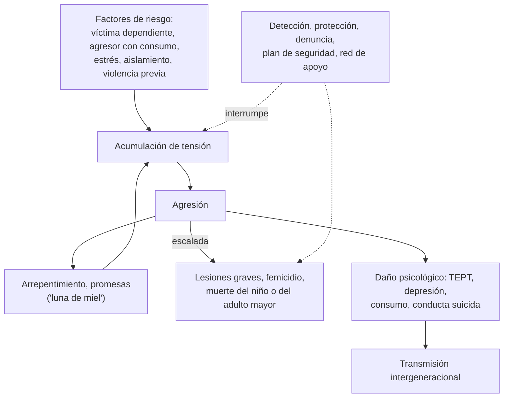

---
tags:
  - Psiquiatría
  - Urgencia
---

# Maltrato infantil, maltrato al adulto mayor, violencia intrafamiliar y nociones de psiquiatría forense

**Subespecialidad**
Psiquiatría · Pediatría · Geriatría · Medicina de urgencia · Medicina legal

**Guías principales**
AAP 2015: evaluación de la sospecha de maltrato físico infantil · USPSTF 2018: tamizaje de violencia de pareja, maltrato al adulto mayor y a adultos vulnerables · Marco legal chileno: Ley 20.066 (violencia intrafamiliar), Ley 21.013 (maltrato a personas vulnerables), Ley 21.430 (garantías de la niñez), Ley 21.057 (entrevistas videograbadas), Ley 21.331 (salud mental), Ley 21.822 (personas mayores) y Código Procesal Penal (art. 175)

**Otras fuentes**
Regla de los hematomas TEN-4-FACESp (Pierce, *JAMA Netw Open* 2021) · Revisión del maltrato al adulto mayor (Lachs y Pillemer, *N Engl J Med* 2015) · Prevalencia del maltrato al adulto mayor (Yon, *Lancet Glob Health* 2017) · Prevalencia mundial de la violencia de pareja (Sardinha, *Lancet* 2022) · Ver [conducta suicida](conducta-suicida.md), [trastornos relacionados con traumas](trastornos-relacionados-con-traumas-y-estres.md), [enuresis y encopresis](enuresis-y-encopresis.md), [caídas y fractura de cadera](../geriatria/caidas-hipotension-ortostatica-y-fractura-de-cadera.md) y [demencia](../neurologia/demencia-y-deterioro-cognitivo.md)

**GES**
**Atención integral de salud en agresión sexual aguda** (N.° 86).

**EUNACOM**
5.01.3.008 Maltrato infantil · 5.01.3.007 Maltrato en el adulto mayor · 5.01.3.013 Violencia intrafamiliar · 5.01.3.009 Nociones de psiquiatría forense

**Revisado**
Octubre 2026

!!! abstract "Resumen en 60 segundos"
    - **Maltrato**: toda acción u omisión que daña o pone en riesgo la integridad física, psicológica o sexual de una persona en una relación de **confianza o dependencia**. Tipos: **físico**, **psicológico**, **sexual**, **negligencia**, **abandono** y, en los adultos mayores, **financiero** o patrimonial.
    - **Sospecha de maltrato infantil**: lesiones **incompatibles** con el relato o con el **desarrollo** del niño ("no se desplaza, no se golpea"), **demora** en consultar, relatos **cambiantes**, hematomas en zonas **protegidas** (regla **TEN-4-FACESp**), **fracturas** en lactantes (costales posteriores, metafisarias), **quemaduras** en guante o calcetín.
    - **Lactante con trauma craneano abusivo** (sacudido): irritabilidad, vómitos, convulsiones, compromiso de conciencia; **hemorragias retinales**, hematoma **subdural**. Estudio: **TC cerebral**, **fondo de ojo**, **serie ósea** en < 2 años, coagulación.
    - **Maltrato al adulto mayor**: ~ **1 de cada 6** personas mayores en la comunidad; más con **dependencia**, **demencia** y cuidador sobrecargado o con consumo. Buscar lesiones en distintas etapas, **desnutrición**, **úlceras por presión**, fármacos no administrados o sobremedicación, **abuso económico**.
    - **Violencia intrafamiliar y de pareja**: **~ 1 de cada 4** mujeres la sufre en la vida. **Preguntar** en privado, **creer**, evaluar el **riesgo** (escalada, armas, amenazas de muerte, embarazo) y hacer un **plan de seguridad**.
    - **Obligación legal**: los profesionales de la salud deben **denunciar** los delitos que conozcan en el ejercicio de su función (art. 175 del Código Procesal Penal, en **24 horas**). Proteger a la víctima (hospitalizar si es necesario), registrar con detalle, **no revictimizar** (Ley 21.057) y solicitar **medidas de protección** al Tribunal de Familia.
    - **Psiquiatría forense**: **imputabilidad** (Código Penal art. 10 N.° 1), **capacidad** para consentir y para administrar bienes (interdicción), **internación no voluntaria** (Ley 21.331), secreto profesional y peritajes.

## Definición

- **Maltrato infantil** (OMS): todas las formas de abuso **físico** y **psicológico**, **abuso sexual**, **negligencia** y **explotación** de menores de 18 años que causan un daño real o potencial a su salud, supervivencia, desarrollo o dignidad, en el contexto de una relación de **responsabilidad, confianza o poder**.
    - **Físico**: lesiones intencionales (golpes, quemaduras, sacudidas, fracturas).
    - **Psicológico o emocional**: insultos, humillaciones, amenazas, rechazo, aislamiento, exposición a la **violencia** entre los padres.
    - **Abuso sexual**: participación de un niño en actividades sexuales que no comprende, para las que no puede dar consentimiento o que violan las leyes.
    - **Negligencia**: omisión de los cuidados básicos (alimentación, salud, higiene, educación, supervisión).
    - **Trastorno facticio impuesto a otro**: el cuidador inventa o provoca enfermedades en el niño.
- **Maltrato al adulto mayor** (OMS): acto único o repetido, u omisión, que causa daño o angustia a una persona mayor en una relación de **confianza**. Incluye el físico, psicológico, sexual, **financiero o patrimonial**, la **negligencia** (del cuidador) y el **abandono**; también la **autonegligencia**.
- **Violencia intrafamiliar (VIF)** (Ley 20.066): todo maltrato que afecte la vida o la integridad física o psíquica de quien tenga o haya tenido la calidad de **cónyuge** o **conviviente** del ofensor, o sea su **pariente** por consanguinidad o afinidad, o de menores de edad, adultos mayores o personas con discapacidad que se encuentren bajo el cuidado o dependencia de cualquiera de los integrantes del grupo familiar.
- **Violencia de pareja**: violencia física, sexual, psicológica, económica o **control coercitivo** por una pareja actual o anterior.
- **Psiquiatría forense**: rama de la psiquiatría que aplica sus conocimientos a las cuestiones **legales** (penales, civiles, laborales y de familia).

## Epidemiología

### Mundial

- **Maltrato infantil** (OMS): hasta **1 de cada 2** niños de 2 a 17 años sufre alguna forma de violencia cada año; ~ **1 de cada 5 mujeres** y **1 de cada 7–13 hombres** relatan abuso sexual en la infancia.
- El **trauma craneano abusivo** es la principal causa de **muerte** por maltrato en los **menores de 2 años**.
- **Adulto mayor**: prevalencia de maltrato en la comunidad **~ 15,7 %** en el último año (Yon 2017), con predominio del **psicológico**, el **financiero** y la **negligencia**; mucho mayor en las **instituciones**. Se notifica **muy poco**.
- **Violencia de pareja**: **~ 27 %** de las mujeres de 15 a 49 años que han tenido pareja la sufrió en la vida y **~ 13 %** en el último año (Sardinha 2022).

### Chile

!!! chile "Datos nacionales"
    - **Ley 21.430** (2022): sistema de garantías y protección integral de los derechos de la niñez y adolescencia; crea las **Oficinas Locales de la Niñez**. El **Servicio Nacional de Protección Especializada** reemplazó al SENAME en la protección.
    - **Ley 21.057** (2018): regula las **entrevistas videograbadas** a niños víctimas de delitos sexuales y violentos para **evitar la revictimización** (el equipo de salud **no** debe interrogar en detalle al niño).
    - **Ley 21.013** (2017): tipifica el **maltrato corporal relevante** y el **trato degradante** contra menores de 18 años, adultos mayores y personas con discapacidad.
    - **Ley 20.066** (2005): **violencia intrafamiliar**; el maltrato **habitual** es delito. **Ley 21.212** (2020, "Ley Gabriela"): amplía el **femicidio**.
    - **Ley 21.822** (2026): ley **integral de personas mayores** (más de 60 años); reúne la protección de sus derechos y crea un procedimiento por **abandono social**.
    - **Fono 1455** (SernamEG): orientación en violencia contra la mujer. **Fono 149** (Carabineros): fono familia.
    - **GES N.° 86**: atención integral en **agresión sexual aguda** (profilaxis, anticoncepción de emergencia, apoyo psicológico y peritaje).

## Etiología y factores de riesgo

| Nivel | Maltrato infantil | Maltrato al adulto mayor | Violencia de pareja |
|---|---|---|---|
| **Víctima** | **< 4 años**, prematuro, discapacidad, enfermedad crónica, hijo no deseado, llanto difícil | **Dependencia** funcional, **demencia**, aislamiento, mujer, edad avanzada | Mujer joven, **embarazo**, separación reciente, dependencia económica |
| **Agresor** | Padres jóvenes, **consumo** de alcohol o drogas, depresión, **antecedente de maltrato** en su infancia, expectativas irreales | **Cuidador sobrecargado**, consumo, problemas psiquiátricos, **dependencia económica** de la víctima | Consumo de alcohol, **celos y control**, haber sido testigo o víctima de violencia, actitudes que justifican la violencia |
| **Familia y entorno** | **Violencia de pareja**, pobreza, aislamiento social, estrés | Conflictos familiares previos, falta de redes, institucionalización | Normas culturales, impunidad, aislamiento |

## Fisiopatología

- **Ciclo de la violencia** (Walker): **acumulación de tensión** → **explosión** (agresión) → **"luna de miel"** (arrepentimiento, promesas) → nueva acumulación. Explica la dificultad para salir de la relación y la **escalada** de la gravedad.
- **Trauma y desarrollo**: el estrés tóxico en la infancia altera el desarrollo del **eje del estrés**, la regulación emocional y el apego; aumenta el riesgo de **depresión, ansiedad, TEPT, consumo, conducta suicida**, enfermedades crónicas y **transmisión intergeneracional** de la violencia (estudio de **experiencias adversas en la infancia**, ACE).
- **Trauma craneano abusivo**: la **aceleración-desaceleración** rotacional (sacudida) rompe las **venas puente** (hematoma **subdural**) y produce **hemorragias retinales** y lesión axonal difusa.

*Figura 1. Ciclo y consecuencias de la violencia intrafamiliar, y puntos de intervención. Esquema propio basado en Lachs y Pillemer (2015) y AAP 2015.*

## Clasificación

**Psiquiatría forense: áreas principales**

| Área | Conceptos clave |
|---|---|
| **Penal** | **Imputabilidad**: el **Código Penal (art. 10 N.° 1)** exime de responsabilidad al "**loco o demente**" (salvo que haya obrado en un intervalo lúcido) y a quien, por cualquier causa independiente de su voluntad, se halla **privado totalmente de razón**. **Imputabilidad disminuida** (atenuante). Si es inimputable y peligroso: **medidas de seguridad** (internación o tratamiento). La **intoxicación voluntaria** no exime |
| **Civil** | **Capacidad** para contratar, testar y administrar bienes; **interdicción** por demencia (con un curador); **capacidad para consentir** un tratamiento (comprender, apreciar, razonar y expresar una decisión) |
| **Salud mental** | **Ley 21.331** (2021): derechos de las personas en la atención de salud mental; **internación no voluntaria** solo ante un **riesgo real e inminente** para sí o para terceros, como **último recurso**, con evaluación por psiquiatra y notificación a la autoridad sanitaria |
| **Derechos del paciente** | **Ley 20.584** (2012): **consentimiento informado**, **confidencialidad** de la ficha clínica, derecho a la información |
| **Laboral** | Enfermedades mentales de origen laboral (Ley 16.744), licencias médicas, invalidez |
| **Familia** | Peritajes de **cuidado personal** de los hijos, medidas de protección, VIF |
| **Ético-legal** | **Secreto profesional** y sus **excepciones** (deber de denunciar delitos, riesgo grave para terceros), certificados médicos, **constatación de lesiones** |

- **Perito** frente a **tratante**: el perito evalúa para el tribunal (no hay relación terapéutica ni confidencialidad plena); se recomienda que no sea la misma persona.
- **Simulación**: hay que considerarla en todo contexto médico-legal.

## Clínica

### Maltrato infantil: indicadores

- **En la historia**: relato **ausente**, **vago**, **cambiante** o **incompatible** con la lesión o con el desarrollo del niño; **demora** injustificada en consultar; lesiones previas; atribución al hermano; consultas repetidas en distintos centros.
- **Hematomas** (regla **TEN-4-FACESp**): en el **Tronco**, las **orejas** (*Ears*) o el **cuello** (*Neck*) en < 4 años; **cualquier hematoma en un lactante < 4 meses**; en el **frenillo**, el **ángulo de la mandíbula**, las **mejillas**, los **párpados** y la **subconjuntiva**, o con un **patrón** (marca de mano, cinturón, mordida).
- **Quemaduras**: en **guante o calcetín** (inmersión), con bordes netos, de **cigarrillo** (circulares de 5–10 mm), en los glúteos y los genitales.
- **Fracturas** muy sugerentes: **costales posteriores**, **metafisarias** ("en asa de balde"), escapulares, del esternón, de las apófisis espinosas, fracturas **múltiples** en distinta etapa de consolidación, fracturas de huesos largos en un niño que **no camina**.
- **Trauma craneano abusivo**: lactante con **irritabilidad**, vómitos, **apneas**, convulsiones, compromiso de conciencia, abombamiento de la fontanela, **sin** relato de trauma importante.
- **Abuso sexual**: relato del niño (**creerle**), conductas **sexualizadas** inapropiadas para la edad, lesiones genitales o anales, ITS o **embarazo** en una adolescente menor de 14 años, enuresis o encopresis secundaria, cambios bruscos de conducta, autolesiones.
- **Negligencia**: desnutrición, falta de controles y vacunas, higiene deficiente, accidentes repetidos por falta de supervisión, ausentismo escolar.

### Maltrato al adulto mayor: indicadores

- **Físico**: hematomas en distinta etapa, en los brazos (sujeción), quemaduras, fracturas inexplicadas, marcas de contención.
- **Negligencia**: **desnutrición**, **deshidratación**, **úlceras por presión**, higiene deficiente, fármacos no administrados o **sobremedicación** (sedación), falta de lentes o audífonos.
- **Psicológico**: miedo al cuidador, retraimiento, depresión, ansiedad.
- **Financiero**: cambios bruscos en las finanzas, firmas de documentos, retiro de dinero, desaparición de bienes, cuentas impagas pese a tener recursos.
- **Cuidador**: no permite que el paciente hable a solas, relatos contradictorios, hostilidad o indiferencia.

### Violencia de pareja: indicadores

- Consultas repetidas por lesiones "**accidentales**", **lesiones en distintas etapas**, demora en consultar, pareja que **no se separa** y responde por la paciente.
- **Síntomas inespecíficos**: dolor crónico, cefalea, molestias digestivas, insomnio, **depresión**, ansiedad, TEPT, consumo, **intentos de suicidio**.
- **Embarazo**: aumenta el riesgo; lesiones abdominales, control prenatal tardío.

!!! alarma "Riesgo vital: proteger de inmediato"
    - **Lactante** con lesiones sugerentes de **trauma craneano abusivo** o fracturas: **hospitalizar** siempre.
    - Relato de **abuso sexual reciente** (< 72 horas): **GES N.° 86**, profilaxis y peritaje en el servicio correspondiente.
    - **Violencia de pareja** con **escalada**, uso o acceso a **armas**, **amenazas de muerte**, **estrangulamiento** previo, **separación reciente**, embarazo o celos extremos: **alto riesgo de femicidio**.
    - Adulto mayor dependiente con **negligencia grave** o violencia física.
    - **Ideación suicida** en la víctima.

## Diagnóstico

!!! guia "Enfoque de la sospecha (AAP 2015; USPSTF 2018)"
    - **Preguntar** directamente y **en privado** (sin el acompañante), con un lenguaje no culpabilizador. USPSTF 2018: tamizar la **violencia de pareja** en las **mujeres en edad reproductiva**.
    - **Creer** y **validar** el relato; **no** interrogar en detalle a los niños sobre el abuso sexual (lo hace la entrevista videograbada, Ley 21.057): registrar textualmente lo que relaten espontáneamente.
    - **Examen físico completo** (desvestido), con **registro detallado** de las lesiones (ubicación, tamaño, forma, color, etapa) y, si es posible, fotografías con consentimiento.
    - **Niños**: estudio dirigido según la edad (ver laboratorio e imágenes); evaluar a los **hermanos**.
    - **Adultos mayores**: entrevistar a solas, evaluar la **cognición** (capacidad), la funcionalidad, la nutrición y los fármacos; buscar señales de abuso financiero.
    - Evaluar el **riesgo** de nuevas agresiones y la **red de apoyo**.

## Laboratorio

| Examen | Para qué |
|---|---|
| **Hemograma**, **plaquetas**, **TP, TTPA**, fibrinógeno, factor VIII y IX, von Willebrand según la clínica | Descartar **coagulopatías** en los niños con hematomas o hemorragia intracraneana |
| **Pruebas hepáticas**, **lipasa**, examen de orina | **Trauma abdominal** oculto en el niño maltratado |
| **Calcio, fósforo, fosfatasa alcalina, vitamina D, PTH** | Descartar **enfermedad ósea** (raquitismo, osteogénesis imperfecta) ante fracturas |
| **ITS**, **β-hCG**, VIH, VHB, sífilis | Abuso sexual |
| **Tóxicos** | Intoxicación intencional o negligente |
| **Albúmina**, hemograma, electrolitos | Negligencia en el adulto mayor (desnutrición, deshidratación) |

## Imágenes

- **Serie esquelética completa** en todo niño **< 2 años** con sospecha de maltrato físico (repetir a las 2 semanas para detectar fracturas en consolidación).
- **TC cerebral** en los lactantes con sospecha de trauma craneano (y en < 6 meses con lesiones de maltrato aunque estén asintomáticos, según el caso); **RM** para completar.
- **Fondo de ojo** por oftalmología: **hemorragias retinales** extensas y en múltiples capas (trauma craneano abusivo).
- **TC de abdomen** si hay sospecha de trauma abdominal.

## Diagnóstico diferencial

| Hallazgo | Diagnósticos a descartar |
|---|---|
| **Hematomas** | **Coagulopatías** (hemofilia, von Willebrand, trombocitopenia), **manchas mongólicas** (melanocitosis dérmica), vasculitis (Schönlein-Henoch), prácticas culturales (ventosas, *coining*) |
| **Fracturas** | **Osteogénesis imperfecta** (escleras azules, dentinogénesis imperfecta, antecedentes familiares), **raquitismo**, prematurez con osteopenia, lesiones del parto |
| **Hemorragia intracraneana** | Coagulopatías, trauma accidental grave (con relato coherente), malformaciones vasculares, aciduria glutárica tipo 1 |
| **Lesiones genitales** | Liquen escleroso, infecciones, traumatismos accidentales a horcajadas |
| **Lesiones en el adulto mayor** | Caídas por fragilidad, anticoagulantes, púrpura senil |

## Tratamiento

!!! guia "Actuación ante la sospecha de maltrato o violencia"
    1. **Atender las lesiones** y la urgencia médica.
    2. **Proteger**: si el niño o el adulto vulnerable corre riesgo al volver a su casa, **hospitalizar** ("hospitalización de protección") hasta resolver.
    3. **Registrar** en la ficha clínica en forma **objetiva** y detallada (relato textual, hallazgos, fotografías).
    4. **Denunciar**: los profesionales de salud deben denunciar los **delitos** que conozcan en el ejercicio de su función (**art. 175 del Código Procesal Penal**), dentro de **24 horas** (art. 176), ante el **Ministerio Público**, **Carabineros** o la **PDI**. Omitirla tiene sanción. El deber de denunciar prevalece sobre el secreto profesional.
    5. **Medida de protección**: solicitarla al **Tribunal de Familia** en los niños en riesgo (aunque no haya un delito claro) y coordinar con la **Oficina Local de la Niñez** y el **asistente social**.
    6. **No revictimizar**: no repetir interrogatorios; derivar a las instancias especializadas (entrevista videograbada en los niños).
    7. **Apoyo** psicológico y psiquiátrico (TEPT, depresión, riesgo suicida) y seguimiento.

- **Agresión sexual aguda** (GES N.° 86): profilaxis de **ITS** y **VIH**, vacuna de VHB, **anticoncepción de emergencia**, toma de muestras médico-legales (Servicio Médico Legal o según el protocolo local), apoyo psicológico.
- **Violencia de pareja**:
    - Validar ("no es su culpa"), **evaluar el riesgo** y elaborar un **plan de seguridad** (lugar seguro, documentos, dinero, contactos de emergencia).
    - Informar sobre el **Fono 1455**, los **Centros de la Mujer** y las **casas de acogida** (SernamEG), y sobre la posibilidad de denuncia y de **medidas cautelares**.
    - La decisión de denunciar en un adulto capaz es suya, salvo las lesiones que constituyan un **delito** que el profesional debe denunciar; respetar su autonomía y mantener el contacto.
- **Adulto mayor**:
    - Proteger, evaluar la **capacidad** de decisión y la **sobrecarga del cuidador** (escala de Zarit).
    - Apoyo social (SENAMA, redes comunitarias, cuidados de respiro), denuncia si hay delito (Ley 21.013), y medidas de protección o interdicción si corresponde.
- **Prevención del maltrato infantil**: visitas domiciliarias en la primera infancia, **apoyo a la crianza** (Chile Crece Contigo, programa "Nadie es Perfecto"), educación sobre el **llanto del lactante** y el riesgo de sacudirlo, detección de la depresión posparto y del consumo de los padres.

## Complicaciones

- **Muerte** (trauma craneano abusivo, femicidio, negligencia grave).
- Secuelas **neurológicas** (parálisis cerebral, epilepsia, déficit cognitivo, ceguera).
- **Salud mental**: TEPT, depresión, ansiedad, trastornos disociativos y de personalidad, **consumo**, **conducta suicida**, trastornos de la conducta alimentaria.
- **Salud física a largo plazo**: más enfermedades crónicas en los adultos que sufrieron experiencias adversas en la infancia.
- **Revictimización** y transmisión **intergeneracional** de la violencia.
- **Adulto mayor**: mayor mortalidad, institucionalización, pérdida patrimonial.

## Pronóstico y seguimiento

- La **detección precoz** y la protección reducen la recurrencia; sin intervención, el maltrato tiende a **repetirse** y **escalar**.
- El pronóstico del niño mejora con un **ambiente protector** estable, apoyo terapéutico y un adulto significativo.
- **Seguimiento**: coordinación con la red (salud, protección, justicia, educación), controles de salud mental, evaluación de los hermanos y del resto de la familia.

## Perlas para el internado

!!! perla "Para recordar"
    - **"Los niños que no se desplazan no se golpean"**: un hematoma en un lactante **< 4 meses** es sospechoso.
    - **TEN-4-FACESp**: hematomas en el tronco, las orejas y el cuello en < 4 años; cualquiera en < 4 meses; frenillo, ángulo mandibular, mejillas, párpados, subconjuntiva; o con patrón.
    - **Fracturas costales posteriores** y **metafisarias** = muy sugerentes de maltrato.
    - Lactante con **subdural + hemorragias retinales** sin trauma importante = **trauma craneano abusivo** hasta demostrar lo contrario.
    - **< 2 años** con sospecha de maltrato: **serie esquelética** + evaluar TC y fondo de ojo.
    - **Denunciar** es una **obligación** legal (art. 175 del CPP, en 24 horas); **proteger** primero (hospitalizar).
    - **No** interrogar al niño en detalle sobre el abuso: registrar lo que diga espontáneamente.
    - Violencia de pareja: preguntar **a solas**; **estrangulamiento**, armas y separación reciente = alto riesgo de femicidio.
    - **Imputabilidad**: art. 10 N.° 1 del Código Penal (privación total de razón). **Internación no voluntaria**: Ley 21.331, riesgo real e inminente.

## Preguntas de repaso

??? repaso "1. Lactante de 3 meses traído por 'una caída del sillón' con irritabilidad y vómitos. La TC muestra un hematoma subdural bilateral y el fondo de ojo, hemorragias retinales extensas. ¿Qué sospecha y qué hace?"
    **Trauma craneano abusivo** (síndrome del niño sacudido): el mecanismo relatado no explica las lesiones. Conducta: hospitalizar (tratamiento neuroquirúrgico y **protección**), **serie esquelética**, coagulación, pruebas hepáticas y lipasa, evaluar a los hermanos, **denunciar** (art. 175 del CPP, 24 horas) y solicitar una **medida de protección** al Tribunal de Familia.

??? repaso "2. Niña de 6 años que cuenta espontáneamente en el control que 'el tío le toca sus partes'. ¿Cómo actúa?"
    **Creerle**, contenerla y **registrar textualmente** lo que dijo, **sin interrogarla en detalle** (Ley 21.057: entrevista videograbada por especialistas). Evaluar el riesgo de que siga expuesta (proteger, hospitalizar si es necesario), examen físico según el tiempo transcurrido (si es reciente, protocolo de agresión sexual y GES N.° 86), **denunciar** y pedir medidas de protección.

??? repaso "3. Mujer de 82 años con demencia, traída por su hijo, con hematomas en ambos brazos en distinta etapa, úlcera sacra y baja de peso. El hijo no permite que hable a solas. ¿Qué sospecha y qué hace?"
    **Maltrato al adulto mayor** (físico y **negligencia**). Atender las lesiones y la nutrición, **entrevistarla a solas**, evaluar la **sobrecarga** y el consumo del cuidador, hospitalizar si no es seguro volver, **denunciar** (Ley 21.013) y activar la red social (asistente social, SENAMA) y las medidas de protección.

??? repaso "4. Mujer de 28 años embarazada, con su tercera consulta por 'caídas', que relata que su pareja la estranguló la semana pasada y tiene un arma. ¿Cómo evalúa el riesgo y qué hace?"
    **Alto riesgo de femicidio** (estrangulamiento, arma, embarazo, escalada). Validar, asegurar su **seguridad** inmediata, elaborar un **plan de seguridad**, informar sobre el **Fono 1455**, los Centros de la Mujer y las **casas de acogida**, facilitar la **denuncia** y las **medidas cautelares**, y registrar las lesiones. Las lesiones que constituyen delito deben ser denunciadas por el profesional.

??? repaso "5. Hombre con esquizofrenia que, en plena psicosis, agredió a un vecino creyendo que era un agente que lo perseguía. ¿Qué concepto forense se aplica?"
    La **imputabilidad**: si al momento del hecho estaba **privado totalmente de razón** por su enfermedad mental, puede ser declarado **inimputable** (Código Penal art. 10 N.° 1) y, si es peligroso, se le aplican **medidas de seguridad** (internación o tratamiento) en vez de una pena. Lo determina el tribunal con un **peritaje** psiquiátrico.

??? repaso "6. ¿Qué indica la regla TEN-4-FACESp?"
    Hematomas sugerentes de maltrato en los niños: en el **T**ronco, las orejas (***E**ars*) y el cuello (*Neck*) en **menores de 4 años**; **cualquier** hematoma en un lactante **menor de 4 meses**; o en el **F**renillo, el **A**ngulo de la mandíbula, las mejillas (*Cheeks*), los párpados (*Eyelids*) y la **S**ubconjuntiva; y los hematomas con **p**atrón (marca de mano, cinturón, mordida).

## Referencias

1. Christian CW; Committee on Child Abuse and Neglect. The evaluation of suspected child physical abuse. *Pediatrics.* 2015;135(5):e1337–e1354. doi:[10.1542/peds.2015-0356](https://doi.org/10.1542/peds.2015-0356)
2. Pierce MC, Kaczor K, Lorenz DJ, et al. Validation of a clinical decision rule to predict abuse in young children based on bruising characteristics. *JAMA Netw Open.* 2021;4(4):e215832. doi:[10.1001/jamanetworkopen.2021.5832](https://doi.org/10.1001/jamanetworkopen.2021.5832)
3. US Preventive Services Task Force; Curry SJ, Krist AH, Owens DK, et al. Screening for intimate partner violence, elder abuse, and abuse of vulnerable adults: US Preventive Services Task Force final recommendation statement. *JAMA.* 2018;320(16):1678–1687. doi:[10.1001/jama.2018.14741](https://doi.org/10.1001/jama.2018.14741)
4. Lachs MS, Pillemer KA. Elder abuse. *N Engl J Med.* 2015;373(20):1947–1956. doi:[10.1056/NEJMra1404688](https://doi.org/10.1056/NEJMra1404688)
5. Yon Y, Mikton CR, Gassoumis ZD, et al. Elder abuse prevalence in community settings: a systematic review and meta-analysis. *Lancet Glob Health.* 2017;5(2):e147–e156. doi:[10.1016/S2214-109X(17)30006-2](https://doi.org/10.1016/S2214-109X(17)30006-2)
6. Sardinha L, Maheu-Giroux M, Stöckl H, et al. Global, regional, and national prevalence estimates of physical or sexual, or both, intimate partner violence against women in 2018. *Lancet.* 2022;399(10327):803–813. doi:[10.1016/S0140-6736(21)02664-7](https://doi.org/10.1016/S0140-6736(21)02664-7)
7. Chile. Ley 20.066 de violencia intrafamiliar (2005); Ley 21.013 que tipifica un nuevo delito de maltrato y aumenta la protección de personas en situación especial (2017); Ley 21.057 que regula entrevistas grabadas en video (2018); Ley 21.430 sobre garantías y protección integral de los derechos de la niñez y adolescencia (2022); Ley 21.331 de salud mental (2021); Ley 20.584 de derechos y deberes de los pacientes (2012); Ley 21.822 integral de personas mayores (2026). [bcn.cl](https://www.bcn.cl/leychile/)
8. Chile. Código Procesal Penal, artículos 175 y 176 (obligación de denunciar); Código Penal, artículo 10 N.° 1. [bcn.cl](https://www.bcn.cl/leychile/)
