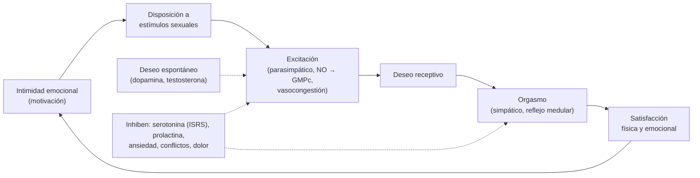

---
tags:
  - Psiquiatría
---

# Sexualidad humana, respuesta sexual, disfunciones sexuales y disforia de género

**Subespecialidad**
Psiquiatría · Sexología · Urología · Ginecología · Medicina familiar

**Guías principales**
Criterios DSM-5-TR (2022) y CIE-11 (capítulo de condiciones relacionadas con la salud sexual) · AUA 2018: disfunción eréctil · ISSM 2014: eyaculación precoz · WPATH 2022: estándares de atención para personas trans y de género diverso (versión 8)

**Otras fuentes**
Modelo circular de la respuesta sexual (Basson, *J Sex Marital Ther* 2001) · Modelos clásicos de Masters y Johnson (1966) y de Kaplan (1979) · Ley 21.120 de identidad de género (2018) · Ver [disfunción eréctil y patología del pene](../cirugia/urologia/patologia-del-pene-y-disfuncion-erectil.md), [pubertad, sexualidad y diversidad](../ginecologia-obstetricia/pubertad-adolescencia-sexualidad-y-diversidad.md), [climaterio](../endocrinologia/climaterio-y-menopausia.md), [hipogonadismo masculino](../endocrinologia/hipogonadismo-masculino-y-ginecomastia.md) y [depresión](../geriatria/depresion.md)

**GES**
No.

**EUNACOM**
5.01.1.017 Disfunción sexual (sospecha, inicial, derivar) · 5.01.1.019 Sexualidad humana y sus alteraciones (sospecha, inicial, derivar) · 5.01.3.012 Respuesta sexual humana · 5.01.3.006 Disforia de género

**Revisado**
Octubre 2026

!!! abstract "Resumen en 60 segundos"
    - **Sexualidad**: dimensión central del ser humano que incluye el **sexo**, la **identidad de género**, la **orientación sexual**, el erotismo, el placer, la intimidad y la reproducción. La **diversidad** sexual y de género **no es patología**.
    - **Respuesta sexual**: modelo lineal de **Masters y Johnson** (excitación, meseta, orgasmo, resolución) y **Kaplan** (deseo, excitación, orgasmo); modelo **circular de Basson**: en muchas mujeres el deseo es **receptivo** y surge de la intimidad y la excitación.
    - **Disfunción sexual** (DSM-5-TR): alteración **persistente** (≥ **6 meses**, en ~ 75–100 % de las ocasiones) del deseo, la excitación, el orgasmo o con **dolor**, que causa **malestar significativo**.
    - Siempre buscar causas **orgánicas** (diabetes, enfermedad vascular, hipogonadismo, fármacos: **ISRS**, antihipertensivos, antipsicóticos), **psicológicas** (ansiedad de desempeño, depresión, trauma) y **de pareja**.
    - La **disfunción eréctil** es un **marcador de riesgo cardiovascular**. Tratamiento: **inhibidores de la PDE-5** (sildenafil, tadalafil), salvo con **nitratos**.
    - **Terapia sexual** (focalización sensorial de Masters y Johnson, TCC) en la mayoría de las disfunciones; tratar la causa.
    - **Disforia de género** (DSM-5-TR): **malestar** por la incongruencia entre el género vivido y el asignado. La **CIE-11** usa "**incongruencia de género**" fuera de los trastornos mentales. Atención **afirmativa** y respetuosa; los tratamientos médicos los indican **equipos especializados** (WPATH 2022).

## Definición

- **Sexo**: características biológicas (cromosomas, gónadas, genitales, hormonas).
- **Identidad de género**: vivencia interna del propio género (hombre, mujer, no binario), que puede o no coincidir con el sexo asignado al nacer (**cisgénero** o **trans**).
- **Expresión de género**: forma de manifestar el género (vestimenta, conducta).
- **Orientación sexual**: atracción erótica y afectiva (heterosexual, homosexual, bisexual, asexual). **No es un trastorno** (se eliminó del DSM en 1973).
- **Disfunción sexual**: alteración clínicamente significativa de la capacidad de responder sexualmente o de sentir placer sexual, con **malestar** para la persona.
- **Disforia de género** (DSM-5-TR): **malestar clínicamente significativo** por la **incongruencia** entre el género experimentado y el asignado, durante **≥ 6 meses**. Lo diagnosticable es el **malestar**, no la identidad.
- **Incongruencia de género** (CIE-11): incongruencia **marcada y persistente** entre el género experimentado y el asignado, clasificada en el capítulo de **condiciones relacionadas con la salud sexual** (no como trastorno mental), para facilitar el acceso a la atención sin estigmatizar.
- **Trastornos parafílicos**: intereses sexuales atípicos e intensos (exhibicionismo, voyeurismo, frotteurismo, pedofilia, sadismo, masoquismo, fetichismo, travestismo) que causan malestar o daño a sí o a terceros, o que involucran a personas que **no consienten**. Una parafilia **sin** malestar ni daño **no** es un trastorno.

## Epidemiología

### Mundial

- Las **dificultades sexuales** son muy frecuentes: hasta **40–45 % de las mujeres** y **20–30 % de los hombres** refieren alguna; las que causan malestar (disfunción) son menos.
- **Disfunción eréctil**: aumenta con la **edad** (~ 50 % entre los 40 y 70 años tiene algún grado en el estudio de Massachusetts).
- **Eyaculación precoz**: la queja sexual masculina **más frecuente** en los jóvenes.
- **Bajo deseo sexual** en las mujeres: la queja más frecuente, sobre todo en la peri y posmenopausia.
- **Disfunción sexual por ISRS**: **30–60 %** de quienes los usan; causa frecuente de abandono del tratamiento.
- **Personas trans y de género diverso**: ~ **0,5–1 %** de los adultos y más en los adolescentes en las encuestas recientes.

### Chile

!!! chile "Datos nacionales"
    - La **Ley 21.120** (2018) reconoce el derecho a la **identidad de género** y permite la **rectificación registral** del nombre y el sexo (desde los 18 años por vía administrativa; de los 14 a los 18 años, por los tribunales de familia).
    - La **Ley 20.609** (2012) sanciona la **discriminación arbitraria**, incluida la basada en la orientación sexual y la identidad de género.
    - El MINSAL implementa el **Programa de Acompañamiento a la Identidad de Género** (PAIG), de apoyo psicosocial para niños, niñas y adolescentes trans o de género diverso y sus familias.
    - La consulta por disfunciones sexuales es **subdiagnosticada**: los pacientes rara vez lo plantean si el médico no **pregunta**.

## Etiología y factores de riesgo

| Tipo | Factores |
|---|---|
| **Vascular** | **Diabetes**, HTA, dislipidemia, **tabaquismo**, obesidad, enfermedad coronaria (la disfunción eréctil puede **preceder** al evento coronario en 3–5 años) |
| **Neurológica** | Neuropatía diabética, lesión medular, esclerosis múltiple, Parkinson, cirugía pélvica (prostatectomía) |
| **Endocrina** | **Hipogonadismo**, **hiperprolactinemia**, hipotiroidismo, **menopausia** (síndrome genitourinario) |
| **Fármacos y sustancias** | **ISRS e IRSN**, **antipsicóticos** (prolactina), β-bloqueadores, **tiazidas**, espironolactona, finasterida, antiandrógenos, opioides, **alcohol**, tabaco, cannabis |
| **Psicológica** | **Ansiedad de desempeño**, depresión, ansiedad, estrés, **trauma o abuso sexual**, culpa, educación sexual restrictiva |
| **Relacional** | Conflictos de pareja, falta de comunicación, diferencias de deseo |
| **Ginecológica** | **Vulvodinia**, endometriosis, vaginismo, atrofia vaginal, posparto y lactancia |

## Fisiopatología

- **Deseo**: depende de la **dopamina** (estimula), la **testosterona** (en ambos sexos) y los estrógenos; la **serotonina** y la **prolactina** lo inhiben (por eso los ISRS y los antipsicóticos lo reducen).
- **Excitación**: respuesta **parasimpática** con liberación de **óxido nítrico** → **GMPc** → relajación del músculo liso → **vasocongestión** (erección, lubricación). La **PDE-5** degrada el GMPc: su inhibición prolonga la erección.
- **Orgasmo y eyaculación**: respuesta **simpática** y refleja medular (emisión y expulsión); la serotonina la **retrasa** (base del uso de ISRS en la eyaculación precoz).
- **Resolución**: vuelta al estado basal; **período refractario** en el hombre.
- **Modelos de la respuesta sexual**:
    - **Masters y Johnson** (1966): **excitación → meseta → orgasmo → resolución** (lineal, fisiológico).
    - **Kaplan** (1979): agrega el **deseo** como primera fase (**deseo → excitación → orgasmo**), base de la clasificación de las disfunciones.
    - **Basson** (2001): modelo **circular**; la motivación por la **intimidad** lleva a buscar estímulos, la **excitación** genera un deseo **receptivo** y la **satisfacción** emocional y física refuerza el ciclo.

*Figura 1. Respuesta sexual humana según el modelo circular de Basson, con sus bases neurofisiológicas. Esquema propio basado en Basson (2001) y en los modelos de Masters y Johnson y de Kaplan.*

## Clasificación

**Disfunciones sexuales (DSM-5-TR)**: duración **≥ 6 meses**, en el **75–100 %** de las ocasiones (salvo las inducidas por sustancias), con **malestar significativo**, no explicadas por otro trastorno, una sustancia o un problema grave de pareja.

| Fase | Mujer | Hombre |
|---|---|---|
| **Deseo y excitación** | **Trastorno del interés o la excitación sexual femenina** | **Deseo sexual hipoactivo masculino**; **trastorno eréctil** |
| **Orgasmo** | **Trastorno orgásmico femenino** | **Eyaculación precoz** (≤ **1 minuto** tras la penetración); **eyaculación retardada** |
| **Dolor** | **Trastorno de dolor génito-pélvico o de la penetración** (incluye el antiguo **vaginismo** y la **dispareunia**) | — |
| **Otras** | Disfunción **inducida por sustancias o fármacos**; otra especificada | Ídem |

- **Especificadores**: **de toda la vida** o **adquirida**; **generalizada** o **situacional** (solo con cierta pareja o situación: sugiere causa psicológica o relacional); gravedad leve, moderada o grave.

**Otras alteraciones de la sexualidad**:

- **Trastornos parafílicos** (ver la definición).
- **Conducta sexual compulsiva** (CIE-11): incapacidad persistente de controlar impulsos sexuales intensos, con deterioro.
- **Disforia de género** (DSM-5-TR) e **incongruencia de género** (CIE-11): en la **infancia** y en la **adolescencia y adultez**.

## Clínica

- **Trastorno eréctil**: dificultad para lograr o mantener la erección. Sugiere causa **orgánica**: inicio **gradual**, **sin erecciones matutinas** ni con la masturbación, factores de riesgo vascular. Sugiere causa **psicógena**: inicio **brusco**, **situacional**, erecciones nocturnas conservadas, joven.
- **Eyaculación precoz**: de toda la vida (≤ 1 minuto desde las primeras relaciones) o adquirida (≈ ≤ 3 minutos; buscar disfunción eréctil, prostatitis, hipertiroidismo, ansiedad).
- **Trastorno del interés o excitación femenina**: ausencia o reducción del interés, de las fantasías, de la iniciativa y del placer; frecuente con la **depresión**, la menopausia, los conflictos de pareja y los fármacos.
- **Trastorno de dolor génito-pélvico**: dolor con la penetración, **miedo anticipatorio** y **contracción involuntaria** de la musculatura del piso pélvico (vaginismo). Buscar vulvodinia, endometriosis, atrofia, infecciones, **abuso sexual**.
- **Disforia de género**:
    - **Niños**: deseo intenso de ser del otro género o insistencia en que lo son, preferencia por la ropa, los juegos y los compañeros del otro género, rechazo de la propia anatomía. En muchos niños **no persiste** en la adolescencia.
    - **Adolescentes y adultos**: incongruencia marcada con las características sexuales primarias o secundarias, deseo de ser tratado como el otro género. Gran malestar con la **pubertad**.
    - Alta frecuencia de **depresión, ansiedad, autolesiones y conducta suicida**, relacionadas sobre todo con el **estigma**, el **rechazo** familiar y social y la discriminación (**estrés de minorías**).

!!! alarma "Signos de alarma"
    - **Disfunción eréctil** en un hombre con factores de riesgo: evaluar el **riesgo cardiovascular** (puede preceder al infarto).
    - **Dolor torácico** con PDE-5 + **nitratos**: **hipotensión grave** (contraindicación absoluta).
    - **Priapismo** (erección > 4 horas): urgencia urológica.
    - **Ideación suicida** en personas trans o de género diverso, sobre todo adolescentes con rechazo familiar.
    - **Parafilias** con riesgo para terceros (pedofilia): derivación especializada y protección de los menores.
    - Disfunción sexual tras un **abuso sexual**: abordar el trauma.

## Diagnóstico

!!! guia "Enfoque de la consulta (DSM-5-TR; AUA 2018)"
    - **Preguntar** de rutina, en forma **respetuosa** y **sin supuestos** sobre la orientación o la identidad ("¿Tiene alguna preocupación sobre su vida sexual?"). Modelo **PLISSIT**: **P**ermiso, **I**nformación **L**imitada, **S**ugerencias **E**specíficas, **T**erapia **I**ntensiva.
    - **Historia sexual**: inicio (de toda la vida o adquirida), situacional o generalizada, fase afectada, expectativas, pareja, **fármacos**, alcohol y drogas, **trauma**.
    - **Historia médica**: diabetes, HTA, enfermedad CV, cirugías pélvicas, síntomas de hipogonadismo, depresión.
    - **Examen físico**: PA, IMC, pulsos, caracteres sexuales secundarios, genitales (testículos, placas de Peyronie), examen ginecológico si hay dolor.
    - **Instrumentos**: **IIEF-5** (disfunción eréctil), **FSFI** (función sexual femenina).
    - **Disforia de género**: evaluación **integral** por equipos con experiencia; explorar la identidad, el malestar, la red de apoyo y la salud mental, **sin intentar cambiar** la identidad (las terapias de "conversión" son **dañinas** y no éticas).

## Laboratorio

| Examen | Cuándo |
|---|---|
| **Glicemia o HbA1c**, **perfil lipídico** | Disfunción eréctil (factores de riesgo vascular) |
| **Testosterona total matinal** (repetir si es baja), LH | Bajo deseo, disfunción eréctil, síntomas de hipogonadismo |
| **Prolactina** | Bajo deseo, disfunción eréctil, galactorrea, uso de antipsicóticos |
| **TSH** | Eyaculación precoz adquirida, bajo deseo |
| Flujo vaginal, cultivos | Dolor génito-pélvico |

## Imágenes

- En general **no** se requieren.
- **Ecografía Doppler peneana** en casos seleccionados (urología). **Ecografía pélvica** en el dolor génito-pélvico (endometriosis).
- En la disfunción eréctil con factores de riesgo, **evaluación cardiovascular** (por ejemplo, test de esfuerzo) según la clínica.

## Diagnóstico diferencial

- **Disfunción sexual secundaria** a: **depresión** (anhedonia), ansiedad, **fármacos** (ISRS, antipsicóticos), **alcohol**, enfermedades médicas.
- **Problemas de pareja** graves o violencia (no se diagnostica una disfunción).
- **Variación normal**: diferencias de deseo entre los miembros de la pareja, cambios con la edad, expectativas irreales.
- **Asexualidad**: orientación sin atracción sexual, sin malestar: **no** es disfunción.
- **Disforia de género** frente a la exploración de la identidad (normal en la adolescencia), la **no conformidad de género** sin malestar, el trastorno dismórfico corporal o síntomas psicóticos (raros).

## Tratamiento

### Principios

- **Educación sexual** y psicoeducación: desmitificar, informar la **anatomía** y la fisiología, normalizar.
- **Tratar la causa**: controlar la diabetes y los factores de riesgo, **cambiar los fármacos** responsables, tratar la depresión, el hipogonadismo o la atrofia vaginal.
- **Terapia sexual** (individual o de **pareja**): **focalización sensorial** (*sensate focus*) de Masters y Johnson (reduce la ansiedad de desempeño), TCC, técnicas específicas.

!!! dosis "Tratamientos específicos"
    | Disfunción | Tratamiento | Comentario |
    |---|---|---|
    | **Trastorno eréctil** | **Inhibidores de la PDE-5**: **sildenafil** 50 mg (25–100 mg) 1 hora antes; **tadalafil** 10–20 mg a demanda o 5 mg/día | **Contraindicados con nitratos** (y riociguat). Efectos: cefalea, rubor, congestión nasal, alteración visual. Requieren estimulación sexual. Segunda línea: alprostadil intracavernoso, dispositivos de vacío, prótesis |
    | **Eyaculación precoz** | Técnicas conductuales (**parar y apretar**, parar y empezar), **dapoxetina** 30–60 mg a demanda, **ISRS diarios** (paroxetina, sertralina) fuera de ficha, anestésicos tópicos | Tratar la disfunción eréctil si coexiste |
    | **Disfunción sexual por ISRS** | Esperar unas semanas, bajar la dosis, cambiar a **bupropión**, mirtazapina o vortioxetina, o agregar un **PDE-5** | No suspender sin plan |
    | **Bajo deseo femenino** | Terapia sexual y de pareja, tratar la causa; en la **premenopausia** la FDA aprobó la **flibanserina** y el **bremelanotide** (eficacia modesta); en la **posmenopausia**, testosterona transdérmica en casos seleccionados | Evaluar la depresión y la relación |
    | **Dolor génito-pélvico** | Tratar la causa (atrofia: **estrógenos vaginales**; vulvodinia), **fisioterapia del piso pélvico**, **dilatadores** graduales, terapia sexual y TCC | Abordar el trauma si existe |
    | **Trastorno orgásmico femenino** | Educación, **masturbación dirigida**, terapia sexual | — |

### Disforia o incongruencia de género

- Atención **afirmativa**: respetar el **nombre social** y los **pronombres**, confidencialidad, trato no discriminatorio (Ley 20.609).
- **Acompañamiento psicosocial** de la persona y la **familia** (el apoyo familiar es el principal **factor protector**).
- Tratar la **comorbilidad** (depresión, ansiedad, riesgo suicida), que **no** es la causa de la identidad.
- **Intervenciones médicas** de afirmación (bloqueo puberal, hormonización, cirugías) por **equipos especializados** multidisciplinarios, con evaluación individual, **consentimiento informado** y criterios según la edad (WPATH 2022). Ver [pubertad, sexualidad y diversidad](../ginecologia-obstetricia/pubertad-adolescencia-sexualidad-y-diversidad.md).

## Complicaciones

- Deterioro de la **calidad de vida**, de la **autoestima** y de la **relación de pareja**; ansiedad y depresión secundarias.
- **Abandono** del tratamiento antidepresivo por los efectos sexuales.
- **Infertilidad** (eyaculación, dolor que impide las relaciones).
- En las personas trans: **discriminación**, violencia, **suicidio**; efectos adversos de la hormonización (trombosis con estrógenos, eritrocitosis con testosterona).
- **Uso indebido** de PDE-5 con nitratos o "poppers" (nitritos de amilo): hipotensión grave.

## Pronóstico y seguimiento

- La mayoría de las disfunciones **mejora** con educación, tratamiento de la causa y terapia sexual.
- La disfunción eréctil responde a los **PDE-5** en ~ **60–70 %**; menos en la diabetes y tras la prostatectomía.
- Las **técnicas conductuales** de la eyaculación precoz tienen buenos resultados iniciales, pero con recaídas.
- **Disforia de género**: con atención afirmativa y apoyo familiar mejoran la salud mental y la calidad de vida.

## Perlas para el internado

!!! perla "Para recordar"
    - **Pregunta** por la sexualidad: los pacientes rara vez lo plantean.
    - **Disfunción eréctil** = posible **enfermedad vascular**: evaluar el riesgo cardiovascular.
    - **PDE-5 + nitratos = hipotensión grave** (contraindicado).
    - **Erecciones matutinas conservadas** y disfunción **situacional** → causa psicógena.
    - Los **ISRS** causan disfunción sexual en hasta la mitad de los pacientes: preguntar y manejar (bupropión, PDE-5).
    - **Masters y Johnson**: excitación–meseta–orgasmo–resolución. **Kaplan** agrega el **deseo**. **Basson**: modelo **circular** con deseo **receptivo**.
    - Duración mínima de una disfunción sexual (DSM-5-TR): **6 meses**. Eyaculación precoz: **≤ 1 minuto**.
    - **Disforia de género**: lo diagnosticable es el **malestar**, no la identidad. CIE-11: **incongruencia de género**, fuera del capítulo de trastornos mentales.

## Preguntas de repaso

??? repaso "1. Hombre de 58 años, diabético, hipertenso y fumador, con 1 año de disfunción eréctil progresiva y sin erecciones matutinas. ¿Qué piensa y qué hace?"
    Disfunción eréctil **orgánica** (vascular y neuropática). Evaluar el **riesgo cardiovascular** (puede preceder a un evento coronario), pedir glicemia o HbA1c, perfil lipídico y **testosterona matinal**; revisar los fármacos (tiazidas, β-bloqueadores). Tratar: control de los factores de riesgo, dejar de fumar y un **PDE-5** (sildenafil o tadalafil) si **no usa nitratos**.

??? repaso "2. Mujer de 32 años en tratamiento con sertralina por depresión, ya en remisión, con disminución del deseo y anorgasmia. ¿Qué opciones tiene?"
    **Disfunción sexual por ISRS**. Opciones: **bajar la dosis** si es posible, **cambiar** a un antidepresivo con menos efecto sexual (**bupropión**, mirtazapina o vortioxetina) o **agregar bupropión**. No suspender bruscamente. Ofrecer terapia sexual.

??? repaso "3. Joven de 22 años que eyacula antes del minuto desde su primera relación sexual, con angustia. ¿Diagnóstico y manejo?"
    **Eyaculación precoz de toda la vida**. Manejo: educación, técnicas conductuales (**parar y apretar**, parar y empezar), terapia sexual; fármacos como **dapoxetina** a demanda, ISRS diarios fuera de ficha o anestésicos tópicos.

??? repaso "4. Mujer de 27 años con imposibilidad de tener relaciones por dolor y contracción involuntaria al intentar la penetración, con miedo anticipatorio. ¿Qué tiene?"
    **Trastorno de dolor génito-pélvico o de la penetración** (antes, vaginismo). Descartar causas orgánicas (vulvodinia, infecciones, endometriosis) y explorar con delicadeza un posible **abuso sexual**. Tratamiento: educación, **fisioterapia del piso pélvico**, **dilatadores** graduales y terapia sexual o TCC.

??? repaso "5. Adolescente de 15 años, asignado hombre al nacer, que se identifica como mujer, tiene gran malestar con los cambios puberales y tiene ideación suicida por el rechazo de su familia. ¿Cómo lo aborda?"
    Atención **afirmativa** (nombre social y pronombres), **evaluación del riesgo suicida** y plan de seguridad, **acompañamiento** psicosocial de la adolescente y su **familia** (el apoyo familiar es protector), tratamiento de la depresión, y derivación a un **equipo especializado** para evaluar las intervenciones médicas según la WPATH 2022. Informar la Ley 21.120 y el apoyo del programa de acompañamiento a la identidad de género.

??? repaso "6. Describa el modelo circular de la respuesta sexual de Basson."
    En lugar de un modelo lineal (deseo → excitación → orgasmo), Basson propone que, sobre todo en las mujeres con relaciones de largo plazo, la **motivación por la intimidad** lleva a buscar estímulos; la **excitación** genera un **deseo receptivo**, y la **satisfacción** física y emocional refuerza la motivación para el próximo encuentro. El deseo espontáneo no es necesario para una respuesta sexual satisfactoria.

## Referencias

1. American Psychiatric Association. *Diagnostic and Statistical Manual of Mental Disorders, Fifth Edition, Text Revision (DSM-5-TR).* Washington, DC: APA; 2022.
2. Basson R. Human sex-response cycles. *J Sex Marital Ther.* 2001;27(1):33–43. doi:[10.1080/00926230152035831](https://doi.org/10.1080/00926230152035831)
3. Burnett AL, Nehra A, Breau RH, et al. Erectile dysfunction: AUA guideline. *J Urol.* 2018;200(3):633–641. doi:[10.1016/j.juro.2018.05.004](https://doi.org/10.1016/j.juro.2018.05.004)
4. Althof SE, McMahon CG, Waldinger MD, et al. An update of the International Society of Sexual Medicine's guidelines for the diagnosis and treatment of premature ejaculation (PE). *J Sex Med.* 2014;11(6):1392–1422. doi:[10.1111/jsm.12504](https://doi.org/10.1111/jsm.12504)
5. Coleman E, Radix AE, Bouman WP, et al. Standards of care for the health of transgender and gender diverse people, version 8. *Int J Transgend Health.* 2022;23(Suppl 1):S1–S259. doi:[10.1080/26895269.2022.2100644](https://doi.org/10.1080/26895269.2022.2100644)
6. Masters WH, Johnson VE. *Human Sexual Response.* Boston: Little, Brown; 1966.
7. Kaplan HS. *Disorders of Sexual Desire.* Nueva York: Brunner/Mazel; 1979.
8. Organización Mundial de la Salud. *Clasificación Internacional de Enfermedades, 11.ª revisión (CIE-11).* Ginebra: OMS; 2022. [icd.who.int](https://icd.who.int/)
9. Chile. Ley 21.120 que reconoce y da protección al derecho a la identidad de género. *Diario Oficial*, 10 de diciembre de 2018. [bcn.cl](https://www.bcn.cl/leychile/navegar?i=1126480)
