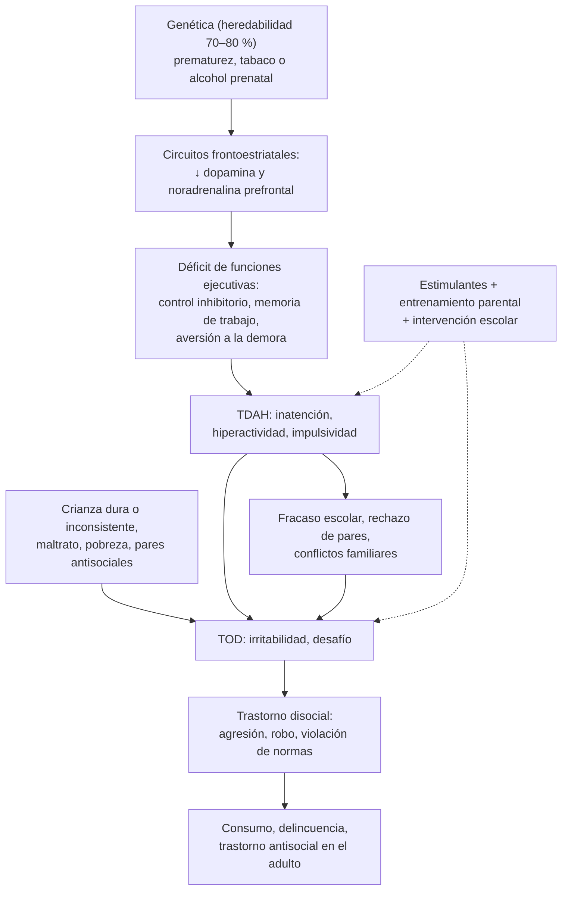

---
tags:
  - Psiquiatría
  - Frecuente en sala
---

# Trastorno por déficit de atención e hiperactividad (TDAH) y trastornos de conducta (oposicionista desafiante y disocial)

**Subespecialidad**
Psiquiatría infantojuvenil · Neurología infantil · Pediatría · Atención primaria

**Guías principales**
AAP 2019: diagnóstico, evaluación y tratamiento del TDAH en niños y adolescentes · NICE NG87 (2018, actualizada en 2019): TDAH · Consenso internacional de la World Federation of ADHD (2021) · Criterios DSM-5-TR (2022)

**Otras fuentes**
Metaanálisis en red de los fármacos para el TDAH (Cortese, *Lancet Psychiatry* 2018) · Revisión del trastorno disocial (Fairchild, *Nat Rev Dis Primers* 2019) · Prevalencia de trastornos mentales en niños y adolescentes chilenos (Vicente, *J Child Psychol Psychiatry* 2012) y del TDAH (de la Barra 2013) · Ver [trastornos del neurodesarrollo](trastornos-del-neurodesarrollo.md), [consumo de sustancias](consumo-de-alcohol-tabaco-y-drogas.md) y [trastornos de la personalidad](trastornos-de-la-personalidad.md)

**GES**
No.

**EUNACOM**
5.01.1.028 Trastorno por déficit atencional (sospecha, inicial, completo) · 5.01.1.030 Trastorno conducta oposicionista desafiante (sospecha, inicial, derivar) · 5.01.1.031 Trastorno conducta disocial (sospecha, inicial, derivar)

**Revisado**
Octubre 2026

!!! abstract "Resumen en 60 segundos"
    - **TDAH**: patrón persistente de **inatención** y/o **hiperactividad-impulsividad**, con **≥ 6 síntomas** (≥ 5 desde los 17 años) por **≥ 6 meses**, presentes **antes de los 12 años**, en **≥ 2 contextos** (casa y colegio) y con **deterioro**. Prevalencia **~ 5–7 %** en niños; en Chile **~ 10 %** (de la Barra 2013).
    - **Diagnóstico clínico** con información de **padres y profesores** (escalas de **Conners** o **Vanderbilt**); descartar problemas de **audición, visión, sueño**, aprendizaje, ansiedad, depresión, maltrato y ausentismo.
    - **Tratamiento** (AAP 2019):
        - **4–5 años**: primero **entrenamiento conductual de los padres**; metilfenidato si no basta.
        - **≥ 6 años**: **estimulantes** (metilfenidato, anfetaminas) + intervenciones **conductuales** y **escolares**.
        - Alternativas: **atomoxetina**, guanfacina.
    - Antes del estimulante: preguntar por **síncope, dolor torácico, muerte súbita familiar** y cardiopatía; controlar **peso, talla, PA y FC**.
    - **Trastorno oposicionista desafiante (TOD)**: patrón de **enojo, irritabilidad, discusión y desafío** a las figuras de autoridad, **≥ 6 meses**, sin violar gravemente los derechos de otros.
    - **Trastorno disocial**: violación **repetida** de los derechos de otros y de las normas sociales (**agresión** a personas o animales, **destrucción**, **robo y engaño**, violación grave de normas). Puede evolucionar al **trastorno antisocial** en la adultez.
    - **Tratamiento de los trastornos de conducta**: **entrenamiento parental** (el más eficaz en los niños), intervenciones escolares y multisistémicas en los adolescentes; tratar el TDAH comórbido.

## Definición

- **TDAH** (DSM-5-TR): patrón persistente de **inatención** y/o **hiperactividad-impulsividad** que interfiere con el funcionamiento o el desarrollo:
    - **Inatención** (≥ 6 de 9): errores por descuido, dificultad para mantener la atención, parece no escuchar, no sigue instrucciones ni termina las tareas, dificultad para **organizarse**, evita tareas que requieren esfuerzo mental sostenido, **pierde cosas**, se distrae con facilidad, **olvidadizo** en las actividades diarias.
    - **Hiperactividad e impulsividad** (≥ 6 de 9): mueve manos o pies, se levanta del asiento, corre o trepa en situaciones inapropiadas (inquietud en los adolescentes), dificultad para jugar tranquilo, "**motor encendido**", **habla en exceso**, responde **antes** de que terminen la pregunta, dificultad para **esperar el turno**, **interrumpe**.
    - **≥ 6 síntomas** (≥ 5 a partir de los **17 años**) por **≥ 6 meses**, varios **antes de los 12 años**, en **≥ 2 contextos**, con **deterioro** y no explicados por otro trastorno.
    - **Presentaciones**: **combinada**, **predominio inatento**, **predominio hiperactivo-impulsivo**.
- **Trastorno oposicionista desafiante** (DSM-5-TR): **≥ 4 síntomas** por **≥ 6 meses** de **ánimo enojado o irritable** (pierde la calma, susceptible, resentido), **conducta discutidora o desafiante** (discute con adultos, desafía las normas, molesta deliberadamente, culpa a otros) o **vengativa**, con al menos una persona que no sea un hermano.
- **Trastorno disocial** (de conducta): patrón **repetitivo y persistente** que viola los **derechos básicos de otros** o las **normas sociales** propias de la edad, con **≥ 3 de 15 criterios** en los últimos 12 meses (≥ 1 en los últimos 6), en 4 grupos: **agresión** a personas y animales, **destrucción** de la propiedad, **engaño o robo**, **violación grave de normas** (escaparse de la casa, ausentismo escolar antes de los 13 años). Especificador "**con emociones prosociales limitadas**" (falta de remordimiento, de empatía, afecto superficial: rasgos de **dureza e insensibilidad**).

## Epidemiología

### Mundial

- **TDAH**: **~ 5–7 %** de los niños y adolescentes y **~ 2,5 %** de los adultos. Más diagnosticado en **niños** (~ 2 : 1); las niñas tienen más presentación **inatenta** y se subdiagnostican.
- **TOD**: ~ 3 %; **trastorno disocial**: ~ 2–4 %, más en **hombres**.
- **Comorbilidad**: hasta el **50–60 %** de los niños con TDAH tiene otro trastorno (TOD, trastornos del aprendizaje, ansiedad, tics, TEA, trastornos del sueño).

### Chile

!!! chile "Datos nacionales"
    - **Estudio chileno de prevalencia en niños y adolescentes** (Vicente 2012; 1558 niños de 4 a 18 años): **22,5 %** tenía algún trastorno psiquiátrico en el último año, más en los de **4 a 11 años** (27,8 %).
    - **TDAH**: prevalencia de **~ 10 %**, con predominio del subtipo **hiperactivo-impulsivo** y sin diferencia por sexo; las comorbilidades más frecuentes fueron la **ansiedad** y el **trastorno oposicionista**; el **maltrato** se asoció al TDAH (de la Barra 2013).
    - El TDAH es uno de los motivos más frecuentes de derivación a la **salud mental infantil** y de apoyo en los **Programas de Integración Escolar**.

## Etiología y factores de riesgo

- **TDAH**:
    - **Genética**: heredabilidad **~ 70–80 %** (una de las más altas en psiquiatría); poligénico.
    - **Ambientales**: **prematurez** y bajo peso al nacer, **exposición prenatal** a tabaco, alcohol y otras drogas, plomo, TEC, privación psicosocial grave.
    - **No** lo causan el azúcar, los aditivos ni el "mal manejo" de los padres (aunque el ambiente influye en el curso).
- **Trastornos de conducta**:
    - **Temperamento** difícil, **TDAH**, déficits cognitivos y del lenguaje.
    - **Familia**: crianza **inconsistente o dura**, castigo físico, **maltrato**, negligencia, conflicto parental, padres con consumo o conducta antisocial.
    - **Sociales**: pobreza, **pares** con conducta delictual, barrios violentos.

## Fisiopatología

- **TDAH**: alteración del desarrollo de los circuitos **frontoestriatales** y **frontocerebelosos** que regulan las **funciones ejecutivas** (control inhibitorio, memoria de trabajo, planificación) y la **aversión a la demora**; **maduración cortical retrasada** ~ 2–3 años en las imágenes.
- **Neurotransmisores**: menor actividad de la **dopamina** y la **noradrenalina** en la corteza prefrontal. Los **estimulantes** bloquean la recaptación (metilfenidato) o aumentan la liberación (anfetaminas) de ambas; la **atomoxetina** inhibe la recaptación de noradrenalina.
- **Trastorno disocial con dureza e insensibilidad**: baja reactividad de la **amígdala** a las señales de miedo y dolor de otros (menor empatía) y baja reactividad autonómica.

*Figura 1. Del TDAH a los trastornos de conducta: factores de riesgo, trayectoria y puntos de intervención. Esquema propio basado en Faraone (2021) y Fairchild (2019).*

## Clasificación

| Trastorno | Núcleo | Edad de inicio | Duración |
|---|---|---|---|
| **TDAH** | Inatención, hiperactividad-impulsividad | Síntomas **antes de los 12 años** | ≥ 6 meses |
| **TOD** | **Enojo**, **desafío** a la autoridad, vengatividad | Preescolar o escolar | ≥ 6 meses |
| **Disocial** | **Violación de derechos de otros** y de normas | **Inicio infantil** (≥ 1 síntoma **antes de los 10 años**, peor pronóstico) o **adolescente** | 12 meses |
| **Antisocial de la personalidad** | Igual que el disocial en el adulto | **≥ 18 años**, con disocial antes de los 15 | — |
| **Trastorno explosivo intermitente** | Arrebatos de ira **desproporcionados** y recurrentes | ≥ 6 años | — |
| **Trastorno de desregulación disruptiva del estado de ánimo** | Irritabilidad **crónica** + **rabietas** graves frecuentes (≥ 3 por semana) | 6–18 años (inicio antes de los 10) | ≥ 12 meses |

## Clínica

- **TDAH según la edad**:
    - **Preescolar**: hiperactividad marcada, accidentes, dificultad para seguir las normas.
    - **Escolar**: inatención en clases, tareas incompletas, desorden, olvidos, interrupciones, bajo rendimiento, conflictos con pares.
    - **Adolescente**: predomina la **inatención** y la **inquietud interna**; impulsividad (conducción riesgosa, **consumo**, sexualidad de riesgo), desorganización.
    - **Adulto**: desorganización, procrastinación, inestabilidad laboral, accidentes.
- **TOD**: discusiones constantes con los padres y los profesores, rabietas, se niega a cumplir normas, molesta a otros, culpa a los demás; suele ser más intenso **en la casa**.
- **Trastorno disocial**: peleas, intimidación (*bullying*), uso de armas, **crueldad con animales**, incendios intencionales, robos, mentiras, fugas, ausentismo, vandalismo, abuso sexual de otros.

!!! alarma "Signos de alarma"
    - **Síncope**, **dolor torácico** de esfuerzo, palpitaciones, **muerte súbita** en familiares jóvenes o cardiopatía conocida antes de iniciar estimulantes: evaluación **cardiológica** (ECG).
    - **Maltrato** o abuso como causa o consecuencia de los problemas de conducta: activar la **protección**.
    - **Ideación suicida**, consumo de sustancias, conductas delictivas graves.
    - Uso **indebido** o **desvío** de estimulantes (adolescentes, universitarios).
    - **Tics** que aparecen o empeoran con los estimulantes.

## Diagnóstico

!!! guia "Puntos clave (AAP 2019; DSM-5-TR)"
    - El médico de la APS puede **diagnosticar y tratar** el TDAH desde los **4 años** (AAP 2019).
    - Diagnóstico **clínico** con los criterios DSM-5-TR e **información de ≥ 2 contextos**: padres y **profesores** (escalas **Vanderbilt** o **Conners**; en Chile se usa la de Conners abreviada para profesores y padres).
    - **Descartar** y buscar **comorbilidades**: **hipoacusia** y problemas **visuales**, **trastornos del sueño** (apnea obstructiva: ronquido; privación de sueño), **trastornos del aprendizaje**, **TEA**, ansiedad, depresión, **trauma y maltrato**, consumo, epilepsia de ausencias, hipertiroidismo, fármacos.
    - **Examen físico** completo, crecimiento, PA y FC, examen cardiovascular.
    - No se requieren exámenes de laboratorio, EEG ni neuroimágenes de rutina.
    - **Trastornos de conducta**: entrevista a los padres, al niño y al colegio; evaluar el contexto familiar y social, el **maltrato** y el consumo.

## Laboratorio

- **No** hay exámenes diagnósticos.
- Según la clínica: **TSH** (síntomas tiroideos), **plomo** (pica, riesgo ambiental), hemograma y ferritina (piernas inquietas, anemia), tóxicos (adolescentes).
- **ECG** antes de los estimulantes **solo** si hay antecedentes personales o familiares de riesgo cardíaco (síncope, dolor torácico, muerte súbita, cardiopatía).

## Imágenes

- **No** se usan para el diagnóstico.
- **Neuroimagen** o **EEG** solo si hay signos neurológicos, crisis (ausencias), regresión o sospecha de otra causa.

## Diagnóstico diferencial

| Diagnóstico | Claves |
|---|---|
| **Conducta normal** para la edad | Niño preescolar activo, sin deterioro, en un solo contexto |
| **Trastornos del aprendizaje** y **DI** | La inatención aparece en las tareas académicas que no puede hacer |
| **Trastornos del sueño** (apnea, privación) | Ronquido, somnolencia; mejora al tratar el sueño |
| **Hipoacusia** o problemas visuales | Audiometría, agudeza visual |
| **Ansiedad**, **depresión** | Inquietud o inatención por preocupación o anhedonia |
| **TEA** | Déficit de la reciprocidad social, intereses restringidos |
| **Trauma**, **maltrato**, negligencia | Hipervigilancia, problemas de conducta en un contexto adverso |
| **Trastorno bipolar** | Episodios con euforia o grandiosidad y menos sueño (raro en los niños pequeños) |
| **Epilepsia de ausencias** | "Desconexiones" breves, EEG con punta-onda de 3 Hz |
| **Hipertiroidismo**, fármacos (antihistamínicos, salbutamol, antiepilépticos), consumo | Historia y examen |

## Tratamiento

### TDAH

!!! guia "Tratamiento según la edad (AAP 2019)"
    - **Preescolares (4–5 años)**: **entrenamiento conductual de los padres** e intervenciones en el jardín como **primera línea**; **metilfenidato** si no hay mejoría suficiente y el deterioro es moderado a grave.
    - **Escolares (6–11 años)**: **fármaco aprobado** (de preferencia un **estimulante**) **+** entrenamiento conductual de los padres y/o intervenciones **escolares** (adecuaciones, PIE).
    - **Adolescentes (12–18 años)**: **fármaco** (con su acuerdo) + intervenciones conductuales y escolares.
    - Tratar como una **enfermedad crónica**: seguimiento, ajuste de la dosis hasta el **máximo beneficio** con efectos adversos tolerables.

- **Estimulantes** (primera línea): **metilfenidato** (liberación inmediata o prolongada) o **anfetaminas** (lisdexanfetamina). Eficacia ~ **70–80 %**. En el metaanálisis de Cortese (2018), el metilfenidato fue el de elección en los niños y las anfetaminas en los adultos.
- **No estimulantes**: **atomoxetina** (efecto en 4–8 semanas; útil con ansiedad, tics o riesgo de abuso), **guanfacina** o **clonidina** de liberación prolongada.
- **Medidas generales**: rutinas, ambiente ordenado, **sueño** adecuado, actividad física, límites claros, refuerzo positivo, ubicación adelante en la sala, instrucciones breves, pausas.

!!! dosis "Fármacos para el TDAH"
    | Fármaco | Dosis | Efectos adversos y precauciones |
    |---|---|---|
    | **Metilfenidato de liberación inmediata** | 5 mg 1–2 veces al día (desayuno y almuerzo), subir 5–10 mg por semana; máximo ~ 60 mg/día o 2 mg/kg/día | **Hiporexia** y baja de peso, **insomnio**, cefalea, dolor abdominal, irritabilidad al pasar el efecto, aumento de PA y FC, **tics** |
    | **Metilfenidato de liberación prolongada** (OROS) | 18 mg/día, subir de a 18 mg hasta 54–72 mg/día | Ídem; una dosis en la mañana |
    | **Lisdexanfetamina** | 30 mg/día, subir de a 10–20 mg hasta 70 mg/día | Ídem; menor potencial de abuso que las anfetaminas de acción corta |
    | **Atomoxetina** | 0,5 mg/kg/día → 1,2 mg/kg/día (máx. 100 mg) | Náuseas, somnolencia, **ideación suicida** (advertencia), hepatotoxicidad (rara) |
    | **Guanfacina XR** | 1 mg/día, hasta 4–7 mg/día | Somnolencia, **hipotensión**, bradicardia; **no suspender bruscamente** (HTA de rebote) |
    - **Controles**: **peso, talla, PA y FC** cada 3–6 meses; apetito y sueño. Las "**vacaciones**" del fármaco no son obligatorias.

### Trastorno oposicionista desafiante y disocial

- **Entrenamiento parental** (programas estructurados como *Parent Management Training*, Triple P, *Incredible Years*): el tratamiento con **mejor evidencia** en los niños; enseña refuerzo positivo, instrucciones claras, consecuencias consistentes y no violentas, tiempo fuera.
- **Intervenciones escolares** y entrenamiento en **habilidades sociales** y resolución de problemas del niño.
- **Adolescentes con trastorno disocial**: **terapia multisistémica** (familia, colegio, pares, comunidad), terapia familiar funcional; coordinación con la red de protección y judicial.
- **Tratar el TDAH** comórbido (los estimulantes reducen también la agresividad).
- **Fármacos** solo para la **agresividad grave** persistente: **risperidona** en dosis bajas por especialista.
- **Detectar y abordar** el maltrato, la violencia intrafamiliar y el consumo.

## Complicaciones

- **TDAH no tratado**: fracaso y **deserción escolar**, baja autoestima, rechazo de los pares, **accidentes** y lesiones (incluidos los de tránsito), **consumo de sustancias**, embarazo adolescente, desempleo, problemas legales.
- **Trastornos de conducta**: **delincuencia**, consumo, **violencia**, encarcelamiento, **trastorno antisocial** de la personalidad, depresión y suicidio.
- **Estimulantes**: retraso leve del crecimiento (~ 1–2 cm), insomnio, desvío o uso indebido.

## Pronóstico y seguimiento

- **TDAH**: la **hiperactividad** disminuye con la edad, pero la **inatención** persiste; ~ **50–65 %** mantiene síntomas con deterioro en la adultez.
- El **tratamiento** reduce los accidentes, el consumo, la criminalidad y mejora el rendimiento.
- **TOD**: muchos remiten; un tercio evoluciona a trastorno disocial (sobre todo con TDAH y adversidad).
- **Disocial de inicio infantil**: **peor pronóstico** que el adolescente; ~ 40 % evoluciona a **trastorno antisocial**.
- **Seguimiento**: síntomas (escalas de padres y profesores), rendimiento escolar, efectos adversos, crecimiento, PA y FC, **adherencia**, transición a la adultez.

## Perlas para el internado

!!! perla "Para recordar"
    - TDAH: **≥ 6 síntomas**, **≥ 6 meses**, **antes de los 12 años**, en **≥ 2 contextos**, con **deterioro**.
    - Pedir siempre el informe del **profesor**: si el problema está **solo en la casa**, no es TDAH (pensar en conflicto familiar o TOD).
    - Descartar **sueño** (ronquido), **audición**, **visión** y **maltrato** antes de diagnosticar.
    - **4–5 años**: primero **entrenamiento parental**; **≥ 6 años**: estimulante + intervención conductual y escolar.
    - Antes del estimulante: **síncope, dolor torácico, muerte súbita familiar**; controlar **peso, talla, PA y FC**.
    - **TOD**: enojo y desafío; **disocial**: viola los **derechos de otros**; **antisocial**: ≥ 18 años con disocial antes de los 15.
    - El tratamiento con mejor evidencia en los trastornos de conducta infantiles es el **entrenamiento parental**.

## Preguntas de repaso

??? repaso "1. Niño de 7 años con 1 año de inquietud, interrupciones, olvidos, tareas incompletas y conflictos con sus compañeros, en la casa y en el colegio. Duerme bien, examen normal, sin antecedentes cardíacos. ¿Diagnóstico y tratamiento?"
    **TDAH presentación combinada** (≥ 6 síntomas, ≥ 6 meses, ≥ 2 contextos, deterioro). Confirmar con escalas de **padres y profesores**, descartar audición, visión y aprendizaje. Tratamiento: **metilfenidato** (por ejemplo, 5 mg en el desayuno y el almuerzo, ajustando por semana) **+ entrenamiento parental** y **adecuaciones escolares**; controlar peso, talla, PA y FC.

??? repaso "2. Niña de 10 años con bajo rendimiento, 'en las nubes', olvidadiza y desorganizada, sin hiperactividad. ¿Qué considera?"
    **TDAH presentación inatenta** (frecuente y subdiagnosticada en las niñas). Descartar **ausencias** (EEG si hay desconexiones breves), **hipoacusia**, trastornos del **aprendizaje**, **ansiedad**, **depresión** y problemas de **sueño**. Si se confirma, tratar con estimulante y apoyo escolar.

??? repaso "3. Niño de 4 años muy hiperactivo, con rabietas y conducta impulsiva en el jardín y en la casa. ¿Cuál es el primer tratamiento?"
    **Entrenamiento conductual de los padres** (y del jardín) como primera línea (AAP 2019). Si no basta y hay deterioro moderado a grave, agregar **metilfenidato** en dosis bajas.

??? repaso "4. Adolescente de 14 años con peleas frecuentes, robos, crueldad con animales y fugas desde los 9 años. ¿Diagnóstico y pronóstico?"
    **Trastorno disocial de inicio infantil** (síntomas antes de los 10 años), probablemente con emociones prosociales limitadas. Peor pronóstico, con riesgo de **trastorno antisocial** en la adultez, consumo y delincuencia. Tratamiento: **terapia multisistémica** y familiar, intervención escolar, tratar el TDAH comórbido y evaluar el **maltrato** y el consumo.

??? repaso "5. ¿Qué diferencia el trastorno oposicionista desafiante del trastorno disocial?"
    En el **TOD** predomina el **enojo o la irritabilidad** y la **conducta desafiante o discutidora** frente a la autoridad, sin violar gravemente los derechos de otros. En el **disocial** hay **violación de los derechos básicos de otros** y de las normas sociales importantes (agresión a personas o animales, destrucción, robo, violación grave de normas).

??? repaso "6. Antes de iniciar metilfenidato, ¿qué debe preguntar y controlar?"
    Antecedentes de **síncope**, **dolor torácico**, palpitaciones, cardiopatía y **muerte súbita** o arritmias en familiares jóvenes (si los hay, ECG y cardiología); **tics**, **epilepsia** y **consumo** (riesgo de abuso o desvío). Medir **peso, talla, PA y FC** basales y controlarlos periódicamente.

## Referencias

1. Wolraich ML, Hagan JF, Allan C, et al. Clinical practice guideline for the diagnosis, evaluation, and treatment of attention-deficit/hyperactivity disorder in children and adolescents. *Pediatrics.* 2019;144(4):e20192528. doi:[10.1542/peds.2019-2528](https://doi.org/10.1542/peds.2019-2528)
2. National Institute for Health and Care Excellence. Attention deficit hyperactivity disorder: diagnosis and management. NICE guideline NG87. Londres: NICE; 2018 (actualizada en 2019). [nice.org.uk](https://www.nice.org.uk/guidance/ng87)
3. Faraone SV, Banaschewski T, Coghill D, et al. The World Federation of ADHD International Consensus Statement: 208 evidence-based conclusions about the disorder. *Neurosci Biobehav Rev.* 2021;128:789–818. doi:[10.1016/j.neubiorev.2021.01.022](https://doi.org/10.1016/j.neubiorev.2021.01.022)
4. Cortese S, Adamo N, Del Giovane C, et al. Comparative efficacy and tolerability of medications for attention-deficit hyperactivity disorder in children, adolescents, and adults: a systematic review and network meta-analysis. *Lancet Psychiatry.* 2018;5(9):727–738. doi:[10.1016/S2215-0366(18)30269-4](https://doi.org/10.1016/S2215-0366(18)30269-4)
5. Fairchild G, Hawes DJ, Frick PJ, et al. Conduct disorder. *Nat Rev Dis Primers.* 2019;5(1):43. doi:[10.1038/s41572-019-0095-y](https://doi.org/10.1038/s41572-019-0095-y)
6. Vicente B, Saldivia S, de la Barra F, et al. Prevalence of child and adolescent mental disorders in Chile: a community epidemiological study. *J Child Psychol Psychiatry.* 2012;53(10):1026–1035. doi:[10.1111/j.1469-7610.2012.02566.x](https://doi.org/10.1111/j.1469-7610.2012.02566.x)
7. de la Barra FE, Vicente B, Saldivia S, et al. Epidemiology of ADHD in Chilean children and adolescents. *Atten Defic Hyperact Disord.* 2013;5(1):1–8. doi:[10.1007/s12402-012-0090-6](https://doi.org/10.1007/s12402-012-0090-6)
8. American Psychiatric Association. *Diagnostic and Statistical Manual of Mental Disorders, Fifth Edition, Text Revision (DSM-5-TR).* Washington, DC: APA; 2022.
