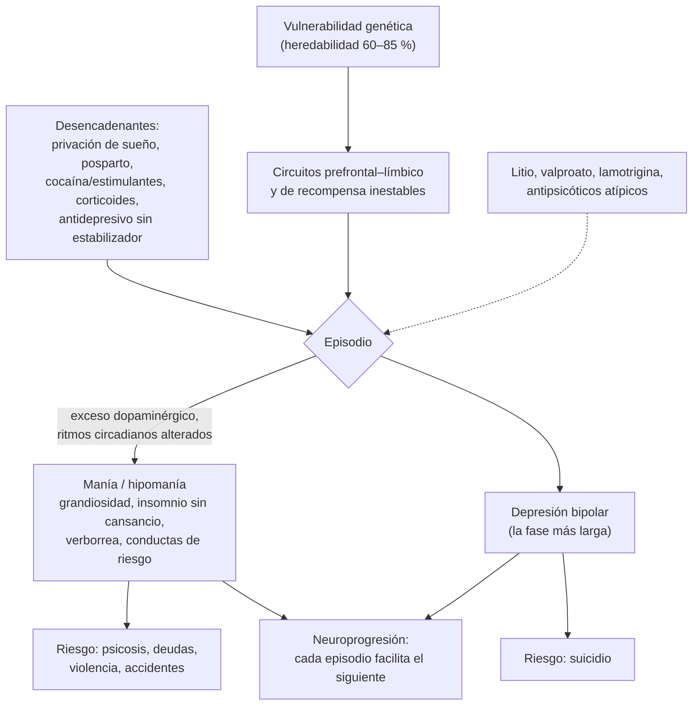

---
tags:
  - Psiquiatría
  - GES
  - Urgencia
---

# Trastorno bipolar

**Subespecialidad**
Psiquiatría

**Guías principales**
CANMAT/ISBD 2018: manejo del trastorno bipolar (y actualización de presentaciones mixtas 2021) · MINSAL: guía clínica GES de trastorno bipolar en personas de 15 años y más (recomendaciones GRADE) · NICE CG185 (2014, actualizada en 2023): trastorno bipolar · Criterios DSM-5-TR (2022)

**Otras fuentes**
Revisión de los trastornos bipolares (McIntyre, *Lancet* 2020) · Metaanálisis del litio en la prevención del suicidio (Cipriani, *BMJ* 2013) · Resumen y actualización 2023 de la evidencia CANMAT/ISBD (Keramatian, *Focus* 2023) · Ver [depresión](../geriatria/depresion.md), [agitación psicomotora](../geriatria/agitacion-psicomotora-y-agresividad.md), [trastornos del movimiento por fármacos](../neurologia/trastornos-del-movimiento-por-farmacos.md), [trastornos de ansiedad](trastornos-de-ansiedad-y-toc.md) y [esquizofrenia](esquizofrenia-y-trastornos-psicoticos.md)

**GES**
Sí: **trastorno bipolar en personas de 15 años y más** (N.° 75). Garantiza la confirmación diagnóstica por especialista, el tratamiento y el seguimiento.

**EUNACOM**
5.01.1.009 Trastorno bipolar (sospecha, inicial, derivar)

**Revisado**
Octubre 2026

!!! abstract "Resumen en 60 segundos"
    - **Trastorno bipolar**: episodios de **manía o hipomanía** que alternan con **depresión** (y períodos de eutimia). Prevalencia **~ 1–2 %**; inicio típico en la **adolescencia o adultez joven**.
    - **Tipo I**: al menos un episodio de **manía** (≥ 1 semana o con hospitalización; deterioro grave, a veces **psicosis**). **Tipo II**: **hipomanía** (≥ 4 días, sin deterioro grave) + **depresión mayor**.
    - **Manía** = ánimo **expansivo o irritable** + energía aumentada con ≥ 3 de: grandiosidad, **menos necesidad de dormir**, verborrea, fuga de ideas, distraibilidad, hiperactividad, **conductas de riesgo** (gastos, sexo).
    - **Clave del internado**: ante toda depresión, **preguntar por episodios de manía o hipomanía** y por antecedentes familiares. Un **antidepresivo solo** puede **inducir manía** (viraje).
    - Descartar causas **orgánicas y fármacos** (corticoides, estimulantes, cocaína, hipertiroidismo, lesiones frontales), sobre todo en un primer episodio después de los **40 años**.
    - **Tratamiento**: estabilizadores del ánimo. **Litio** = estándar de oro (**reduce el suicidio**); además **valproato**, **lamotrigina** (depresión y mantención) y **antipsicóticos atípicos** (quetiapina, aripiprazol, risperidona, olanzapina).
    - **Manía aguda**: hospitalizar si hay riesgo; **litio o valproato + antipsicótico atípico**; suspender antidepresivos. **GES N.° 75** desde los 15 años.

## Definición

- **Trastorno bipolar**: trastorno del ánimo **crónico y recurrente** con episodios de **(hipo)manía** y, casi siempre, episodios **depresivos**.
- **Episodio maníaco** (DSM-5-TR): período bien definido de ánimo **elevado, expansivo o irritable** y aumento persistente de la **actividad o energía**, **≥ 1 semana** (o cualquier duración si requiere **hospitalización**), con **≥ 3** síntomas (**≥ 4** si el ánimo es solo irritable):
    1. **Autoestima exagerada** o **grandiosidad**.
    2. **Menor necesidad de dormir** (descansado con 3 horas).
    3. Más **hablador** de lo habitual o **presión del habla**.
    4. **Fuga de ideas** o pensamiento acelerado.
    5. **Distraibilidad**.
    6. Aumento de la **actividad dirigida** a un fin o **agitación** psicomotora.
    7. **Conductas de riesgo**: compras desenfrenadas, indiscreciones sexuales, inversiones absurdas.
- Causa **deterioro grave**, requiere hospitalización o tiene **síntomas psicóticos**.
- **Episodio hipomaníaco**: los mismos síntomas, **≥ 4 días consecutivos**, observable por otros, **sin** deterioro grave, **sin** psicosis y **sin** hospitalización.
- Un episodio maníaco **inducido por un antidepresivo** que **persiste** más allá del efecto fisiológico del fármaco cuenta para el diagnóstico de trastorno bipolar.

## Epidemiología

### Mundial

- Prevalencia de vida: **tipo I ~ 0,6–1 %**, **tipo II ~ 0,4–1 %**; el **espectro** completo hasta **2–4 %**.
- **Tipo I**: igual en hombres y mujeres. **Tipo II**: algo más en mujeres.
- **Inicio**: edad media **~ 20 años**; el primer episodio suele ser **depresivo**, por lo que el diagnóstico se **retrasa** en promedio **5–10 años**.
- Entre las primeras causas de **discapacidad** en los jóvenes. **Suicidio**: riesgo **20–30 veces** mayor que la población general; **~ 5–15 %** muere por suicidio.
- **Esperanza de vida** reducida en **10–15 años**, sobre todo por **enfermedad cardiovascular** y metabólica.

### Chile

!!! chile "Datos nacionales"
    - El trastorno bipolar en personas de **15 años y más** es **GES (N.° 75)** desde 2013: confirmación diagnóstica por **psiquiatra**, tratamiento farmacológico y psicosocial, y seguimiento.
    - El MINSAL mantiene recomendaciones **GRADE** para su tratamiento (estabilizadores del ánimo, antipsicóticos y psicoeducación).
    - En la **APS** se sospecha y se deriva; la confirmación y el ajuste del tratamiento los hace la **especialidad**. El **litio** está disponible en la red pública con controles de **litemia**.

## Etiología y factores de riesgo

- **Genética**: uno de los trastornos psiquiátricos **más heredables** (heredabilidad **~ 60–85 %**). Riesgo en familiares de primer grado **~ 10 %**; gemelos monocigóticos ~ 40–70 %.
- **Desencadenantes de episodios**: **privación de sueño** (viajes, turnos, posparto), **estrés**, **consumo de sustancias** (cocaína, anfetaminas, cannabis, alcohol), **antidepresivos** sin estabilizador, **corticoides**, cambios de estación (primavera).
- **Posparto**: período de **altísimo riesgo** de recaída (psicosis posparto).
- **Causas secundarias** ("manía orgánica"): hipertiroidismo, síndrome de Cushing, tumores o ACV **frontales o del hemisferio derecho**, esclerosis múltiple, VIH, neurosífilis, epilepsia del lóbulo temporal, fármacos (**corticoides**, levodopa, estimulantes, isoniazida, interferón).

## Fisiopatología

- **Poligénica**: múltiples genes de riesgo, varios compartidos con la **esquizofrenia** y la depresión (canales de calcio *CACNA1C*, *ANK3*).
- **Disfunción de los circuitos** de regulación emocional (prefrontal–límbico): hiperactividad de la **amígdala** y del **estriado ventral** (recompensa) en la manía.
- **Dopamina**: exceso funcional en la manía (por eso responde a los **antipsicóticos** y los estimulantes la desencadenan).
- **Ritmos circadianos** alterados: la **privación de sueño** desencadena manía; los episodios tienen estacionalidad.
- **Neuroprogresión**: cada episodio aumenta el riesgo del siguiente y el deterioro cognitivo ("*kindling*"). Base para un **tratamiento de mantención** precoz.
- **Mecanismos del litio**: inhibe la **GSK-3** y la inositol monofosfatasa; efecto **neuroprotector** y **antisuicida** propio.

*Figura 1. Fisiopatología del trastorno bipolar: vulnerabilidad, desencadenantes y episodios. Esquema propio basado en McIntyre (2020) y CANMAT/ISBD 2018.*

## Clasificación

| Tipo (DSM-5-TR) | Criterio | Comentario |
|---|---|---|
| **Bipolar I** | ≥ 1 episodio **maníaco** | La depresión es frecuente pero no necesaria para el diagnóstico |
| **Bipolar II** | ≥ 1 **hipomanía** + ≥ 1 **depresión mayor**, **nunca** manía | No es "más leve": más tiempo deprimido y alto riesgo suicida |
| **Ciclotimia** | ≥ 2 años (1 en adolescentes) de síntomas hipomaníacos y depresivos que **no** cumplen criterios de episodio | Riesgo de evolucionar a bipolar I o II |
| Inducido por sustancias o fármacos | Cocaína, anfetaminas, corticoides | Se resuelve con la suspensión |
| Debido a otra afección médica | Hipertiroidismo, lesión frontal | Buscar en el inicio tardío |

**Especificadores**: con **características mixtas** (síntomas del polo opuesto), con **ciclos rápidos** (**≥ 4 episodios en 12 meses**), con **síntomas psicóticos** (congruentes o no con el ánimo), con **catatonía**, con **inicio en el periparto**, con **patrón estacional**, con **ansiedad**.

## Clínica

### Manía

- **Aspecto**: vestimenta llamativa o desordenada, maquillaje excesivo, hiperactivo.
- **Ánimo**: eufórico, **expansivo** o muy **irritable** (hostil si se lo contradice); **labilidad**.
- **Discurso**: **taquilalia**, presión del habla, difícil de interrumpir; **fuga de ideas**, asociaciones por asonancia, juegos de palabras.
- **Pensamiento**: **grandiosidad** (planes extraordinarios, poderes especiales); en la manía grave, **ideas delirantes** de grandeza, místicas o persecutorias.
- **Conducta**: duerme 2–3 horas **sin cansancio**, gastos desmesurados, deudas, **desinhibición sexual**, conducción temeraria, conflictos.
- **Introspección** (*insight*) **ausente**: no se siente enfermo; por eso consulta la familia.
- **Hipomanía**: más productivo, sociable y con menos sueño; a menudo **no** se reconoce como enfermedad (preguntarla dirigidamente y a los familiares).

### Depresión bipolar

- Igual que la depresión unipolar, pero sugieren bipolaridad: **inicio precoz** (< 25 años), **hipersomnia** e hiperfagia, enlentecimiento, **síntomas psicóticos**, **depresión posparto**, episodios **breves y frecuentes**, **antecedente familiar** de bipolaridad, **viraje** con antidepresivos o mala respuesta a ellos.

### Características mixtas

- Síntomas maníacos y depresivos **simultáneos** (por ejemplo, energía y aceleración con ánimo desesperanzado): **alto riesgo suicida**.

!!! alarma "Signos de alarma: hospitalizar"
    - **Riesgo suicida** o de **heteroagresión**.
    - **Manía con psicosis**, deshidratación, agotamiento o incapacidad de cuidarse.
    - Conductas que ponen en riesgo grave el **patrimonio** o la **integridad** (internación no voluntaria según la **Ley 21.331** si corresponde).
    - **Intoxicación por litio** (temblor grueso, ataxia, confusión, diarrea y vómitos).
    - **Embarazo** o **posparto** con descompensación.

## Diagnóstico

!!! guia "Puntos clave (DSM-5-TR; CANMAT/ISBD 2018; guía GES)"
    - Diagnóstico **clínico** y **longitudinal**: historia de episodios (preguntar por períodos de "**energía excesiva**, poco sueño sin cansancio, gastos o proyectos fuera de lo común"), con **información de familiares**.
    - **Tamizaje** en los deprimidos: **MDQ** (*Mood Disorder Questionnaire*) o HCL-32 (hipomanía). Un tamizaje positivo **no** confirma el diagnóstico.
    - **Antecedentes familiares** de trastorno bipolar, suicidio o psicosis.
    - **Descartar** causas médicas y sustancias en todo primer episodio (sobre todo con inicio **> 40 años**, síntomas neurológicos o atípicos).
    - Evaluar el **riesgo suicida**, el **consumo de sustancias** y la **comorbilidad** (ansiedad, TDAH, trastorno de personalidad limítrofe).
    - **GES**: la **confirmación diagnóstica** la hace el **psiquiatra**.

## Laboratorio

**Para descartar causas secundarias** (primer episodio): hemograma, **TSH**, electrolitos, calcio, glicemia, función renal y hepática, **tóxicos en orina**, VIH y **VDRL o RPR** según el riesgo; β-hCG en mujeres en edad fértil.

**Antes de iniciar y durante el tratamiento**:

| Fármaco | Exámenes basales | Controles |
|---|---|---|
| **Litio** | **Creatinina** y VFGe, ELP, **TSH**, **calcio**, ECG (> 40 años o cardiopatía), β-hCG | **Litemia** a los **5 días** de cada cambio (12 horas tras la última dosis), luego cada **3–6 meses**; creatinina, TSH y calcio cada **6–12 meses** |
| **Valproato** | Hemograma (plaquetas), **pruebas hepáticas**, β-hCG, peso | Niveles (50–125 µg/mL), hemograma y pruebas hepáticas al inicio y cada 6–12 meses |
| **Lamotrigina** | — | Clínico (exantema) |
| **Antipsicóticos atípicos** | **Peso, cintura, PA, glicemia y perfil lipídico** | A las 12 semanas y luego **anual** (síndrome metabólico) |

## Imágenes

- **RM o TC cerebral** en el **primer episodio** con inicio tardío (> 40–50 años), síntomas neurológicos focales, deterioro cognitivo o presentación atípica (descartar tumor, ACV o desmielinización).
- **No** son necesarias en el paciente joven con cuadro típico y examen normal.

## Diagnóstico diferencial

| Diagnóstico | Claves |
|---|---|
| **Depresión unipolar** | Sin historia de (hipo)manía; preguntar siempre |
| **Esquizofrenia y trastorno esquizoafectivo** | Psicosis **fuera** de los episodios afectivos (≥ 2 semanas en el esquizoafectivo); curso con deterioro |
| **Trastorno límite de la personalidad** | Cambios de ánimo **en horas** y reactivos a conflictos interpersonales, no episodios de días o semanas; impulsividad crónica |
| **TDAH** | Inquietud e impulsividad **crónicas** desde la infancia, sin episodios |
| **Consumo de sustancias** | **Cocaína**, anfetaminas, abstinencia; tóxicos en orina; resolución con la abstinencia |
| **Causas médicas** | Hipertiroidismo, Cushing, corticoides, lesión frontal, neurosífilis, VIH, epilepsia temporal |
| **Delirium** | Inicio agudo, **alteración de la conciencia y la atención**, fluctuación |
| **Demencia frontotemporal** | Desinhibición en un adulto mayor, sin episodios previos |

## Tratamiento

### Principios

- **Hospitalizar** si hay riesgo para sí o para terceros, psicosis o incapacidad de autocuidado.
- **Combinar**: fármaco + **psicoeducación** (reconocer los síntomas precoces, adherencia, regularidad del sueño, evitar sustancias) + psicoterapia (TCC, terapia familiar, terapia interpersonal y de ritmos sociales).
- **Evitar los antidepresivos en monoterapia** (riesgo de **viraje** a manía y de ciclos rápidos). Si se usan, siempre **con un estabilizador** y por el menor tiempo.
- **Valproato**: **evitarlo en mujeres en edad fértil** (teratogenicidad: defectos del tubo neural; menor CI y autismo en los hijos). Si se usa, con anticoncepción eficaz.

!!! guia "Elección de fármacos (CANMAT/ISBD 2018)"
    | Fase | Primera línea |
    |---|---|
    | **Manía aguda** | Monoterapia: **litio**, **quetiapina**, **valproato**, asenapina, **aripiprazol**, paliperidona, **risperidona**, cariprazina. Combinación (más eficaz en la manía grave): **quetiapina, aripiprazol, risperidona o asenapina + litio o valproato**. Segunda línea: **olanzapina**, carbamazepina, **haloperidol**, olanzapina + litio o valproato, TEC |
    | **Depresión bipolar I** | **Quetiapina**, **lurasidona** (sola o con litio o valproato), **litio**, **lamotrigina** (sola o como potenciación), cariprazina |
    | **Mantención** | **Litio** (el mejor respaldo), quetiapina, valproato, **lamotrigina** (previene sobre todo la depresión), asenapina, aripiprazol; combinaciones de quetiapina o aripiprazol con litio o valproato |
    - En la manía **suspender** los antidepresivos y los estimulantes, y reducir la cafeína.
    - La **terapia electroconvulsiva** es muy eficaz en la manía o depresión grave, refractaria, con catatonía, con alto riesgo suicida o en el embarazo.

!!! dosis "Dosis y controles de los estabilizadores"
    | Fármaco | Inicio | Meta | Precauciones |
    |---|---|---|---|
    | **Carbonato de litio** | 300 mg c/12 h (adulto mayor 150–300 mg/día) | **Litemia 0,8–1,2 mEq/L** en la manía; **0,6–0,8** en la mantención (0,4–0,6 en el adulto mayor) | **Margen estrecho**. Sube con **deshidratación**, **diuréticos tiazídicos**, **IECA/ARA-II**, **AINE**, ERC. Efectos: temblor fino, poliuria (**diabetes insípida nefrogénica**), **hipotiroidismo**, **hiperparatiroidismo**, ERC, aumento de peso, acné. Embarazo: anomalía de **Ebstein** (riesgo bajo) |
    | **Ácido valproico** | 250–500 mg c/12 h (carga 20–30 mg/kg/día en la manía) | Nivel **50–125 µg/mL** | **Teratogénico**, hepatotoxicidad, **pancreatitis**, trombocitopenia, hiperamonemia, aumento de peso, SOP |
    | **Lamotrigina** | **25 mg/día** por 2 semanas, 50 mg por 2 semanas, luego 100–200 mg/día | Clínica | **Titular lento**: riesgo de **Stevens-Johnson**. Con valproato, **mitad** de la dosis. Sin efecto en la manía aguda |
    | **Quetiapina** | 50–100 mg/noche | 300 mg (depresión) a 400–800 mg/día (manía) | Sedación, hipotensión ortostática, síndrome metabólico |
    | **Aripiprazol** | 10–15 mg/día | 15–30 mg/día | Acatisia; menos efecto metabólico |
    | **Olanzapina** | 10 mg/día | 10–20 mg/día | **Aumento de peso** y síndrome metabólico importantes |

!!! alarma "Intoxicación por litio"
    - **Leve a moderada** (1,5–2,5 mEq/L): náuseas, vómitos, diarrea, **temblor grueso**, ataxia, disartria, letargo.
    - **Grave** (> 2,5 mEq/L): **confusión**, mioclonías, **convulsiones**, coma, arritmias (bradicardia, QT largo).
    - Manejo: suspender el litio, **hidratar con suero fisiológico**, evitar los nefrotóxicos, litemia seriada. **Hemodiálisis** si la litemia es > 4 mEq/L, o > 2,5 con síntomas neurológicos graves o insuficiencia renal. El **carbón activado no** adsorbe el litio.

### En la urgencia (manía agitada)

1. **Desescalamiento verbal** y entorno seguro (ver [agitación psicomotora](../geriatria/agitacion-psicomotora-y-agresividad.md)).
2. Si hace falta: **antipsicótico** (olanzapina 10 mg IM o VO, o haloperidol 5 mg IM) **± benzodiacepina** (lorazepam o midazolam). No combinar olanzapina IM con benzodiacepinas parenterales.
3. Descartar **intoxicación** (cocaína, anfetaminas), **causas médicas** e **intoxicación por litio** si lo usa.
4. **Hospitalizar** en psiquiatría y **notificar** la internación no voluntaria si corresponde (Ley 21.331).

## Complicaciones

- **Suicidio** (sobre todo en la depresión y los estados mixtos).
- **Consumo de sustancias** (hasta 50 %), deudas, pérdida del trabajo, problemas legales y familiares.
- **Síndrome metabólico**, obesidad, diabetes y **enfermedad cardiovascular** (enfermedad y fármacos).
- Del litio: **ERC**, **hipotiroidismo**, hiperparatiroidismo, diabetes insípida nefrogénica, intoxicación.
- Del valproato: malformaciones congénitas, hepatotoxicidad, pancreatitis.
- Deterioro **cognitivo** con los episodios repetidos.

## Pronóstico y seguimiento

- Enfermedad **crónica** y **recurrente**: > 90 % de quienes tienen una manía tendrán otro episodio. Los pacientes pasan **más tiempo deprimidos** que maníacos.
- La **adherencia** al estabilizador reduce las recaídas, las hospitalizaciones y el **suicidio** (el litio lo reduce ~ 60 %).
- **Mantención**: en general **indefinida** después de un episodio maníaco (o tras dos episodios de cualquier tipo).
- **Seguimiento** (GES): controles con psiquiatra y en la APS, **litemia**, función renal, tiroidea y calcio, control **metabólico**, **planificación familiar** (anticoncepción; evaluar el embarazo con el especialista), detección de síntomas precoces de recaída.

## Perlas para el internado

!!! perla "Para recordar en la sala y el turno"
    - Ante toda **depresión**: "¿Ha tenido períodos en que durmió muy poco **sin sentirse cansado** y con mucha energía?". Y preguntar por la **familia**.
    - **Antidepresivo solo en un bipolar = riesgo de manía**.
    - **Manía ≥ 7 días** (o hospitalización); **hipomanía ≥ 4 días** sin deterioro grave ni psicosis.
    - **Litio**: litemia **12 horas** tras la última dosis y **5 días** tras cada cambio. Cuidado con **tiazidas, IECA, AINE y deshidratación**.
    - **Valproato**: evitarlo en mujeres en edad fértil. **Lamotrigina**: subir **lento** (Stevens-Johnson).
    - Primer episodio maníaco en un **adulto mayor**: buscar una causa **orgánica** (lesión frontal, tiroides, fármacos).
    - El litio es el único estabilizador con efecto **antisuicida** demostrado.

## Preguntas de repaso

??? repaso "1. Hombre de 24 años traído por su familia: hace 10 días duerme 2 horas, habla sin parar, gastó todos sus ahorros en un 'negocio millonario' y dice que tiene una misión divina. ¿Diagnóstico y conducta?"
    **Episodio maníaco con síntomas psicóticos** (bipolar I). Conducta: descartar consumo de sustancias (cocaína, anfetaminas) y causas médicas (TSH, tóxicos), **hospitalizar** (riesgo e incapacidad de juicio; internación no voluntaria según la Ley 21.331 si corresponde) e iniciar **litio o valproato + antipsicótico atípico** (por ejemplo, quetiapina o risperidona). GES N.° 75.

??? repaso "2. Mujer de 26 años con su tercer episodio depresivo; en uno anterior, tras iniciar fluoxetina, 'se puso acelerada', durmió poco y gastó mucho por 5 días sin requerir hospitalización. ¿Qué sospecha y qué no debe hacer?"
    **Trastorno bipolar tipo II** (hipomanía + depresiones mayores; un viraje con antidepresivo que persiste también cuenta). **No** indicar un **antidepresivo en monoterapia**. Derivar a psiquiatría: opciones de primera línea para la depresión bipolar son la **quetiapina**, la **lurasidona**, la **lamotrigina** o el **litio**. Evitar el valproato (edad fértil).

??? repaso "3. Paciente en litio que inicia hidroclorotiazida por HTA y a las 2 semanas presenta diarrea, temblor grueso, ataxia y confusión. ¿Qué ocurrió y cómo se maneja?"
    **Intoxicación por litio** precipitada por la **tiazida** (aumenta la reabsorción de litio). Manejo: suspender el litio y la tiazida, **hidratación con suero fisiológico**, **litemia** seriada, creatinina y ELP, ECG. **Hemodiálisis** si la litemia es > 4 mEq/L o > 2,5 con síntomas neurológicos graves o falla renal.

??? repaso "4. ¿Qué exámenes pide antes de iniciar litio y cada cuánto controla?"
    Basales: **creatinina y VFGe**, electrolitos, **TSH**, **calcio**, β-hCG y ECG (si > 40 años o cardiopatía). Litemia a los **5 días** de iniciar o cambiar la dosis (12 horas tras la última toma), luego cada **3–6 meses**; creatinina, TSH y calcio cada **6–12 meses**.

??? repaso "5. Mujer de 30 años con trastorno bipolar estable con valproato que desea embarazarse. ¿Qué le aconseja?"
    El **valproato es teratogénico** (defectos del tubo neural, malformaciones, menor CI y autismo en los hijos). Planificar con el psiquiatra el **cambio** a una alternativa más segura (por ejemplo, **lamotrigina**, **litio** con control estrecho o un antipsicótico como la quetiapina), suplementar **ácido fólico** y vigilar el **posparto**, que es de altísimo riesgo de recaída.

??? repaso "6. Hombre de 68 años sin antecedentes psiquiátricos presenta un primer cuadro de euforia, desinhibición y gastos excesivos. ¿Qué le preocupa?"
    Un primer episodio maníaco **tardío** obliga a descartar una **manía secundaria**: lesión **frontal** (tumor, ACV), **demencia frontotemporal**, **hipertiroidismo**, fármacos (**corticoides**, levodopa), **neurosífilis** o VIH. Pedir **neuroimagen**, TSH, VDRL o RPR, VIH y revisar los fármacos.

## Referencias

1. Yatham LN, Kennedy SH, Parikh SV, et al. Canadian Network for Mood and Anxiety Treatments (CANMAT) and International Society for Bipolar Disorders (ISBD) 2018 guidelines for the management of patients with bipolar disorder. *Bipolar Disord.* 2018;20(2):97–170. doi:[10.1111/bdi.12609](https://doi.org/10.1111/bdi.12609)
2. Yatham LN, Chakrabarty T, Bond DJ, et al. Canadian Network for Mood and Anxiety Treatments (CANMAT) and International Society for Bipolar Disorders (ISBD) recommendations for the management of patients with bipolar disorder with mixed presentations. *Bipolar Disord.* 2021;23(8):767–788. doi:[10.1111/bdi.13135](https://doi.org/10.1111/bdi.13135)
3. Ministerio de Salud de Chile. Guía de práctica clínica GES: tratamiento de personas de 15 años y más con trastorno bipolar (recomendaciones). [diprece.minsal.cl](https://diprece.minsal.cl/garantias-explicitas-en-salud-auge-o-ges/guias-de-practica-clinica/tratamiento-de-personas-de-15-anos-y-mas-con-transtorno-bipolar/recomendaciones/)
4. National Institute for Health and Care Excellence. Bipolar disorder: assessment and management. Clinical guideline CG185. Londres: NICE; 2014 (actualizada en 2023). [nice.org.uk](https://www.nice.org.uk/guidance/cg185)
5. McIntyre RS, Berk M, Brietzke E, et al. Bipolar disorders. *Lancet.* 2020;396(10265):1841–1856. doi:[10.1016/S0140-6736(20)31544-0](https://doi.org/10.1016/S0140-6736(20)31544-0)
6. Cipriani A, Hawton K, Stockton S, et al. Lithium in the prevention of suicide in mood disorders: updated systematic review and meta-analysis. *BMJ.* 2013;346:f3646. doi:[10.1136/bmj.f3646](https://doi.org/10.1136/bmj.f3646)
7. Keramatian K, Chithra NK, Yatham LN. The CANMAT and ISBD guidelines for the treatment of bipolar disorder: summary and a 2023 update of evidence. *Focus (Am Psychiatr Publ).* 2023;21(4):344–353. doi:[10.1176/appi.focus.20230009](https://doi.org/10.1176/appi.focus.20230009)
8. American Psychiatric Association. *Diagnostic and Statistical Manual of Mental Disorders, Fifth Edition, Text Revision (DSM-5-TR).* Washington, DC: APA; 2022.
