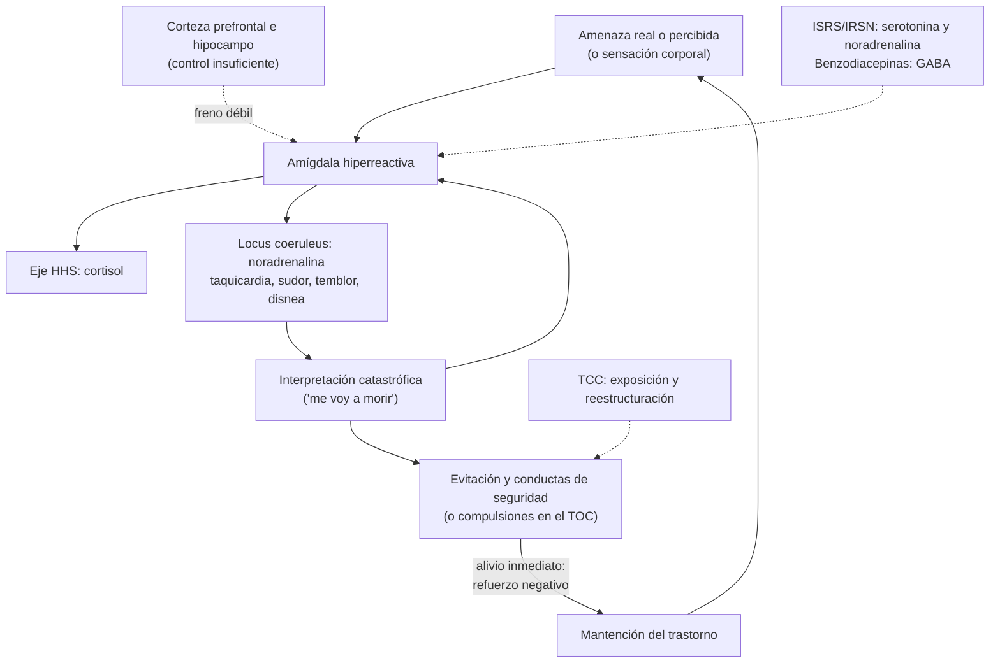

---
tags:
  - Psiquiatría
  - Frecuente en sala
---

# Trastornos de ansiedad y trastorno obsesivo-compulsivo (pánico, agorafobia, fobias, TAG y TOC)

**Subespecialidad**
Psiquiatría · Medicina familiar · Atención primaria

**Guías principales**
WFSBP 2023: tratamiento de los trastornos de ansiedad, TOC y TEPT (versión 3, partes I y II) · CANMAT 2014: trastornos de ansiedad, TEPT y TOC · NICE CG113 (2011, actualizada en 2020): TAG y trastorno de pánico en adultos · USPSTF 2023: tamizaje de ansiedad en adultos · Criterios DSM-5-TR (2022)

**Otras fuentes**
Revisión de los trastornos de ansiedad (Craske y Stein, *Lancet* 2016) · Revisión del TOC (Stein, *Nat Rev Dis Primers* 2019) · Estudio Chileno de Prevalencia Psiquiátrica (Vicente, *Am J Psychiatry* 2006) · GBD 2019 de trastornos mentales (*Lancet Psychiatry* 2022) · Escala GAD-7 (Spitzer 2006) · Ver [depresión](../geriatria/depresion.md) e [hipertiroidismo](../endocrinologia/hipotiroidismo-e-hipertiroidismo.md)

**GES**
No. Se atienden en la APS (Programa de Salud Mental) y en la especialidad si son graves o no responden.

**EUNACOM**
5.01.1.001 Trastorno de pánico con o sin agorafobia (específico, inicial, completo) · 5.01.1.002 Trastorno obsesivo compulsivo (sospecha, inicial, derivar) · 5.01.1.003 Trastornos fóbicos: fobia social y fobia específica (sospecha, inicial, derivar) · 5.01.1.036 Trastorno de ansiedad generalizada (específico, completo, completo)

**Revisado**
Octubre 2026

!!! abstract "Resumen en 60 segundos"
    - La **ansiedad patológica** es **desproporcionada** a la amenaza, **persistente** y **deteriora** la vida diaria. Los trastornos de ansiedad son los trastornos mentales **más frecuentes** (~ **4 %** de la población mundial; el doble en las **mujeres**).
    - **Trastorno de pánico**: **crisis de angustia inesperadas y recurrentes** (síntomas autonómicos que llegan al máximo en **minutos**) + **≥ 1 mes** de miedo a nuevas crisis o cambios de conducta. La **agorafobia** es el miedo a lugares de los que es difícil escapar.
    - **TAG**: preocupación **excesiva y difícil de controlar** sobre **múltiples temas**, **≥ 6 meses**, con tensión muscular, insomnio, irritabilidad y fatiga.
    - **Fobias**: miedo intenso a un **objeto o situación** (fobia específica) o a la **evaluación de los demás** (fobia social), con **evitación**.
    - **TOC**: **obsesiones** (pensamientos intrusivos que generan angustia) y **compulsiones** (actos para neutralizarla). Ya no es un trastorno de ansiedad en el DSM-5: tiene **capítulo propio**.
    - **Antes del diagnóstico**: descartar causas **médicas** (hipertiroidismo, arritmias, hipoglicemia, feocromocitoma, EPOC/asma) y **sustancias** (cafeína, estimulantes, abstinencia de alcohol o benzodiacepinas).
    - **Tratamiento de primera línea**: **terapia cognitivo-conductual (TCC)** y/o **ISRS o IRSN** (sertralina, escitalopram, venlafaxina). Las **benzodiacepinas** solo por **poco tiempo** (puente de 2–4 semanas). En el TOC: **dosis altas de ISRS** + **exposición con prevención de respuesta**.

## Definición

- **Ansiedad**: respuesta emocional normal y adaptativa ante una **amenaza anticipada**. El **miedo** es la respuesta a una amenaza **inminente**.
- **Trastorno de ansiedad**: la ansiedad o el miedo son **excesivos** respecto de la amenaza real, **persistentes** (en general ≥ 6 meses) y causan **malestar significativo o deterioro** funcional (DSM-5-TR).
- **Crisis de angustia** (ataque de pánico): aparición **brusca** de miedo o malestar intenso que llega a su **máximo en minutos**, con **≥ 4 de 13 síntomas**: palpitaciones, sudoración, temblor, sensación de ahogo, asfixia, dolor torácico, náuseas, mareo, escalofríos o calor, parestesias, **desrealización o despersonalización**, miedo a perder el control o "volverse loco", **miedo a morir**. Puede aparecer en cualquier trastorno; no es un diagnóstico por sí sola.
- El **DSM-5** separó el **TOC** (con el trastorno dismórfico corporal, la acumulación, la tricotilomanía y la dermatilomanía) y el **TEPT** (con los trastornos relacionados con traumas y estrés) del capítulo de ansiedad.

## Epidemiología

### Mundial

- Los trastornos de ansiedad son los trastornos mentales **más prevalentes**: **~ 301 millones** de personas en 2019 (GBD 2019), con un aumento importante después de la pandemia de COVID-19.
- Prevalencia de vida **~ 25–30 %** en los estudios poblacionales. **Mujeres : hombres ≈ 2 : 1**.
- **Inicio precoz**: la mayoría comienza en la **infancia, adolescencia o adultez joven** (fobias y ansiedad de separación en la niñez, fobia social en la adolescencia, pánico y TAG en la adultez joven).
- **TOC**: prevalencia de vida **2–3 %**; inicio en la adolescencia o adultez joven (en los hombres, a menudo en la infancia).
- **Comorbilidad** muy frecuente: **depresión** (~ 50 %), **consumo de alcohol y otras sustancias**, otros trastornos de ansiedad y trastornos de personalidad.

### Chile

!!! chile "Datos nacionales"
    - **Estudio Chileno de Prevalencia Psiquiátrica** (Vicente 2006; 2978 personas ≥ 15 años): un **31,5 %** tuvo un trastorno psiquiátrico en la vida y un **22,2 %** en los últimos 12 meses.
    - Los trastornos de vida **más frecuentes** fueron de ansiedad: **agorafobia 11,1 %**, **fobia social 10,2 %** y **fobia simple 9,8 %**, seguidas por la **depresión mayor (9,2 %)** y la **dependencia de alcohol (6,4 %)**.
    - En la APS, los trastornos de ansiedad son un motivo frecuente de consulta y de **licencia médica**. Se atienden en el **Programa de Salud Mental** con psicólogo y médico; derivar a la especialidad los graves, refractarios o con comorbilidad.

## Etiología y factores de riesgo

- **Genética**: heredabilidad **30–50 %**; mayor riesgo en los familiares de primer grado.
- **Temperamento**: **inhibición conductual** en la infancia, **neuroticismo** (afectividad negativa), sensibilidad a la ansiedad (interpretar los síntomas corporales como peligrosos).
- **Ambiente**: **adversidad infantil** (maltrato, abuso, pérdida de los padres), estilos de crianza **sobreprotectores**, eventos vitales estresantes.
- **Sexo femenino**.
- **Enfermedades médicas** crónicas y **consumo de sustancias**.
- **TOC**: genética (heredabilidad ~ 40–50 %), alteración de los circuitos **córtico-estriado-tálamo-corticales**; forma de inicio brusco en niños tras una infección estreptocócica (**PANDAS**/PANS, aún discutida).

## Fisiopatología

- **Circuito del miedo**: la **amígdala** detecta la amenaza y activa el **hipotálamo** (eje **hipotálamo-hipófisis-suprarrenal**, cortisol) y el **tronco** (locus coeruleus, **noradrenalina**: taquicardia, sudoración, temblor).
- La **corteza prefrontal** medial y el **hipocampo** regulan (frenan) esa respuesta según el contexto. En los trastornos de ansiedad, la amígdala está **hiperreactiva** y el control prefrontal es **insuficiente**.
- **Neurotransmisores**: menor tono **GABA** (por eso responden a las benzodiacepinas), alteración de la **serotonina** (base del efecto de los ISRS) y exceso **noradrenérgico**.
- **Pánico**: hipersensibilidad a las señales de **asfixia** (CO₂, lactato) e **interpretación catastrófica** de las sensaciones corporales → círculo vicioso.
- **Aprendizaje**: condicionamiento del miedo y **evitación**, que lo mantiene (refuerzo negativo). La TCC actúa sobre este mecanismo.
- **TOC**: hiperactividad del circuito **corteza orbitofrontal–cíngulo–caudado–tálamo**; las compulsiones alivian la angustia en el corto plazo y la refuerzan en el largo.

*Figura 1. Fisiopatología de los trastornos de ansiedad y del TOC: circuito del miedo, círculo vicioso del pánico y papel de la evitación. Esquema propio basado en Craske y Stein (2016) y Stein (2019).*

## Clasificación

| Trastorno (DSM-5-TR) | Núcleo | Duración |
|---|---|---|
| **Trastorno de pánico** | Crisis de angustia **inesperadas** y recurrentes + preocupación o cambio de conducta | **≥ 1 mes** tras una crisis |
| **Agorafobia** | Miedo y evitación de **≥ 2** situaciones (transporte, espacios abiertos, cerrados, multitudes, salir solo) por temor a no poder escapar o recibir ayuda | ≥ 6 meses |
| **TAG** | **Preocupación excesiva** sobre múltiples temas, difícil de controlar, con ≥ 3 de 6 síntomas | **≥ 6 meses** |
| **Fobia social** (ansiedad social) | Miedo a ser **evaluado negativamente** en situaciones sociales o de desempeño | ≥ 6 meses |
| **Fobia específica** | Miedo a un **objeto o situación** concreta (animales, sangre-inyecciones-heridas, alturas, aviones) | ≥ 6 meses |
| Ansiedad de separación, mutismo selectivo | Más propios de la infancia (ver ansiedad y ánimo en niños y adolescentes) | ≥ 4 semanas en niños |
| Ansiedad **inducida por sustancias** o **debida a otra afección médica** | Causa identificable | Variable |
| **TOC** (capítulo propio) | **Obsesiones** y/o **compulsiones** que consumen **> 1 hora al día** o causan malestar | — |

- **Especificador del TOC según la introspección**: buena, pobre o **ausente** (convicción delirante); y si tiene **tics** (actuales o pasados).
- **CIE-11** usa categorías muy similares; el TOC también está en un grupo propio.

## Clínica

### Trastorno de pánico y agorafobia

- **Crisis**: inicio brusco, máximo en **≤ 10 minutos**, duración habitual **20–30 minutos**. Palpitaciones, dolor torácico, disnea, parestesias (a menudo por **hiperventilación**: alcalosis respiratoria), mareo, **miedo a morir o a volverse loco**.
- Consultas repetidas en el **servicio de urgencia** por "infarto" o "falta de aire", con estudio normal.
- **Ansiedad anticipatoria** (miedo a la próxima crisis) y **evitación**: deja de manejar, de usar el metro, de salir solo → **agorafobia** (puede llegar a no salir de la casa).

### Trastorno de ansiedad generalizada

- Preocupación **constante** ("me preocupo por todo"): salud, trabajo, dinero, familia, cosas menores.
- **≥ 3 de 6 síntomas**: inquietud, **fatiga**, dificultad para concentrarse, **irritabilidad**, **tensión muscular** (cefalea tensional, cervicalgia, bruxismo), **insomnio**.
- Muchos consultan por **síntomas somáticos** (cefalea, molestias digestivas, colon irritable, insomnio) y no por "ansiedad".

### Fobias

- **Fobia social**: miedo a hablar en público, comer o escribir frente a otros, conocer gente; síntomas visibles (**rubor**, temblor, sudor) que aumentan el miedo. Evitación de estudios y trabajos. Riesgo de **consumo de alcohol** como "automedicación".
- **Fobia específica**: el contacto con el estímulo provoca ansiedad inmediata (a veces una crisis). La de **sangre-inyecciones-heridas** produce una respuesta **vasovagal** (bradicardia y **síncope**), a diferencia de las demás.

### Trastorno obsesivo-compulsivo

- **Obsesiones** (egodistónicas: el paciente las reconoce como propias pero absurdas o excesivas): **contaminación**, **dudas** (¿cerré la puerta?), **simetría** u orden, pensamientos **agresivos, sexuales o religiosos** intrusivos (miedo a dañar a otros).
- **Compulsiones**: **lavado**, **verificación**, orden, conteo, repetición, rituales mentales (rezar, contar).
- Consume horas, genera **evitación** y deterioro. Los pacientes suelen **ocultarlo** por vergüenza: preguntar directamente.
- Pista en medicina general: **dermatitis de las manos** por lavado excesivo.

!!! alarma "Signos de alarma"
    - **Ideación suicida** (el riesgo aumenta con la **depresión comórbida**, el pánico y el consumo de alcohol).
    - **Primer episodio de "pánico" después de los 45 años**, con síntomas **atípicos** (síncope, déficit neurológico, dolor torácico de esfuerzo) o alteraciones al examen: buscar una **causa médica** (SCA, arritmia, TEP, hipoglicemia, feocromocitoma).
    - **Consumo de alcohol o benzodiacepinas** en aumento para controlar la ansiedad.
    - **TOC con introspección ausente** o síntomas **psicóticos**: derivar.

## Diagnóstico

!!! guia "Puntos clave (DSM-5-TR; USPSTF 2023; NICE CG113; WFSBP 2023)"
    - El diagnóstico es **clínico**, con los criterios **DSM-5-TR** o **CIE-11**. Preguntar por la **duración**, el **deterioro** funcional y la **evitación**.
    - **Tamizaje**: la **USPSTF 2023** recomienda tamizar la ansiedad en los adultos **≤ 64 años** (incluidas las embarazadas y puérperas). Usar el **GAD-2** (2 preguntas) y, si es positivo, el **GAD-7** (≥ 10 puntos sugiere un trastorno de ansiedad; 5, 10 y 15 = leve, moderado y grave).
    - **Siempre**:
        - Descartar **causas médicas** y **sustancias** (historia, examen, exámenes dirigidos).
        - Buscar **depresión**, **consumo de alcohol** y **riesgo suicida**.
    - En el TOC, preguntar con tacto: "¿Tiene pensamientos que no puede sacarse de la cabeza aunque intente? ¿Tiene que lavarse o revisar cosas una y otra vez?". Escala de gravedad: **Y-BOCS** (Yale-Brown).

## Laboratorio

No hay exámenes que confirmen el diagnóstico. Se piden para **descartar causas médicas**, según la clínica:

| Examen | Qué busca |
|---|---|
| **TSH** (y T4 libre) | **Hipertiroidismo** |
| **Glicemia** | Hipoglicemia |
| **Hemograma** | Anemia |
| **Electrolitos, calcio** | Hipocalcemia, hiponatremia |
| **ECG** | Arritmias (TPSV, FA), preexcitación, QT largo; en el dolor torácico, isquemia |
| Tóxicos en orina | Estimulantes (cocaína, anfetaminas), cannabis |
| Metanefrinas plasmáticas o urinarias | **Feocromocitoma** (crisis con HTA, cefalea y sudoración) |
| Troponina | Dolor torácico sugerente de SCA |

## Imágenes

- **No** se requieren en el estudio habitual.
- **Neuroimagen** solo si hay síntomas neurológicos, inicio tardío atípico o, en el TOC, un inicio tardío o brusco (lesiones de los **ganglios basales**).
- Radiografía de tórax o angio-TC según el diagnóstico diferencial (por ejemplo, **TEP** en una disnea súbita con factores de riesgo).

## Diagnóstico diferencial

| Grupo | Ejemplos |
|---|---|
| **Endocrinológico** | **Hipertiroidismo**, **hipoglicemia** (insulinoma, fármacos), **feocromocitoma**, hiperparatiroidismo, síndrome de Cushing |
| **Cardiovascular** | **Arritmias** (TPSV, FA), **SCA**, prolapso mitral, insuficiencia cardíaca |
| **Respiratorio** | **Asma**, **EPOC**, **TEP**, hipoxemia |
| **Neurológico** | **Epilepsia del lóbulo temporal**, crisis vestibulares, migraña, ataque isquémico transitorio |
| **Sustancias** | **Cafeína**, **cocaína**, anfetaminas, **cannabis**, **abstinencia de alcohol o benzodiacepinas**, corticoides, salbutamol, levotiroxina en exceso, descongestionantes |
| **Psiquiátrico** | **Depresión** (la ansiedad es muy frecuente en ella), TEPT, **trastorno bipolar**, psicosis (ideas delirantes frente a obsesiones), trastorno de síntomas somáticos y **ansiedad por la enfermedad** |
| **TOC frente a** | **Trastorno de personalidad obsesivo-compulsiva** (rasgos **egosintónicos**: perfeccionismo y rigidez sin obsesiones ni compulsiones verdaderas), **tics** y Tourette, rumiación depresiva, ideas delirantes |

## Tratamiento

### Principios generales

- **Psicoeducación**: explicar que los síntomas son reales, frecuentes y **tratables**, y el círculo vicioso de la evitación.
- **Medidas generales**: **reducir la cafeína**, el alcohol y el tabaco; **actividad física** regular; **higiene del sueño**; técnicas de **relajación** y respiración.
- **Primera línea** (WFSBP 2023; CANMAT 2014; NICE): **TCC** y/o **ISRS o IRSN**. La combinación puede ser más eficaz en los casos moderados a graves.
- La TCC incluye **exposición** gradual (en vivo o imaginada) a lo temido, **reestructuración cognitiva** y, en el TOC, **exposición con prevención de respuesta** (EPR).

### Farmacoterapia

- **ISRS** (sertralina, escitalopram, fluoxetina, paroxetina) o **IRSN** (venlafaxina, duloxetina) en **todos** los trastornos de ansiedad.
- **Empezar con dosis bajas** (la mitad de la dosis antidepresiva) en el **pánico**: al inicio pueden **aumentar** la ansiedad ("activación").
- **Latencia**: efecto en **2–6 semanas**; respuesta completa en **8–12 semanas** (más en el TOC).
- **Duración**: mantener **≥ 6–12 meses** después de la respuesta y retirar **gradualmente** (síndrome de discontinuación, sobre todo con la paroxetina y la venlafaxina).
- **Benzodiacepinas**: rápidas y eficaces, pero con **tolerancia, dependencia**, deterioro cognitivo, **caídas** (adulto mayor) y riesgo con alcohol u opioides. Solo como **puente** las primeras **2–4 semanas** mientras actúa el ISRS, o en crisis puntuales. **Evitarlas** en el consumo de sustancias, el adulto mayor y la EPOC grave. No sirven en el TOC.
- **Pregabalina**: aprobada en Europa para el **TAG** (primera línea en la WFSBP).
- **Buspirona**: alternativa en el TAG; latencia larga; no sirve en el pánico.
- **Propranolol**: solo para la **ansiedad de desempeño** puntual (hablar en público), 30–60 minutos antes. No sirve en la fobia social generalizada.
- **TOC**: **ISRS en dosis altas** (fluoxetina 40–80 mg, sertralina 150–200 mg) por **≥ 8–12 semanas** antes de cambiar. Si no responde: **clomipramina** o potenciar con **antipsicóticos atípicos** en dosis bajas (risperidona, aripiprazol) por especialista.

!!! dosis "Dosis habituales en el adulto"
    | Fármaco | Dosis inicial | Dosis habitual | Comentario |
    |---|---|---|---|
    | **Sertralina** | 25 mg/día (pánico) o 50 mg/día | **50–200 mg/día** | Primera línea; segura en cardiopatía y en el embarazo |
    | **Escitalopram** | 5 mg/día (pánico) o 10 mg/día | **10–20 mg/día** | Máximo 10 mg en > 65 años (QT) |
    | **Fluoxetina** | 10–20 mg/día | 20–60 mg/día (TOC hasta 80 mg) | Vida media larga, sin discontinuación |
    | **Paroxetina** | 10 mg/día | 20–60 mg/día | Más sedante, anticolinérgica y con más discontinuación; evitar en el embarazo |
    | **Venlafaxina XR** | 37,5 mg/día | **75–225 mg/día** | Controlar la PA |
    | **Duloxetina** | 30 mg/día | 60–120 mg/día | Útil si hay dolor crónico |
    | **Pregabalina** | 75 mg c/12 h | 150–600 mg/día | TAG; ajustar a la función renal; abuso potencial |
    | **Clonazepam** | 0,25–0,5 mg c/12 h | 0,5–2 mg/día | **Puente 2–4 semanas**; retirar en 25 % cada 1–2 semanas |
    | **Propranolol** | 10–40 mg | Dosis única antes del evento | Ansiedad de desempeño; contraindicado en el asma |
    | **Clomipramina** | 25 mg/día | 100–250 mg/día | TOC refractario; ECG (tricíclico) |

### Manejo de la crisis de angustia en la urgencia

1. **Descartar** una causa médica según la edad y los factores de riesgo (ECG, glicemia capilar, saturación; troponina si corresponde).
2. **Ambiente tranquilo**, explicar que **no es un infarto** y que la crisis cede sola.
3. **Respiración** lenta y diafragmática (no usar la bolsa de papel: riesgo de hipoxemia si la causa es orgánica).
4. Si no cede: **benzodiacepina oral** en dosis única (por ejemplo, **clonazepam 0,5 mg** o lorazepam 1 mg).
5. **Al alta**: derivar a la APS para TCC e ISRS; **no** dejar benzodiacepinas por tiempo indefinido.

!!! alarma "Derivar a psiquiatría"
    - TOC (casi siempre), fobia social grave, refractariedad a **2 tratamientos** adecuados.
    - **Riesgo suicida**, comorbilidad con trastorno bipolar, psicosis o consumo de sustancias.
    - Embarazo con síntomas graves.

## Complicaciones

- **Depresión** secundaria (frecuente) y **suicidio** (el riesgo aumenta con la comorbilidad).
- **Consumo de alcohol** y **dependencia de benzodiacepinas**.
- **Agorafobia** discapacitante, deterioro **laboral, académico** y social.
- **Uso excesivo de servicios de salud** y estudios innecesarios.
- Mayor riesgo **cardiovascular** a largo plazo (asociación con la ansiedad crónica).

## Pronóstico y seguimiento

- Tienden a la **cronicidad** con **fluctuaciones** si no se tratan; con tratamiento, **50–70 %** responde.
- **Recaídas** frecuentes si se suspende el fármaco antes de tiempo.
- **Control** en la APS: cada **2–4 semanas** al inicio (adherencia, efectos adversos, **ideación suicida** en los < 25 años que inician antidepresivos) y luego cada 1–3 meses. Medir con **GAD-7** o PDSS (pánico).
- El TOC suele ser **crónico**; el 40–60 % responde al tratamiento combinado.

## Perlas para el internado

!!! perla "Para recordar en la sala y el turno"
    - **Crisis de pánico**: máximo en **minutos** y cede en 20–30 minutos. Si dura horas, **no es pánico**.
    - Antes de decir "es ansiedad": **TSH**, **glicemia**, **ECG** y preguntar por **cafeína**, estimulantes y **abstinencia** de alcohol o benzodiacepinas.
    - **ISRS en el pánico**: empezar con **la mitad** de la dosis y avisar que la primera semana puede aumentar la ansiedad.
    - Las **benzodiacepinas** son un **puente**, no el tratamiento. Evitarlas en el adulto mayor y en quien consume alcohol.
    - **TOC**: obsesiones **egodistónicas** (las reconoce absurdas). En la **personalidad obsesiva** el perfeccionismo es **egosintónico**.
    - La fobia a la **sangre** produce **síncope vasovagal**; las demás fobias, taquicardia.
    - **Fobia social** + alcohol: preguntar siempre por el consumo.

## Preguntas de repaso

??? repaso "1. Mujer de 28 años consulta por tercera vez en la urgencia por palpitaciones, sensación de ahogo, hormigueo en las manos y miedo a morir, que llegan al máximo en 5 minutos y ceden en 30. Ahora evita viajar en metro. ECG, glicemia y TSH normales. ¿Diagnóstico y tratamiento?"
    **Trastorno de pánico con agorafobia**: crisis inesperadas y recurrentes con miedo a nuevas crisis y evitación. Tratamiento: **psicoeducación**, **TCC** (exposición) y un **ISRS** en dosis baja (por ejemplo, **sertralina 25 mg/día**, subir a 50–100 mg en 1–2 semanas). Puede usarse **clonazepam** por 2–4 semanas como puente. Mantener el ISRS 6–12 meses tras la respuesta.

??? repaso "2. Hombre de 40 años con 1 año de preocupación constante por el trabajo, la salud de sus hijos y las deudas, tensión cervical, insomnio de conciliación e irritabilidad. GAD-7: 14. ¿Qué tiene y cómo lo trata?"
    **Trastorno de ansiedad generalizada** moderado (preocupación excesiva por múltiples temas por ≥ 6 meses con ≥ 3 síntomas). Descartar hipertiroidismo, cafeína y alcohol, y buscar depresión. Tratamiento: **TCC** y/o **ISRS** (escitalopram 10 mg) o **IRSN** (venlafaxina XR 75 mg), medidas generales y control en 2–4 semanas.

??? repaso "3. Estudiante de 22 años que se lava las manos 40 veces al día por miedo a contagiarse y sabe que es exagerado. Tiene las manos agrietadas y llega tarde a clases. ¿Diagnóstico y conducta?"
    **TOC** con buena introspección (obsesión de **contaminación** y compulsión de **lavado** que consume > 1 hora al día). Conducta: iniciar un **ISRS** en dosis que se suben hasta las **altas** (fluoxetina hasta 60–80 mg o sertralina 150–200 mg), por al menos 8–12 semanas, y **derivar a psiquiatría** para **exposición con prevención de respuesta**.

??? repaso "4. Hombre de 55 años, fumador e hipertenso, consulta por su primera 'crisis de pánico' con dolor torácico opresivo de esfuerzo. ¿Qué hace?"
    Un primer episodio después de los 45 años y con dolor de esfuerzo es una **causa médica hasta demostrar lo contrario**: **ECG**, **troponina** y estudio de **síndrome coronario agudo**. No atribuirlo a ansiedad sin descartar lo orgánico.

??? repaso "5. Paciente de 30 años con miedo intenso a hablar en reuniones de trabajo; evita presentaciones y está por perder su empleo. Bebe alcohol antes de los eventos sociales. ¿Diagnóstico y tratamiento?"
    **Fobia social** (ansiedad social) con **consumo de alcohol** como automedicación. Tratamiento: **TCC** (exposición) e **ISRS** (sertralina o escitalopram) o venlafaxina; evaluar el consumo de alcohol (AUDIT). El **propranolol** solo sirve para la ansiedad de desempeño puntual, no para la fobia social generalizada.

??? repaso "6. ¿Por qué no se recomienda tratar el TAG solo con benzodiacepinas?"
    Porque generan **tolerancia, dependencia** y síndrome de **abstinencia**, deterioro cognitivo y psicomotor, **caídas** en el adulto mayor y riesgo de depresión respiratoria con alcohol u opioides, y **no tratan la depresión** comórbida. Se usan solo como **puente** breve mientras actúan los ISRS o IRSN y la TCC.

## Referencias

1. Bandelow B, Allgulander C, Baldwin DS, et al. World Federation of Societies of Biological Psychiatry (WFSBP) guidelines for treatment of anxiety, obsessive-compulsive and posttraumatic stress disorders – Version 3. Part I: Anxiety disorders. *World J Biol Psychiatry.* 2023;24(2):79–117. doi:[10.1080/15622975.2022.2086295](https://doi.org/10.1080/15622975.2022.2086295)
2. Bandelow B, Allgulander C, Baldwin DS, et al. World Federation of Societies of Biological Psychiatry (WFSBP) guidelines for treatment of anxiety, obsessive-compulsive and posttraumatic stress disorders – Version 3. Part II: OCD and PTSD. *World J Biol Psychiatry.* 2023;24(2):118–134. doi:[10.1080/15622975.2022.2086296](https://doi.org/10.1080/15622975.2022.2086296)
3. Katzman MA, Bleau P, Blier P, et al. Canadian clinical practice guidelines for the management of anxiety, posttraumatic stress and obsessive-compulsive disorders. *BMC Psychiatry.* 2014;14(Suppl 1):S1. doi:[10.1186/1471-244X-14-S1-S1](https://doi.org/10.1186/1471-244X-14-S1-S1)
4. National Institute for Health and Care Excellence. Generalised anxiety disorder and panic disorder in adults: management. Clinical guideline CG113. Londres: NICE; 2011 (actualizada en 2020). [nice.org.uk](https://www.nice.org.uk/guidance/cg113)
5. US Preventive Services Task Force; Barry MJ, Nicholson WK, Silverstein M, et al. Screening for anxiety disorders in adults: US Preventive Services Task Force recommendation statement. *JAMA.* 2023;329(24):2163–2170. doi:[10.1001/jama.2023.9301](https://doi.org/10.1001/jama.2023.9301)
6. Craske MG, Stein MB. Anxiety. *Lancet.* 2016;388(10063):3048–3059. doi:[10.1016/S0140-6736(16)30381-6](https://doi.org/10.1016/S0140-6736(16)30381-6)
7. Stein DJ, Costa DLC, Lochner C, et al. Obsessive-compulsive disorder. *Nat Rev Dis Primers.* 2019;5(1):52. doi:[10.1038/s41572-019-0102-3](https://doi.org/10.1038/s41572-019-0102-3)
8. Vicente B, Kohn R, Rioseco P, et al. Lifetime and 12-month prevalence of DSM-III-R disorders in the Chile psychiatric prevalence study. *Am J Psychiatry.* 2006;163(8):1362–1370. doi:[10.1176/ajp.2006.163.8.1362](https://doi.org/10.1176/ajp.2006.163.8.1362)
9. GBD 2019 Mental Disorders Collaborators. Global, regional, and national burden of 12 mental disorders in 204 countries and territories, 1990–2019: a systematic analysis for the Global Burden of Disease Study 2019. *Lancet Psychiatry.* 2022;9(2):137–150. doi:[10.1016/S2215-0366(21)00395-3](https://doi.org/10.1016/S2215-0366(21)00395-3)
10. Spitzer RL, Kroenke K, Williams JBW, et al. A brief measure for assessing generalized anxiety disorder: the GAD-7. *Arch Intern Med.* 2006;166(10):1092–1097. doi:[10.1001/archinte.166.10.1092](https://doi.org/10.1001/archinte.166.10.1092)
11. American Psychiatric Association. *Diagnostic and Statistical Manual of Mental Disorders, Fifth Edition, Text Revision (DSM-5-TR).* Washington, DC: APA; 2022.
