---
tags:
  - Psiquiatría
---

# Trastornos de la personalidad (y concepto, medición y teorías de la personalidad)

**Subespecialidad**
Psiquiatría · Psicología clínica

**Guías principales**
APA 2024: guía de práctica clínica del trastorno límite de la personalidad (2.ª edición) · NICE CG78 (2009): trastorno límite de la personalidad · Criterios DSM-5-TR (2022) y modelo dimensional de la CIE-11

**Otras fuentes**
Tratamiento de los trastornos de la personalidad (Bateman, *Lancet* 2015) · Revisión del trastorno límite (Gunderson, *Nat Rev Dis Primers* 2018) · Revisión Cochrane de psicoterapias en el trastorno límite (Storebø 2020) · Prevalencia mundial de los trastornos de la personalidad (Winsper, *Br J Psychiatry* 2020) · Ver [conducta suicida](conducta-suicida.md), [trastorno bipolar](trastorno-bipolar.md), [consumo de sustancias](consumo-de-alcohol-tabaco-y-drogas.md) y [trastornos relacionados con traumas](trastornos-relacionados-con-traumas-y-estres.md)

**GES**
No.

**EUNACOM**
5.01.1.016 Trastornos de la personalidad (sospecha, inicial, derivar) · 5.01.3.010 Personalidad: concepto y medición; principales teorías en psicología de la personalidad

**Revisado**
Octubre 2026

!!! abstract "Resumen en 60 segundos"
    - **Personalidad**: patrón **estable** de pensar, sentir, relacionarse y actuar. Resulta del **temperamento** (biológico, heredado) y el **carácter** (aprendido).
    - **Trastorno de la personalidad**: patrón **rígido, desadaptativo y persistente**, que se aparta de lo esperable en su cultura, se inicia en la **adolescencia o adultez temprana**, es **estable** y causa malestar o **deterioro**. Suele ser **egosintónico** (la persona no lo vive como ajeno).
    - Prevalencia **~ 8 %** de la población general; mucho mayor en los consultantes psiquiátricos.
    - **DSM-5-TR**: 10 trastornos en 3 **grupos**: **A** "raros o excéntricos" (paranoide, esquizoide, esquizotípico), **B** "dramáticos, emocionales o erráticos" (antisocial, **límite**, histriónico, narcisista) y **C** "ansiosos o temerosos" (evitativo, dependiente, obsesivo-compulsivo). La **CIE-11** usa un modelo **dimensional** (gravedad + rasgos).
    - **Trastorno límite (TLP)**: inestabilidad de las **relaciones**, de la **autoimagen** y del **afecto**, **impulsividad**, miedo al abandono, **autolesiones** y conducta suicida recurrentes (~ 5–10 % muere por suicidio).
    - **Tratamiento**: **psicoterapia estructurada** (terapia **dialéctico-conductual**, terapia basada en la **mentalización**). Los **fármacos no** son el tratamiento principal: solo para comorbilidades o síntomas puntuales y por poco tiempo; evitar las **benzodiacepinas** y la polifarmacia.
    - Diagnosticar con cautela en **adolescentes** y fuera de las crisis; descartar trastornos del ánimo, TEPT, consumo y causas orgánicas (cambio de personalidad por lesión frontal).

## Definición

- **Personalidad**: organización **dinámica** y **relativamente estable** de las características psicológicas (cognitivas, afectivas, conductuales) que hacen **única** a una persona y determinan su forma de adaptarse al ambiente.
    - **Temperamento**: componente **heredado**, biológico, visible desde la infancia (reactividad emocional, nivel de actividad).
    - **Carácter**: componente **adquirido** por el aprendizaje, la cultura y las relaciones.
    - **Rasgos**: disposiciones estables a responder de cierta manera (por ejemplo, extraversión).
- **Trastorno de la personalidad** (DSM-5-TR): patrón **perdurable** de experiencia interna y comportamiento que se aparta de las expectativas de la cultura, en **≥ 2** áreas: **cognición** (percepción de sí y de los demás), **afectividad**, **funcionamiento interpersonal** y **control de impulsos**. Es **inflexible**, **generalizado**, **estable**, de inicio en la **adolescencia o adultez temprana**, y causa **malestar** o **deterioro**.
- **Egosintónico**: los rasgos se viven como propios y razonables (la persona atribuye los problemas a otros). **Egodistónico**: se viven como ajenos y molestos (como las obsesiones del TOC).

## Epidemiología

### Mundial

- Prevalencia de **cualquier trastorno de la personalidad** en la comunidad **~ 7,8 %** (Winsper 2020); mayor en los países de ingresos altos.
- **Por grupo**: A ~ 3,8 %, B ~ 2,8 %, C ~ 5,0 %.
- **TLP**: **1–2 %** de la población general, **~ 10 %** de los pacientes ambulatorios psiquiátricos y **~ 20 %** de los hospitalizados; diagnosticado más en **mujeres** en la clínica (en la comunidad, similar por sexo).
- **Trastorno antisocial**: más en **hombres** (~ 3 : 1); muy frecuente en la población **penitenciaria**.
- **Comorbilidad** muy alta con depresión, ansiedad, consumo de sustancias, TCA y TEPT.

### Chile

!!! chile "Datos nacionales"
    - No hay estudios poblacionales recientes de prevalencia; en los servicios de salud mental el **TLP** es un motivo frecuente de consulta en la **urgencia** por **autolesiones** e intentos de suicidio.
    - Los trastornos de personalidad **no son GES**; se atienden en los **COSAM** y en los equipos de especialidad. La **terapia dialéctico-conductual** se ha ido incorporando en algunos centros públicos y universitarios.

## Etiología y factores de riesgo

- **Genética**: heredabilidad de los rasgos de **~ 40–60 %** (por ejemplo, impulsividad y afectividad negativa).
- **Temperamento** vulnerable (alta reactividad emocional, impulsividad).
- **Experiencias tempranas adversas**: **abuso sexual o físico**, negligencia, **invalidación emocional**, apego inseguro o desorganizado, pérdidas precoces (muy relevantes en el TLP y el antisocial).
- **Trastorno de conducta** en la infancia (precursor del antisocial).
- **Modelo biosocial** del TLP (Linehan): vulnerabilidad emocional biológica + **ambiente invalidante** → desregulación emocional.

## Fisiopatología

- No hay una fisiopatología única; se integran el **temperamento**, el **aprendizaje** y el **apego**.
- **TLP**: hiperreactividad de la **amígdala** a los estímulos emocionales y control **prefrontal** insuficiente (desregulación emocional); alteración de la **mentalización** (capacidad de entender los estados mentales propios y ajenos); sistema de **recompensa** e impulsividad.
- **Antisocial**: baja reactividad autonómica al miedo y al castigo, déficit de **empatía**.
- **Esquizotípico**: comparte vulnerabilidad genética con la **esquizofrenia** (espectro).

```mermaid
flowchart TD
    A["Temperamento heredado<br/>(reactividad emocional, impulsividad)"] --> C["Rasgos de personalidad"]
    B["Ambiente: apego, crianza,<br/>trauma, invalidación, cultura"] --> C
    C --> D{"¿Rígidos, generalizados<br/>y desadaptativos?"}
    D -->|"no"| E["Personalidad normal<br/>(estilo adaptativo)"]
    D -->|"sí"| F["Trastorno de la personalidad<br/>(egosintónico, desde la adolescencia)"]
    F --> G["Grupo A: raros o excéntricos"]
    F --> H["Grupo B: dramáticos, emocionales"]
    F --> I["Grupo C: ansiosos o temerosos"]
    H --> J["TLP: desregulación emocional,<br/>impulsividad, autolesiones"]
    K["Psicoterapia estructurada<br/>(DBT, mentalización)"] -.-> J
```

*Figura 1. Desarrollo de la personalidad y de sus trastornos. Esquema propio basado en Bateman (2015) y Gunderson (2018).*

## Clasificación

### Concepto, teorías y medición de la personalidad

| Enfoque | Autores | Ideas centrales |
|---|---|---|
| **Psicodinámico** | **Freud**; Erikson, Kernberg | Estructura **ello–yo–superyó**; conflictos inconscientes; **mecanismos de defensa**; organización de la personalidad **neurótica, límite o psicótica** (Kernberg) |
| **Conductual** | Skinner, Bandura | La conducta se **aprende** por condicionamiento y **modelado** (aprendizaje social) |
| **Cognitivo** | Beck, Kelly | **Esquemas** y creencias nucleares sobre sí mismo y los demás |
| **Humanista** | **Rogers**, **Maslow** | Tendencia a la **autorrealización**; jerarquía de necesidades; aceptación incondicional |
| **De rasgos** | Allport, **Cattell** (16 factores), **Eysenck** (extraversión, neuroticismo, psicoticismo) | La personalidad se describe con **dimensiones** medibles |
| **Cinco grandes factores** (*Big Five*, OCEAN) | **Costa y McCrae** | **Apertura**, **Responsabilidad**, **Extraversión**, **Amabilidad** y **Neuroticismo**; base de los modelos dimensionales actuales |
| **Psicobiológico** | **Cloninger** | **Temperamento** (búsqueda de novedad, evitación del daño, dependencia de la recompensa, persistencia) y **carácter** (autodirección, cooperación, autotrascendencia) |

**Mecanismos de defensa** (Freud y Vaillant), de los más inmaduros a los más maduros:

| Nivel | Ejemplos |
|---|---|
| **Psicóticos** | Negación psicótica, distorsión, proyección delirante |
| **Inmaduros** | **Proyección**, **escisión** (*splitting*: todo bueno o todo malo; típica del TLP), **actuación** (*acting out*), idealización y devaluación, fantasía esquizoide, identificación proyectiva |
| **Neuróticos** | **Represión**, **desplazamiento**, **formación reactiva**, **racionalización**, **intelectualización**, aislamiento del afecto |
| **Maduros** | **Sublimación**, **humor**, **altruismo**, **anticipación**, supresión |

**Medición de la personalidad**:

- **Entrevista clínica** (la base) e información de **terceros**; entrevistas estructuradas (**SCID-5-PD**, IPDE).
- **Inventarios objetivos (autorreporte)**: **MMPI-2** (Minnesota, el más usado en clínica y peritajes), **NEO-PI-R** (cinco factores), **16PF** (Cattell), **EPQ** (Eysenck), **MCMI** (Millon).
- **Técnicas proyectivas**: **Rorschach** (manchas de tinta), **TAT** (test de apercepción temática), dibujo de la figura humana. Más subjetivas.

### Trastornos de la personalidad (DSM-5-TR)

| Grupo | Trastorno | Rasgo central | Claves |
|---|---|---|---|
| **A** (raros) | **Paranoide** | **Desconfianza** y suspicacia | Interpreta las intenciones de otros como malévolas, rencoroso, celos |
| | **Esquizoide** | **Desapego** social, afecto restringido | Solitario, indiferente al elogio o la crítica; no desea relaciones |
| | **Esquizotípico** | **Excentricidad**, ideas de referencia, pensamiento mágico | Creencias raras, experiencias perceptivas inusuales, ansiedad social; espectro de la esquizofrenia |
| **B** (dramáticos) | **Antisocial** | **Desprecio** y violación de los derechos de otros | ≥ 18 años con **trastorno de conducta antes de los 15**; engaño, impulsividad, agresividad, **falta de remordimiento** |
| | **Límite** | **Inestabilidad** afectiva, de la autoimagen y de las relaciones; impulsividad | Ver abajo |
| | **Histriónico** | **Búsqueda de atención**, emotividad excesiva | Seductor, dramático, sugestionable, emociones superficiales |
| | **Narcisista** | **Grandiosidad**, necesidad de **admiración**, falta de **empatía** | Arrogante, explotador, envidioso; vulnerable a la crítica |
| **C** (ansiosos) | **Evitativo** | **Inhibición** social, sentimientos de inferioridad, **hipersensibilidad** a la crítica | **Desea** relaciones pero las evita por miedo al rechazo (a diferencia del esquizoide) |
| | **Dependiente** | Necesidad excesiva de **ser cuidado** | Sumiso, dificultad para decidir, miedo a la separación |
| | **Obsesivo-compulsivo** | **Perfeccionismo**, orden, **control**, rigidez | Egosintónico, sin obsesiones ni compulsiones verdaderas (distinto del TOC) |

- **CIE-11**: un único **trastorno de la personalidad** clasificado por **gravedad** (leve, moderado, grave) y por **dominios de rasgos** (afectividad negativa, desapego, disocialidad, desinhibición, anancasmo) más un **especificador de patrón límite**. El **DSM-5-TR** ofrece un modelo alternativo dimensional similar en la sección III.

## Clínica

### Trastorno límite de la personalidad (≥ 5 de 9 criterios DSM-5-TR)

1. Esfuerzos frenéticos para **evitar el abandono** real o imaginado.
2. Relaciones **intensas e inestables**, entre la **idealización** y la **devaluación**.
3. **Alteración de la identidad**: autoimagen inestable.
4. **Impulsividad** dañina en ≥ 2 áreas (gastos, sexo, sustancias, conducción, atracones).
5. **Conducta suicida** o **autolesiones** recurrentes.
6. **Inestabilidad afectiva** por una reactividad marcada del ánimo (episodios de **horas**, rara vez días).
7. Sentimientos crónicos de **vacío**.
8. **Ira** intensa e inapropiada o difícil de controlar.
9. Ideación **paranoide** transitoria o síntomas **disociativos** graves ligados al estrés.

### En la sala y la urgencia

- Los pacientes con trastornos de personalidad generan **reacciones intensas** en el equipo (rechazo, rescate, divisiones: "*splitting*" del equipo). Mantener una actitud **consistente**, límites claros, **validación** y un plan acordado.
- **TLP en la urgencia**: autolesiones, intoxicaciones medicamentosas, crisis tras conflictos interpersonales. Evaluar el **riesgo suicida** cada vez (no "es solo para llamar la atención").
- **Narcisista o antisocial**: conflictos con el equipo, exigencias, manipulación; buscar consumo de sustancias.
- **Obsesivo-compulsivo**: rígido con los horarios y el tratamiento, perfeccionista, dificultad para delegar.

!!! alarma "Signos de alarma"
    - **Ideación o intento suicida**, autolesiones graves.
    - **Consumo** de sustancias e **intoxicaciones** repetidas.
    - **Heteroagresividad** (antisocial, TLP con ira intensa).
    - **Síntomas psicóticos** persistentes (no transitorios): pensar en otro diagnóstico.
    - **Cambio de personalidad** de inicio en la adultez: buscar una **causa orgánica**.

## Diagnóstico

!!! guia "Puntos clave (DSM-5-TR; APA 2024)"
    - Diagnóstico **clínico** y **longitudinal**: el patrón debe ser **estable** y presente desde la adolescencia o adultez temprana. Usar información de **terceros**.
    - Evitar diagnosticar **en plena crisis** o durante un episodio afectivo, una intoxicación o una psicosis (los rasgos se exageran).
    - En **< 18 años** se puede diagnosticar si los rasgos persisten **≥ 1 año** (salvo el **antisocial**, que requiere ser **≥ 18 años**). La APA 2024 recomienda **no retrasar** el diagnóstico del TLP en adolescentes cuando se cumplen los criterios, porque permite un tratamiento específico.
    - **Comunicar** el diagnóstico con respeto y explicar que es **tratable** y que muchos mejoran.
    - Evaluar siempre el **riesgo suicida**, el **consumo** y la **comorbilidad** (depresión, bipolar, TEPT, TDAH, TCA).

## Laboratorio

- No hay exámenes diagnósticos.
- Según la clínica: **tóxicos** (consumo), **TSH**, hemograma, y estudio de causas orgánicas si el cambio es de inicio tardío.

## Imágenes

- **Neuroimagen** solo si el **cambio de personalidad** aparece en la **adultez** o hay signos neurológicos (tumor frontal, TEC, demencia frontotemporal, enfermedad de Huntington).

## Diagnóstico diferencial

| Diagnóstico | Diferencia |
|---|---|
| **Trastorno bipolar** | Episodios de **días o semanas** de cambio del ánimo, energía y sueño; en el TLP, cambios en **horas** reactivos a lo interpersonal |
| **Depresión mayor**, **ansiedad** | Episódicos, egodistónicos; pueden coexistir |
| **TEPT complejo** | Trauma prolongado, desregulación emocional; se superpone con el TLP |
| **Esquizofrenia** | Psicosis **persistente** (frente a los síntomas transitorios del TLP o del esquizotípico) |
| **TOC** | Obsesiones y compulsiones **egodistónicas** (frente al perfeccionismo **egosintónico** del trastorno obsesivo-compulsivo de la personalidad) |
| **Fobia social** | Se superpone con el evitativo (a menudo coexisten) |
| **Consumo de sustancias** | Conductas antisociales o impulsivas solo durante el consumo |
| **TDAH** del adulto | Impulsividad y desatención desde la infancia |
| **Cambio de personalidad debido a otra afección médica** | Lesión **frontal**, TEC, epilepsia, demencia frontotemporal: inicio en la adultez |
| **TEA** del adulto | Dificultades de comunicación social y conductas restringidas desde la infancia (confundibles con el esquizoide) |

## Tratamiento

!!! guia "Trastorno límite de la personalidad (APA 2024; Storebø 2020)"
    - **Psicoterapia estructurada** como tratamiento **principal**, con un enfoque específico:
        - **Terapia dialéctico-conductual** (DBT, Linehan): habilidades de **regulación emocional**, tolerancia al malestar, efectividad interpersonal y *mindfulness*; reduce las **autolesiones** y la conducta suicida.
        - **Terapia basada en la mentalización** (MBT), terapia focalizada en la transferencia, terapia de esquemas, STEPPS.
    - **Manejo psiquiátrico general** (*good psychiatric management*) cuando no hay acceso a terapias especializadas: psicoeducación, plan de crisis, foco en la vida interpersonal y laboral.
    - **Fármacos**: **no** son tratamiento de primera línea del TLP; ningún fármaco tiene indicación aprobada. Usarlos para **comorbilidades** (depresión mayor, TEPT) o síntomas puntuales, por **tiempo limitado**, y **revisar** su necesidad. Evitar la **polifarmacia** y las **benzodiacepinas** (desinhibición, dependencia, sobredosis). Entregar cantidades **limitadas** (riesgo de sobredosis).
    - **Hospitalización** breve solo en las crisis con riesgo suicida alto; las hospitalizaciones prolongadas pueden empeorar la evolución.

- **Otros trastornos**:
    - **Psicoterapia** (cognitiva, psicodinámica, de esquemas) adaptada al trastorno.
    - **Esquizotípico**: dosis bajas de **antipsicóticos** si hay síntomas psicóticos atenuados.
    - **Evitativo**: TCC (como en la fobia social), ISRS si hay ansiedad social.
    - **Antisocial**: manejo de la comorbilidad (consumo), intervenciones conductuales; respuesta limitada.
    - Tratar las **comorbilidades** (depresión, consumo, ansiedad).

!!! dosis "Uso de fármacos en el TLP (solo coadyuvantes)"
    | Situación | Opción | Comentario |
    |---|---|---|
    | Depresión mayor comórbida | **ISRS** | Tratar la comorbilidad; cantidades limitadas |
    | Crisis con agitación intensa | **Antipsicótico** en dosis baja por pocos días (quetiapina 25–50 mg, olanzapina 2,5–5 mg) | Evitar benzodiacepinas |
    | Uso prolongado | Revisar y **retirar** lo que no sea necesario | La polifarmacia es frecuente y dañina |

## Complicaciones

- **Suicidio** (TLP: ~ 5–10 %; mayor con depresión y consumo comórbidos) y **autolesiones**.
- **Consumo de sustancias**, **TCA**, depresión.
- Conflictos **legales** (antisocial), **violencia**, inestabilidad laboral y de pareja.
- **Iatrogenia**: polifarmacia, hospitalizaciones repetidas, procedimientos médicos innecesarios.

## Pronóstico y seguimiento

- El **TLP** tiene **mejor pronóstico** de lo que se creía: ~ **50 %** deja de cumplir criterios a los 2 años y **~ 85–90 %** remite en 10 años (estudios de seguimiento longitudinal), aunque el funcionamiento social puede seguir alterado.
- La **impulsividad** y las autolesiones disminuyen con la edad; los rasgos afectivos (vacío, miedo al abandono) persisten más.
- El **antisocial** tiende a "atenuarse" después de los 40 años.
- **Seguimiento**: continuidad con el **mismo equipo**, plan de crisis, tratamiento de las comorbilidades, evaluación del riesgo suicida.

## Perlas para el internado

!!! perla "Para recordar"
    - **A** raros (paranoide, esquizoide, esquizotípico); **B** dramáticos (antisocial, límite, histriónico, narcisista); **C** ansiosos (evitativo, dependiente, obsesivo-compulsivo).
    - **Esquizoide** no quiere relaciones; **evitativo** las quiere pero teme el rechazo.
    - **Antisocial**: ≥ 18 años y **trastorno de conducta antes de los 15**.
    - **TLP**: el ánimo cambia en **horas** y por conflictos; en el **bipolar**, por episodios de días o semanas.
    - Personalidad **obsesiva** (egosintónica) ≠ **TOC** (egodistónico).
    - Tratamiento del TLP: **psicoterapia (DBT)**, no fármacos; evitar benzodiacepinas.
    - En la urgencia, el TLP **también** se suicida: evaluar el riesgo **cada vez**.
    - **Escisión** (*splitting*): mecanismo de defensa típico del TLP; el equipo debe actuar **coordinado**.

## Preguntas de repaso

??? repaso "1. Mujer de 24 años con su quinta consulta en la urgencia por cortes en los antebrazos tras peleas con su pareja. Relata relaciones intensas e inestables, miedo extremo a ser abandonada, sensación crónica de vacío y episodios de ira. ¿Diagnóstico probable y manejo?"
    **Trastorno límite de la personalidad**. Manejo: evaluar el **riesgo suicida** en cada consulta, curar las heridas, validar y acordar un **plan de crisis**; derivar a **psicoterapia estructurada** (idealmente **DBT**). Fármacos solo para comorbilidades; evitar benzodiacepinas y entregar cantidades limitadas.

??? repaso "2. ¿Cómo diferencia un trastorno esquizoide de uno evitativo?"
    En el **esquizoide** hay **desinterés** por las relaciones (indiferente, solitario por preferencia). En el **evitativo** la persona **desea** relacionarse pero las evita por **miedo al rechazo** y sentimientos de inferioridad.

??? repaso "3. Hombre de 30 años con historia de robos, peleas y mentiras desde los 12 años, que no muestra remordimiento por dañar a otros. ¿Qué diagnóstico y qué criterio es indispensable?"
    **Trastorno antisocial de la personalidad**: requiere tener **≥ 18 años** y evidencia de **trastorno de conducta** antes de los **15 años**. Buscar consumo de sustancias comórbido.

??? repaso "4. Hombre de 55 años, antes amable y ordenado, que en el último año se volvió desinhibido, irritable e impulsivo. ¿Es un trastorno de la personalidad?"
    **No**: los trastornos de la personalidad se inician en la adolescencia o adultez temprana. Un **cambio de personalidad** de inicio tardío sugiere una **causa orgánica**: **demencia frontotemporal**, tumor frontal, TEC, enfermedad cerebrovascular o neurodegenerativa. Pedir **neuroimagen** y evaluación neurológica y cognitiva.

??? repaso "5. ¿Qué son los mecanismos de defensa? Dé un ejemplo inmaduro y uno maduro."
    Procesos psicológicos (en general inconscientes) que protegen al yo de la angustia. **Inmaduro**: **escisión** (ver a las personas como totalmente buenas o malas, típica del TLP) o proyección. **Maduro**: **sublimación** (canalizar impulsos en actividades socialmente valoradas), humor o altruismo.

??? repaso "6. ¿Cuáles son los cinco grandes factores de la personalidad?"
    Modelo de **Costa y McCrae** (OCEAN): **Apertura** a la experiencia, **Responsabilidad** (escrupulosidad), **Extraversión**, **Amabilidad** y **Neuroticismo**. Es la base de los modelos **dimensionales** actuales (CIE-11, modelo alternativo del DSM-5-TR) y se mide con el **NEO-PI-R**.

## Referencias

1. American Psychiatric Association. *The American Psychiatric Association Practice Guideline for the Treatment of Patients With Borderline Personality Disorder.* 2.ª ed. Washington, DC: APA Publishing; 2024. [psychiatry.org](https://www.psychiatry.org/News-room/News-Releases/Updated-Borderline-Personality-Disorder-Guideline)
2. National Institute for Health and Care Excellence. Borderline personality disorder: recognition and management. Clinical guideline CG78. Londres: NICE; 2009. [nice.org.uk](https://www.nice.org.uk/guidance/cg78)
3. Bateman AW, Gunderson J, Mulder R. Treatment of personality disorder. *Lancet.* 2015;385(9969):735–743. doi:[10.1016/S0140-6736(14)61394-5](https://doi.org/10.1016/S0140-6736(14)61394-5)
4. Gunderson JG, Herpertz SC, Skodol AE, et al. Borderline personality disorder. *Nat Rev Dis Primers.* 2018;4:18029. doi:[10.1038/nrdp.2018.29](https://doi.org/10.1038/nrdp.2018.29)
5. Storebø OJ, Stoffers-Winterling JM, Völlm BA, et al. Psychological therapies for people with borderline personality disorder. *Cochrane Database Syst Rev.* 2020;(5):CD012955. doi:[10.1002/14651858.CD012955.pub2](https://doi.org/10.1002/14651858.CD012955.pub2)
6. Winsper C, Bilgin A, Thompson A, et al. The prevalence of personality disorders in the community: a global systematic review and meta-analysis. *Br J Psychiatry.* 2020;216(2):69–78. doi:[10.1192/bjp.2019.166](https://doi.org/10.1192/bjp.2019.166)
7. American Psychiatric Association. *Diagnostic and Statistical Manual of Mental Disorders, Fifth Edition, Text Revision (DSM-5-TR).* Washington, DC: APA; 2022.
8. Organización Mundial de la Salud. *Clasificación Internacional de Enfermedades, 11.ª revisión (CIE-11).* Ginebra: OMS; 2022. [icd.who.int](https://icd.who.int/)
