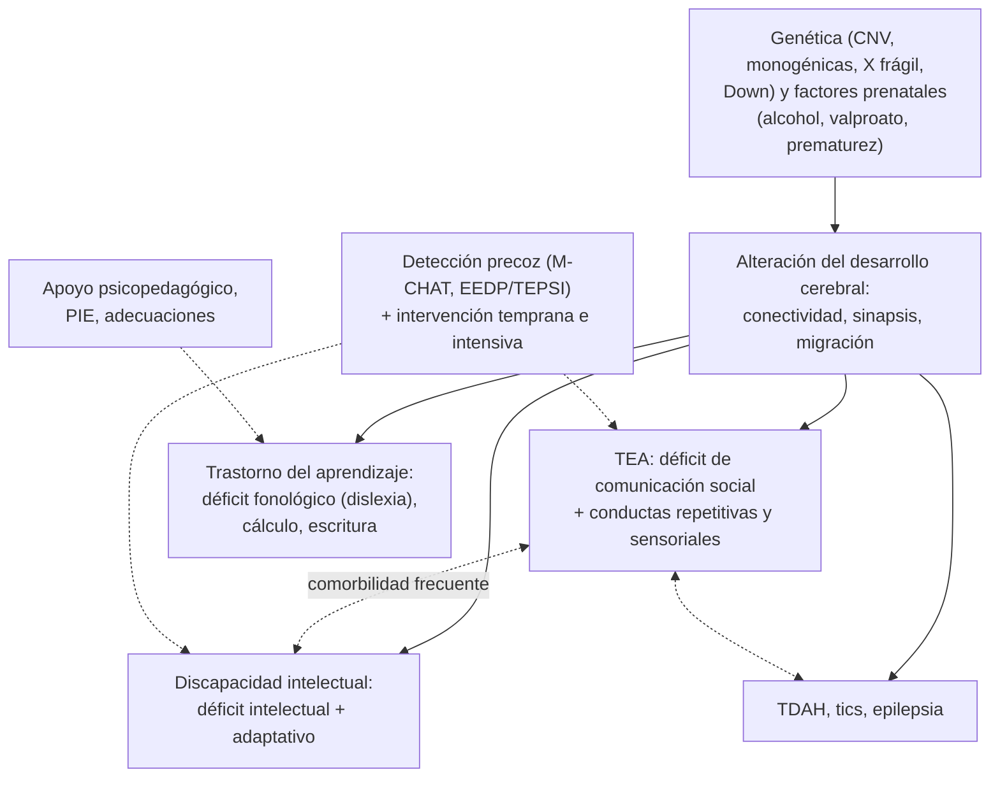

---
tags:
  - Psiquiatría
---

# Trastornos del neurodesarrollo: espectro autista, discapacidad intelectual y trastorno específico del aprendizaje

**Subespecialidad**
Psiquiatría infantojuvenil · Neurología infantil · Pediatría · Atención primaria

**Guías principales**
AAP 2020: identificación, evaluación y manejo de niños con trastorno del espectro autista · AAP 2014: evaluación integral del niño con discapacidad intelectual o retraso global del desarrollo · ACMG 2010: microarreglo cromosómico como examen de primera línea · Criterios DSM-5-TR (2022)

**Otras fuentes**
Revisión del espectro autista (Lord, *Lancet* 2018) · Prevalencia de autismo en los EE. UU. (CDC, *MMWR* 2025) · Revisión de la dislexia del desarrollo (Peterson y Pennington, *Lancet* 2012) · Revisión de la discapacidad intelectual (Purugganan, *Pediatr Rev* 2018) · Ley 21.545 de autismo (2023) · Ver [TDAH y trastornos de conducta](tdah-y-trastornos-de-conducta.md), [ansiedad y ánimo en niños](ansiedad-y-animo-en-ninos-y-adolescentes.md) y [maltrato infantil](maltrato-violencia-intrafamiliar-y-psiquiatria-forense.md)

**GES**
No.

**EUNACOM**
5.01.1.023 Trastorno del espectro autista (sospecha, inicial, derivar) · 5.01.1.024 Trastorno específico del aprendizaje escolar (sospecha, inicial, derivar) · 5.01.1.025 Retardo mental (sospecha, inicial, derivar)

**Revisado**
Octubre 2026

!!! abstract "Resumen en 60 segundos"
    - **Trastornos del neurodesarrollo**: se inician en el **período del desarrollo** (antes de la edad escolar) y alteran el funcionamiento personal, social, académico u ocupacional. Coexisten con frecuencia entre sí (TEA, TDAH, discapacidad intelectual, aprendizaje, tics).
    - **TEA**: déficit **persistente** de la **comunicación e interacción social** + **conductas, intereses o actividades restringidos y repetitivos** (incluida la **hiper o hiporreactividad sensorial**), desde la infancia temprana. Prevalencia creciente (**~ 1 de cada 31** niños de 8 años en los EE. UU., 2022), **3–4 hombres por mujer**.
    - **Señales de alerta**: no responde a su nombre a los **12 meses**, no **señala** ni muestra objetos, poco **contacto visual**, no hay palabras a los **16 meses** ni frases de 2 palabras a los **24 meses**, **pérdida** de lenguaje o habilidades sociales a cualquier edad.
    - **Tamizaje del TEA** a los **18 y 24 meses** con el **M-CHAT-R/F** (AAP). Diagnóstico **clínico** por un equipo especializado (ADOS-2 como apoyo). **Audiometría** a todos.
    - **Discapacidad intelectual** (antes "retardo mental"): déficit de las funciones **intelectuales** (CI ~ **< 70**) **y** del funcionamiento **adaptativo**, desde el desarrollo. La gravedad se define por el **funcionamiento adaptativo**. Estudio etiológico: **microarreglo cromosómico**, X frágil, metabólico, audición y visión.
    - **Trastorno específico del aprendizaje**: dificultad persistente en la **lectura** (dislexia), la **escritura** o el **cálculo**, muy por debajo de lo esperado para la edad, con inteligencia normal y sin otra causa. Diagnóstico **psicopedagógico**.
    - **Tratamiento**: intervención **precoz e intensiva** (conductual, del lenguaje, terapia ocupacional), **apoyo educativo** (Programa de Integración Escolar), apoyo a la familia y manejo de la comorbilidad (TDAH, ansiedad, sueño, epilepsia). Fármacos solo para síntomas específicos (irritabilidad grave: **risperidona** o **aripiprazol**).

## Definición

- **Trastorno del espectro autista (TEA)** (DSM-5-TR):
    - **A. Déficit persistente de la comunicación y la interacción social** en múltiples contextos (los **3**): reciprocidad socioemocional, conductas comunicativas **no verbales** (contacto visual, gestos, expresión facial) y desarrollo, mantención y comprensión de las **relaciones**.
    - **B. Patrones restrictivos y repetitivos** de conducta, intereses o actividades (**≥ 2 de 4**): movimientos, uso de objetos o habla **estereotipados** (ecolalia, alinear objetos); **insistencia en la igualdad** y rutinas inflexibles; **intereses restringidos** muy intensos; **hiper o hiporreactividad sensorial** (indiferencia al dolor, reacción excesiva a ruidos o texturas).
    - Presentes desde el **período temprano** del desarrollo (pueden manifestarse plenamente más tarde), con **deterioro**, y no mejor explicados por la discapacidad intelectual.
    - **Especificadores**: con o sin discapacidad intelectual, con o sin alteración del **lenguaje**, asociado a una condición genética o médica, con catatonía. **Nivel de apoyo** requerido: **1** (necesita apoyo), **2** (apoyo sustancial), **3** (apoyo muy sustancial).
    - El DSM-5 unificó el autismo, el **síndrome de Asperger** y el trastorno generalizado del desarrollo no especificado en el **espectro**.
- **Discapacidad intelectual (DI)**: déficit de las **funciones intelectuales** (razonamiento, resolución de problemas, planificación, pensamiento abstracto, juicio, aprendizaje académico y por la experiencia), confirmado por la evaluación clínica y pruebas estandarizadas (CI ≈ 2 desviaciones estándar bajo la media: **≈ 70 o menos**), **y** del **funcionamiento adaptativo** (conceptual, social y práctico), con inicio durante el **desarrollo**.
- **Retraso global del desarrollo**: en los **menores de 5 años** que no alcanzan los hitos en varias áreas y no pueden evaluarse en forma confiable; requiere reevaluación.
- **Trastorno específico del aprendizaje**: dificultades para aprender y usar las **habilidades académicas** (lectura, comprensión, ortografía, expresión escrita, cálculo, razonamiento matemático) por **≥ 6 meses** pese a las intervenciones, muy por debajo de lo esperado para la edad, iniciadas en la **edad escolar**, **no** explicadas por la DI, déficits sensoriales, otros trastornos, problemas psicosociales o una **instrucción inadecuada**.

## Epidemiología

### Mundial

- **TEA**: prevalencia en aumento por la ampliación de los criterios y la mayor detección. En los EE. UU. (red ADDM, 2022): **32,2 por 1000** niños de 8 años (**~ 1 de cada 31**). **Hombres : mujeres ≈ 3–4 : 1** (las niñas se subdiagnostican: camuflaje social).
- **DI**: **~ 1 %** de la población; la mayoría es **leve** (~ 85 %).
- **Trastorno específico del aprendizaje**: **5–15 %** de los escolares; la **dislexia** es el más frecuente.
- **Comorbilidad**: en el TEA, **TDAH** (30–50 %), **ansiedad**, **DI** (~ 30–40 %), **epilepsia** (hasta 20–30 %, más con DI), trastornos del **sueño**, problemas **gastrointestinales**.

### Chile

!!! chile "Datos nacionales"
    - **Ley 21.545** (2023, "Ley TEA"): ley marco que reconoce los derechos de las personas con TEA, promueve la **detección precoz** y la atención de salud, y obliga a garantizar una **educación inclusiva**.
    - En abril de 2023 más de **51 000 estudiantes autistas** participaban en los **Programas de Integración Escolar** (PIE), que también apoyan a los estudiantes con DI y con trastornos del aprendizaje.
    - El **Programa Chile Crece Contigo** hace la **evaluación del desarrollo psicomotor** (EEDP y TEPSI) en los controles de salud infantil, que permite detectar el retraso del desarrollo.
    - La certificación de la discapacidad se hace mediante la **COMPIN** y el **Registro Nacional de la Discapacidad** (acceso a beneficios).

## Etiología y factores de riesgo

**TEA**:

- **Genética**: heredabilidad **~ 80 %**; riesgo de recurrencia en hermanos **~ 10–20 %**. Causas genéticas identificables en ~ **10–40 %** (variantes de número de copias, monogénicas). Síndromes: **X frágil**, **esclerosis tuberosa**, síndrome de Rett (niñas), deleción o duplicación 15q, 16p11.2.
- **Prenatales**: **edad parental avanzada**, **prematurez**, **valproato** en el embarazo, rubéola congénita, diabetes materna.
- Las **vacunas no causan autismo** (evidencia abundante y concluyente).

**Discapacidad intelectual**:

| Período | Causas |
|---|---|
| **Genéticas** (las más frecuentes en la DI moderada a grave) | **Síndrome de Down** (la causa genética más frecuente), **X frágil** (la causa **hereditaria** más frecuente), microdeleciones (22q11.2, Williams), Rett, monogénicas |
| **Prenatales** | **Alcohol** (trastorno del espectro alcohólico fetal: la causa **prevenible** más frecuente), infecciones **TORCH** y Zika, fármacos, desnutrición materna |
| **Perinatales** | **Prematurez** extrema, **asfixia** (encefalopatía hipóxico-isquémica), hiperbilirrubinemia grave (kernicterus) |
| **Posnatales** | **Meningitis**, encefalitis, **TEC**, desnutrición grave, **hipotiroidismo congénito** no tratado y **fenilcetonuria** (prevenibles con el **tamizaje neonatal**), intoxicación por plomo, privación psicosocial grave |

**Trastorno del aprendizaje**: genética (antecedentes familiares de **dislexia**), prematurez, bajo peso al nacer.

## Fisiopatología

- **TEA**: alteración del **desarrollo de las redes neuronales** (conectividad), de la **sinaptogénesis** y la poda sináptica, con alteraciones de la **cognición social** (teoría de la mente, atención conjunta) y del procesamiento **sensorial**. La **atención conjunta** (mirar lo que otro señala) es uno de los primeros déficits detectables.
- **DI**: múltiples mecanismos según la causa (alteración de la neurogénesis, la migración neuronal, la sinapsis o daño adquirido).
- **Dislexia**: déficit del **procesamiento fonológico** (asociar sonidos y letras), con menor activación de las áreas **temporoparietales izquierdas** durante la lectura.

*Figura 1. Trastornos del neurodesarrollo: causas compartidas, superposición y oportunidades de intervención. Esquema propio basado en Lord (2018) y Purugganan (2018).*

## Clasificación

**Gravedad de la discapacidad intelectual** (DSM-5-TR: según el **funcionamiento adaptativo**; CI orientativo):

| Gravedad | CI aproximado | Edad mental adulta | Funcionamiento |
|---|---|---|---|
| **Leve** (~ 85 %) | 50–69 | 9–12 años | Aprendizaje académico hasta 6.º básico aproximadamente; vida independiente con apoyos; se detecta en la **edad escolar** |
| **Moderada** (~ 10 %) | 35–49 | 6–9 años | Lenguaje simple; autocuidado con entrenamiento; trabajo con supervisión |
| **Grave** (3–4 %) | 20–34 | 3–6 años | Lenguaje mínimo; requiere apoyo diario |
| **Profunda** (1–2 %) | < 20 | < 3 años | Dependencia total; a menudo con alteraciones neurológicas y sensoriales |

**Trastorno específico del aprendizaje**: con dificultades en la **lectura** (**dislexia**: precisión, velocidad, fluidez, comprensión), la **expresión escrita** (**disgrafía**, ortografía) o la **matemática** (**discalculia**). Gravedad: leve, moderada o grave.

## Clínica

### TEA según la edad

| Edad | Señales |
|---|---|
| **< 12 meses** | Poco contacto visual, poca sonrisa social, no balbucea, no responde a su nombre |
| **12–18 meses** | No **señala** para pedir o mostrar (protodeclarativo), no hay **atención conjunta**, no imita, no dice palabras a los 16 meses |
| **2–3 años** | Sin frases de 2 palabras a los 24 meses, **ecolalia**, juego **repetitivo** (alinear, girar objetos), poco interés en otros niños, rabietas ante cambios de rutina, **estereotipias** (aleteo de manos) |
| **Edad escolar y adolescencia** (formas sin DI, antes "Asperger") | Dificultad para **entender** las normas sociales implícitas, la ironía y los dobles sentidos; intereses **muy intensos** y restringidos; lenguaje formal o "pedante"; aislamiento, *bullying*, **ansiedad** y depresión |
| **Cualquier edad** | **Regresión** (pérdida de lenguaje o habilidades sociales): **siempre** es una alarma |

### Discapacidad intelectual

- **Retraso global** de los hitos del desarrollo (motor, lenguaje, social) en los primeros años en las formas moderadas a graves.
- En la DI **leve**: dificultades de **aprendizaje escolar** y de autonomía que se hacen evidentes en la escuela.
- Buscar **rasgos dismórficos**, microcefalia o macrocefalia, manchas cutáneas (café con leche, hipomelanóticas), alteraciones neurológicas.
- **Problemas conductuales** frecuentes (autoagresión, agresividad), a menudo como forma de comunicar **dolor**, malestar o necesidades.

### Trastorno específico del aprendizaje

- **Dislexia**: lectura **lenta**, con errores, inversiones o sustituciones de letras, dificultad para la **conciencia fonológica**; se evidencia en **1.º y 2.º básico**. Inteligencia **normal**.
- **Discalculia**: dificultad para el sentido numérico, los hechos aritméticos y el cálculo.
- Consecuencias emocionales: **baja autoestima**, frustración, rechazo escolar, problemas conductuales.

!!! alarma "Signos de alarma: derivar sin esperar"
    - **Pérdida** del lenguaje o de las habilidades sociales a **cualquier edad** (regresión).
    - **No** balbucea ni hace gestos (señalar, decir adiós) a los **12 meses**; **no** dice palabras a los **16 meses**; **no** usa frases espontáneas de 2 palabras a los **24 meses**.
    - **M-CHAT-R/F** positivo.
    - Retraso del desarrollo con **microcefalia**, **crisis epilépticas**, **dismorfias** o rasgos neurocutáneos.
    - **Autoagresión** grave, agresividad o cambios bruscos de conducta en un niño con TEA o DI (buscar **dolor** o enfermedad médica).

## Diagnóstico

!!! guia "Puntos clave (AAP 2020; AAP 2014; DSM-5-TR)"
    - **Vigilancia** del desarrollo en todos los controles y **tamizaje** estandarizado: **EEDP** y **TEPSI** (Chile Crece Contigo); **M-CHAT-R/F** a los **18 y 24 meses** para el TEA.
    - **TEA**: diagnóstico **clínico** por un equipo especializado (psiquiatra o neurólogo infantil, psicólogo, fonoaudiólogo) con la historia del desarrollo, la observación y herramientas como el **ADOS-2** y el ADI-R. Iniciar la **intervención** sin esperar la confirmación cuando hay una sospecha fundada.
    - **Evaluación de todos los niños con TEA o DI**:
        - **Audiometría** (descartar hipoacusia) y evaluación **visual**.
        - **Microarreglo cromosómico** (primera línea) y **X frágil** (sobre todo en los hombres).
        - Según la clínica: exoma, **estudio metabólico**, **EEG** (crisis, regresión), **RM cerebral** (focalidad, microcefalia, regresión), **plomo**, **TSH**, hemograma y ferritina.
    - **DI**: evaluación psicológica con pruebas de **inteligencia** (WISC-V, WPPSI) **y** de **conducta adaptativa** (Vineland).
    - **Trastorno del aprendizaje**: evaluación **psicopedagógica** con pruebas estandarizadas de lectura, escritura y cálculo; descartar déficits sensoriales, DI, TDAH y problemas emocionales o de escolaridad.

## Laboratorio

| Examen | Indicación |
|---|---|
| **Microarreglo cromosómico** (CGH-array) | **Primera línea** en el TEA, la DI y el retraso global del desarrollo (rendimiento ~ 10–20 %) |
| **X frágil** (FMR1) | TEA o DI, sobre todo en hombres o con antecedentes familiares |
| **Cariotipo** | Sospecha de un síndrome cromosómico (Down) |
| **Exoma** | Si el microarreglo es normal y la sospecha genética persiste |
| **Estudio metabólico** (amonio, lactato, aminoácidos, ácidos orgánicos) | Regresión, crisis, compromiso multisistémico, consanguinidad |
| **TSH**, **plomo**, hemograma y **ferritina** | Según la clínica (pica, retraso, anemia) |

## Imágenes

- **RM cerebral**: **no** de rutina en el TEA; sí ante **macro o microcefalia**, **focalidad** neurológica, **regresión**, crisis o rasgos neurocutáneos, y en la DI moderada a grave sin causa.
- **EEG** si hay crisis o **regresión** (descartar síndrome de Landau-Kleffner o encefalopatías epilépticas).

## Diagnóstico diferencial

| Diagnóstico | Claves |
|---|---|
| **Hipoacusia** | No responde a sonidos; audiometría alterada |
| **Trastorno del lenguaje** (desarrollo) | Comunicación no verbal e interés social **conservados** |
| **DI sin TEA** | Habilidades sociales acordes al nivel de desarrollo global |
| **Privación psicosocial** grave, trastorno del apego | Mejora con un ambiente adecuado |
| **TDAH** | Inatención e impulsividad, con reciprocidad social conservada (puede coexistir) |
| **Síndrome de Rett** | **Niñas**, regresión a los 6–18 meses, **estereotipias de lavado de manos**, desaceleración del perímetro craneano |
| **Ansiedad social**, **mutismo selectivo** | Comunicación normal en contextos cómodos |
| **Esquizofrenia de inicio temprano** | Rara; alucinaciones y delirios tras un desarrollo más normal |
| **Trastorno del aprendizaje frente a DI** | En el del aprendizaje la **inteligencia es normal** |
| **Bajo rendimiento escolar** por otras causas | Ausentismo, enseñanza inadecuada, problemas visuales o auditivos, depresión, maltrato |

## Tratamiento

### TEA

- **Intervención temprana e intensiva**: intervenciones **conductuales** basadas en el **análisis conductual aplicado** (ABA) y modelos **naturalistas** del desarrollo (por ejemplo, el modelo Denver de atención temprana), con la participación de los **padres**.
- **Fonoaudiología** (lenguaje y comunicación, sistemas **aumentativos y alternativos** de comunicación con imágenes), **terapia ocupacional** (integración sensorial, autonomía), entrenamiento en **habilidades sociales**.
- **Educación inclusiva** (PIE) con adecuaciones.
- **Apoyo a la familia** (psicoeducación, grupos de padres, respiro).
- **Comorbilidades**: TDAH (estimulantes, con dosis bajas y cautela), **ansiedad** (TCC adaptada; ISRS con cuidado), **sueño** (higiene del sueño, **melatonina**), epilepsia, problemas gastrointestinales y dentales.
- **Irritabilidad grave** (agresividad, autoagresión, rabietas intensas) que no responde a medidas conductuales: **risperidona** o **aripiprazol** (aprobados para la irritabilidad en el TEA), con control **metabólico**.
- **Sin evidencia** o con riesgo: dietas sin gluten y caseína, quelación, cámara hiperbárica, células madre.

### Discapacidad intelectual

- **Estimulación temprana**, educación especial o inclusiva según el grado, terapia ocupacional y fonoaudiología, formación **laboral** y vida independiente con apoyos.
- **Tratar la causa** cuando es posible (hipotiroidismo, fenilcetonuria) y las **comorbilidades** (epilepsia, déficits sensoriales, problemas conductuales, salud mental).
- **Asesoría genética** a la familia.
- **Prevención**: control del embarazo, evitar el **alcohol**, **tamizaje neonatal** (hipotiroidismo congénito y fenilcetonuria), vacunas, prevención de los accidentes.

### Trastorno específico del aprendizaje

- **Intervención psicopedagógica** específica y sistemática (método **fonológico** en la dislexia), **adecuaciones** curriculares y de evaluación (más tiempo, evaluación oral), apoyo de la **autoestima**.
- Tratar el **TDAH** comórbido (frecuente).

!!! dosis "Fármacos en el TEA (síntomas específicos)"
    | Síntoma | Fármaco | Dosis orientativa | Vigilar |
    |---|---|---|---|
    | **Irritabilidad grave** | **Risperidona** | 0,25–0,5 mg/día, subir a 0,5–3 mg/día | Aumento de peso, prolactina, sedación |
    | **Irritabilidad grave** | **Aripiprazol** | 2 mg/día, subir a 5–15 mg/día | Acatisia, peso |
    | **Insomnio** | **Melatonina** | 1–5 mg 30–60 min antes de acostarse | Tras la higiene del sueño |
    | **TDAH comórbido** | **Metilfenidato** | Dosis bajas iniciales | Irritabilidad, apetito, sueño |

## Complicaciones

- **Aislamiento social**, *bullying*, **ansiedad**, **depresión** y **conducta suicida** (en los adolescentes con TEA sin DI).
- **Autoagresión** y agresividad; **crisis** de desregulación.
- **Epilepsia** (TEA con DI, Rett, esclerosis tuberosa).
- **Fracaso** y **deserción escolar**, menor inserción laboral.
- **Sobrecarga** y estrés de los cuidadores.
- **Abuso** y maltrato (las personas con discapacidad son más vulnerables).
- **Desnutrición** u obesidad por la selectividad alimentaria (TEA).

## Pronóstico y seguimiento

- **TEA**: condición de **toda la vida**, con evolución muy variable. Mejor pronóstico con **lenguaje funcional antes de los 5–6 años**, **CI** normal e **intervención precoz**. Muchos adultos sin DI logran vida independiente con apoyos.
- **DI**: estable; el pronóstico funcional depende de la **gravedad**, la causa, las comorbilidades y los **apoyos**.
- **Trastorno del aprendizaje**: la dificultad **persiste**, pero las estrategias y adecuaciones permiten un buen rendimiento.
- **Seguimiento**: controles del desarrollo, crecimiento y nutrición, sueño, salud mental, transición a la **adultez** (educación, trabajo, aspectos legales como la interdicción).

## Perlas para el internado

!!! perla "Para recordar"
    - **M-CHAT-R/F** a los **18 y 24 meses**; **EEDP** y **TEPSI** en los controles de Chile Crece Contigo.
    - **Regresión** del lenguaje o de las habilidades sociales = **alarma** a cualquier edad.
    - **Audiometría** a todo niño con sospecha de TEA o retraso del lenguaje.
    - **Microarreglo** + **X frágil**: primera línea del estudio genético en el TEA y la DI.
    - **Las vacunas no causan autismo**.
    - **DI**: déficit intelectual **y** adaptativo; la gravedad la define el **funcionamiento adaptativo**.
    - **Down**: causa genética más frecuente de DI; **X frágil**: la causa **hereditaria** más frecuente; **alcohol fetal**: la causa **prevenible** más frecuente.
    - **Dislexia**: inteligencia normal, déficit **fonológico**; diagnóstico **psicopedagógico**.
    - Conducta agresiva nueva en un niño con TEA o DI: buscar **dolor** o enfermedad (otitis, caries, constipación).

## Preguntas de repaso

??? repaso "1. Niño de 20 meses que no dice palabras, no señala, mira poco a los ojos, no responde a su nombre y alinea autos durante horas. ¿Qué hace?"
    Sospecha de **TEA**. Aplicar el **M-CHAT-R/F**, pedir una **audiometría** y derivar a un equipo especializado para el diagnóstico (ADOS-2), **iniciando la intervención temprana** (fonoaudiología, terapia ocupacional, intervención conductual con los padres) sin esperar la confirmación. Estudio genético (microarreglo, X frágil).

??? repaso "2. Niña de 18 meses con desarrollo normal hasta el año que perdió las palabras, presenta movimientos de 'lavado de manos' y el perímetro craneano dejó de crecer. ¿Qué sospecha?"
    **Síndrome de Rett** (mutación de *MECP2*, casi exclusivo de niñas): regresión del lenguaje y del uso de las manos, **estereotipias** de lavado de manos, **desaceleración** del perímetro craneano. Derivar a neurología infantil y pedir el estudio genético.

??? repaso "3. Escolar de 8 años, inteligente según sus padres, con lectura lenta y muchos errores, que confunde letras y tiene notas bajas solo en lenguaje. ¿Qué tiene y cómo se confirma?"
    Probable **trastorno específico del aprendizaje con dificultad en la lectura** (dislexia). Descartar problemas **visuales y auditivos** y el TDAH, y confirmar con una **evaluación psicopedagógica** estandarizada. Tratamiento: intervención fonológica específica, **adecuaciones** escolares y apoyo de la autoestima (PIE).

??? repaso "4. ¿Qué exámenes pide en un niño con discapacidad intelectual moderada sin causa conocida?"
    **Microarreglo cromosómico** (primera línea), **X frágil**, audiometría y evaluación visual; según la clínica, estudio **metabólico**, **TSH**, plomo, **EEG** y **RM cerebral** (microcefalia, focalidad, crisis). Asesoría genética.

??? repaso "5. ¿Cómo se define la gravedad de la discapacidad intelectual en el DSM-5-TR?"
    Por el **funcionamiento adaptativo** (conceptual, social y práctico), no solo por el CI, porque es lo que determina el nivel de **apoyo** requerido. El CI (≈ < 70) sirve como orientación.

??? repaso "6. Adolescente de 14 años con TEA nivel 1 que tiene un aumento brusco de la agresividad y autoagresión. ¿Qué evalúa primero?"
    Buscar una **causa médica** que no puede comunicar (**dolor**: dental, otitis, constipación, fracturas), cambios en el entorno o la rutina, **ansiedad**, depresión, *bullying* y efectos de fármacos. Si persiste una irritabilidad grave pese a las medidas conductuales, considerar **risperidona** o **aripiprazol**.

## Referencias

1. Hyman SL, Levy SE, Myers SM, et al. Identification, evaluation, and management of children with autism spectrum disorder. *Pediatrics.* 2020;145(1):e20193447. doi:[10.1542/peds.2019-3447](https://doi.org/10.1542/peds.2019-3447)
2. Moeschler JB, Shevell M; Committee on Genetics. Comprehensive evaluation of the child with intellectual disability or global developmental delays. *Pediatrics.* 2014;134(3):e903–e918. doi:[10.1542/peds.2014-1839](https://doi.org/10.1542/peds.2014-1839)
3. Miller DT, Adam MP, Aradhya S, et al. Consensus statement: chromosomal microarray is a first-tier clinical diagnostic test for individuals with developmental disabilities or congenital anomalies. *Am J Hum Genet.* 2010;86(5):749–764. doi:[10.1016/j.ajhg.2010.04.006](https://doi.org/10.1016/j.ajhg.2010.04.006)
4. Lord C, Elsabbagh M, Baird G, et al. Autism spectrum disorder. *Lancet.* 2018;392(10146):508–520. doi:[10.1016/S0140-6736(18)31129-2](https://doi.org/10.1016/S0140-6736(18)31129-2)
5. Shaw KA, Williams S, Patrick ME, et al. Prevalence and early identification of autism spectrum disorder among children aged 4 and 8 years — Autism and Developmental Disabilities Monitoring Network, 16 sites, United States, 2022. *MMWR Surveill Summ.* 2025;74(2):1–22. doi:[10.15585/mmwr.ss7402a1](https://doi.org/10.15585/mmwr.ss7402a1)
6. Peterson RL, Pennington BF. Developmental dyslexia. *Lancet.* 2012;379(9830):1997–2007. doi:[10.1016/S0140-6736(12)60198-6](https://doi.org/10.1016/S0140-6736(12)60198-6)
7. Purugganan O. Intellectual disabilities. *Pediatr Rev.* 2018;39(6):299–309. doi:[10.1542/pir.2016-0116](https://doi.org/10.1542/pir.2016-0116)
8. Chile. Ley 21.545 que establece la promoción de la inclusión, la atención integral y la protección de los derechos de las personas con trastorno del espectro autista en el ámbito social, de salud y educación. *Diario Oficial*, 10 de marzo de 2023. [isl.cl (preguntas frecuentes)](https://www.isl.cl/wp-content/uploads/2024/07/Preguntas-frecuentes-Ley-21.545.pdf)
9. American Psychiatric Association. *Diagnostic and Statistical Manual of Mental Disorders, Fifth Edition, Text Revision (DSM-5-TR).* Washington, DC: APA; 2022.
