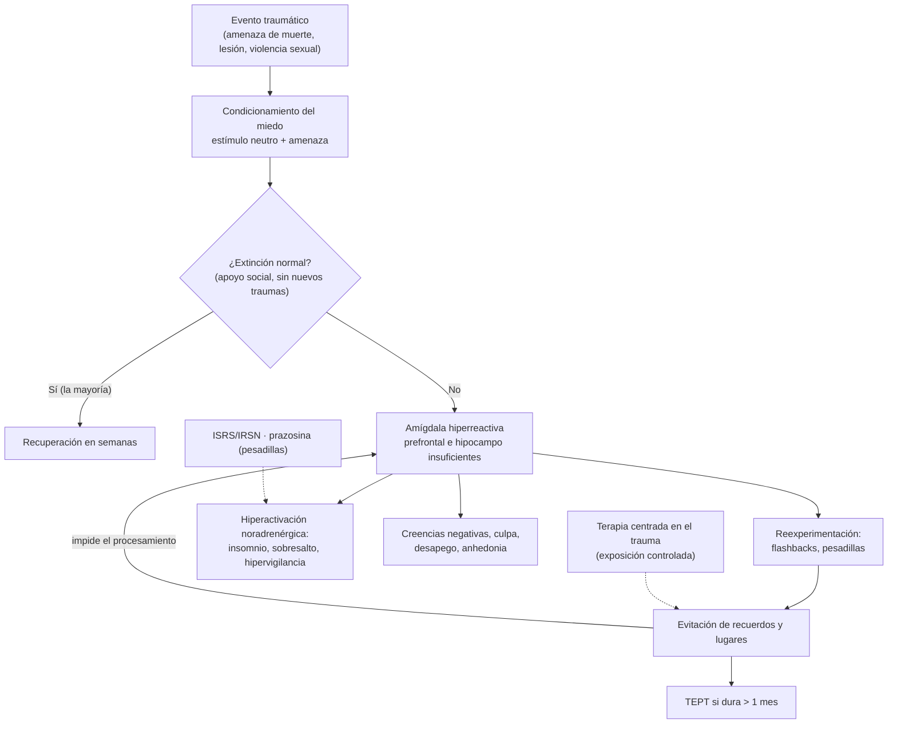

---
tags:
  - Psiquiatría
  - Frecuente en sala
---

# Trastornos relacionados con traumas y estrés (adaptación, estrés agudo y estrés postraumático)

**Subespecialidad**
Psiquiatría · Medicina familiar · Atención primaria · Medicina de urgencia

**Guías principales**
VA/DoD 2023: manejo del trastorno por estrés postraumático y del trastorno por estrés agudo · ISTSS 2019: prevención y tratamiento del TEPT · WFSBP 2023: TOC y TEPT (versión 3, parte II) · Criterios DSM-5-TR (2022) y CIE-11

**Otras fuentes**
Revisión del TEPT (Shalev, *N Engl J Med* 2017) · Revisión Cochrane de intervenciones psicológicas precoces de varias sesiones (Roberts 2019) · Ver [trastornos de ansiedad](trastornos-de-ansiedad-y-toc.md), [depresión](../geriatria/depresion.md) y [abstinencia alcohólica](../neurologia/abstinencia-alcoholica-y-wernicke.md)

**GES**
No como problema propio. La **atención integral en agresión sexual aguda** sí es GES (N.° 86).

**EUNACOM**
5.01.1.004 Trastorno de adaptación (específico, completo, completo) · 5.01.1.005 Trastorno agudo por estrés (específico, completo, completo) · 5.01.1.006 Trastorno por estrés postraumático (sospecha, inicial, derivar)

**Revisado**
Octubre 2026

!!! abstract "Resumen en 60 segundos"
    - Tienen en común un **factor estresante identificable** que inicia el cuadro.
    - **Trastorno de adaptación**: síntomas emocionales o conductuales **desproporcionados** ante un estresor **común** (separación, despido, enfermedad), dentro de **3 meses** del estresor y que se resuelven en **≤ 6 meses** tras su término. No cumple criterios de otro trastorno (por ejemplo, depresión mayor).
    - **Trastorno por estrés agudo**: tras un **evento traumático** (amenaza de muerte, lesión grave o violencia sexual), síntomas de **intrusión, evitación, ánimo negativo, disociación e hiperactivación** entre los **3 días y 1 mes**.
    - **TEPT**: los mismos síntomas por **más de 1 mes**. Cuatro grupos: **reexperimentación** (pesadillas, *flashbacks*), **evitación**, **alteraciones negativas** del ánimo y la cognición, e **hiperactivación** (insomnio, sobresalto, hipervigilancia).
    - **Tras un trauma agudo**: **primeros auxilios psicológicos** (seguridad, calma, conexión, apoyo práctico). **No** hacer *debriefing* obligatorio de sesión única ni dar **benzodiacepinas** de rutina (no previenen y pueden empeorar el TEPT).
    - **TEPT**: primera línea, **psicoterapias centradas en el trauma** (TCC centrada en el trauma, terapia de procesamiento cognitivo, exposición prolongada, EMDR). Si no hay acceso o se prefieren fármacos: **sertralina, paroxetina, fluoxetina o venlafaxina**. **Prazosina** para las pesadillas (evidencia mixta).
    - Buscar siempre **depresión**, **consumo de alcohol y drogas** y **riesgo suicida**.

## Definición

- **Evento traumático** (criterio A del DSM-5-TR): exposición a **muerte real o amenaza de muerte**, **lesión grave** o **violencia sexual**, de forma directa, como **testigo**, al **saber** que le ocurrió a un familiar o amigo cercano (si fue violento o accidental) o por exposición **repetida a detalles** (rescatistas, policías). No incluye la exposición por medios de comunicación, salvo que sea laboral.
- **Estresor no traumático**: evento vital común pero difícil (pérdida de trabajo, separación, enfermedad, migración, problemas económicos o escolares).
- **Trastorno de adaptación**: respuesta desadaptativa a un estresor identificable, con **malestar desproporcionado** o **deterioro** funcional, que **no** corresponde al duelo normal ni a otro trastorno mental.
- **Trastorno por estrés agudo** y **TEPT**: síndromes que siguen a un evento traumático; se distinguen por la **duración** (< 1 mes o > 1 mes).
- **CIE-11** agrega el **TEPT complejo** (trauma prolongado o repetido, como maltrato infantil o violencia de pareja): TEPT + problemas graves de **regulación emocional**, **autoconcepto negativo** y dificultades **relacionales**. También define el **duelo prolongado** (DSM-5-TR lo incorporó en 2022).

## Epidemiología

### Mundial

- La mayoría de las personas vive **al menos un evento traumático** en la vida (~ 70 %), pero solo una minoría desarrolla TEPT.
- **TEPT**: prevalencia de vida **~ 4–8 %** en la población general; mucho mayor en **víctimas de violación** (≈ 30–50 %), combatientes, refugiados y sobrevivientes de tortura. **Mujeres : hombres ≈ 2 : 1**.
- **Trastorno por estrés agudo**: 10–20 % de las víctimas de accidentes o agresiones; alrededor de la mitad evoluciona a TEPT.
- **Trastorno de adaptación**: muy frecuente en la **APS** y en los **hospitalizados** (5–20 % en las interconsultas de psiquiatría de enlace); es uno de los diagnósticos más usados en las **licencias médicas**.

### Chile

!!! chile "Datos nacionales"
    - Chile está expuesto a **desastres** frecuentes (terremotos, tsunamis, incendios forestales, aluviones). Tras el **terremoto y tsunami del 27F de 2010** se desarrollaron estudios nacionales sobre el TEPT y el crecimiento postraumático en las zonas afectadas.
    - El MINSAL y la ONEMI (hoy **SENAPRED**) usan protocolos de **primeros auxilios psicológicos** en las emergencias.
    - La **violencia sexual** y la **violencia intrafamiliar** son causas frecuentes de TEPT. La **agresión sexual aguda** tiene garantía **GES (N.° 86)**: atención integral, profilaxis y apoyo psicológico.
    - Las enfermedades de salud mental derivadas del trabajo (por ejemplo, el TEPT por un asalto en el trabajo) se tratan por la **Ley 16.744** (ver [accidentes del trabajo](../traumatologia/accidentes-del-trabajo-y-enfermedades-profesionales.md)).

## Etiología y factores de riesgo

**Del evento**: **violencia interpersonal intencional** (violación, tortura, secuestro), **gravedad**, **duración**, **cercanía** a la muerte, lesión física, pérdida de seres queridos.

**De la persona (pretrauma)**: **sexo femenino**, traumas previos (sobre todo **en la infancia**), antecedentes psiquiátricos personales o familiares, menor nivel socioeconómico y educacional.

**Del período postrauma** (los más potentes y modificables): **falta de apoyo social**, nuevos estresores, **disociación peritraumática**, dolor intenso, síntomas agudos intensos, consumo de alcohol.

## Fisiopatología

- Ante un trauma, el **condicionamiento del miedo** asocia estímulos neutros (olores, ruidos, lugares) con la amenaza. Normalmente, con el tiempo se produce la **extinción** de esa asociación.
- En el TEPT la extinción **falla**: la **amígdala** está hiperreactiva, la **corteza prefrontal medial** no la frena y el **hipocampo** (que pone el recuerdo en su contexto temporal y espacial) funciona mal. Por eso el recuerdo se revive "como si ocurriera ahora".
- **Noradrenalina** elevada (hiperactivación, insomnio, pesadillas: base del uso de **prazosina**) y respuesta alterada del **cortisol**.
- La **evitación** impide procesar el recuerdo y lo mantiene; las terapias centradas en el trauma lo exponen de forma controlada para permitir la extinción.

*Figura 1. Fisiopatología del TEPT: falla de la extinción del miedo y papel de la evitación. Esquema propio basado en Shalev (2017) y VA/DoD (2023).*

## Clasificación

| Trastorno | Estresor | Inicio | Duración | Núcleo clínico |
|---|---|---|---|---|
| **Reacción normal** al estrés o al duelo | Cualquiera | Inmediato | Breve | Proporcional, sin deterioro marcado |
| **Trastorno de adaptación** | **Común** (no necesariamente traumático) | **≤ 3 meses** tras el estresor | **≤ 6 meses** tras el fin del estresor o sus consecuencias | Ánimo bajo, ansiedad o alteración de la conducta, desproporcionados |
| **Trastorno por estrés agudo** | **Traumático** | Tras el trauma | **3 días a 1 mes** | ≥ 9 de 14 síntomas de intrusión, ánimo negativo, disociación, evitación e hiperactivación |
| **TEPT** | **Traumático** | Cualquier momento (puede ser **diferido**: ≥ 6 meses después) | **> 1 mes** | 4 grupos de síntomas |
| **TEPT complejo** (CIE-11) | Trauma **prolongado o repetido** | Variable | Crónico | TEPT + desregulación emocional, autoimagen negativa, problemas relacionales |
| **Duelo prolongado** | Muerte de un ser querido | — | **≥ 12 meses** (≥ 6 en niños) | Anhelo intenso o preocupación persistente por el fallecido, con deterioro |

- **Subtipos del trastorno de adaptación** (DSM-5-TR): con ánimo deprimido, con ansiedad, mixto, con alteración de la conducta, mixto de emociones y conducta, no especificado.

## Clínica

### Trastorno de adaptación

- Tristeza, llanto, preocupación, irritabilidad, insomnio, dificultad para concentrarse, ausentismo, conflictos, conductas impulsivas o de riesgo (en adolescentes).
- **Relación temporal clara** con el estresor; mejora cuando el estresor cede o la persona se adapta.
- **Puede haber ideación suicida**, sobre todo en adolescentes y adultos jóvenes: preguntarla siempre.

### Trastorno por estrés agudo y TEPT (DSM-5-TR)

| Grupo | Síntomas | TEPT: mínimo |
|---|---|---|
| **B. Intrusión** | Recuerdos intrusivos, **pesadillas**, ***flashbacks*** (revivir el evento), malestar y **reactividad fisiológica** ante recordatorios | ≥ 1 |
| **C. Evitación** | De recuerdos, pensamientos o sentimientos, y de personas, lugares o situaciones que lo recuerdan | ≥ 1 |
| **D. Alteraciones negativas de la cognición y el ánimo** | Amnesia de partes del evento, creencias negativas ("nadie es confiable", "soy culpable"), **culpa** distorsionada, emociones negativas persistentes, **anhedonia**, **desapego**, incapacidad de sentir emociones positivas | ≥ 2 |
| **E. Hiperactivación y reactividad** | Irritabilidad o agresividad, conducta temeraria o autodestructiva, **hipervigilancia**, **sobresalto exagerado**, problemas de concentración, **insomnio** | ≥ 2 |

- **Especificadores**: con **síntomas disociativos** (despersonalización, desrealización); con **expresión retardada** (criterios completos ≥ 6 meses después).
- En **niños ≤ 6 años**: juego repetitivo con temas del trauma, pesadillas sin contenido claro, regresión (enuresis, pérdida del lenguaje).
- En la consulta médica general: **insomnio**, dolor crónico, síntomas somáticos, consumo de alcohol, consultas repetidas.

!!! alarma "Signos de alarma"
    - **Ideación o conducta suicida** (el TEPT la aumenta, sobre todo con depresión o consumo de sustancias).
    - **Violencia en curso**: la víctima sigue expuesta (violencia intrafamiliar, abuso sexual infantil). Activar la **protección** y la **denuncia** cuando corresponda.
    - **Síntomas psicóticos**, disociación grave o incapacidad de cuidarse.
    - **Consumo de alcohol o drogas** para "dormir" u "olvidar".

## Diagnóstico

!!! guia "Puntos clave (DSM-5-TR; VA/DoD 2023; ISTSS 2019)"
    - Diagnóstico **clínico**. Preguntar directamente por **eventos traumáticos** (incluidos la violencia sexual y la violencia de pareja), con respeto y sin obligar a relatar detalles.
    - **Tamizaje del TEPT**: **PC-PTSD-5** (5 preguntas; positivo con ≥ 3–4). Para confirmar y medir la gravedad: **PCL-5** (≥ 31–33 sugiere TEPT).
    - **Trastorno de adaptación**: diagnóstico de **exclusión**: si cumple criterios de **depresión mayor**, TAG o TEPT, se diagnostica ese trastorno, aunque haya un estresor.
    - **Duración** como eje: < 1 mes tras un trauma = estrés agudo; > 1 mes = TEPT.
    - Evaluar **comorbilidad**: depresión (~ 50 %), consumo de alcohol, dolor crónico, **TEC** (en el trauma físico) y **riesgo suicida**.

## Laboratorio

- **No hay** exámenes diagnósticos.
- Según la clínica: **TSH**, hemograma, **alcoholemia o tóxicos** si se sospecha consumo; en la violencia sexual aguda, los exámenes del protocolo (β-hCG, VIH, VHB, sífilis, ITS) y las muestras médico-legales.

## Imágenes

- **No** se usan para el diagnóstico.
- **TC o RM cerebral** si hubo **TEC** o hay síntomas neurológicos o cognitivos (el TEC leve y el TEPT comparten síntomas: cefalea, insomnio, irritabilidad, problemas de concentración).

## Diagnóstico diferencial

| Diagnóstico | Claves |
|---|---|
| **Duelo normal** | Tras una muerte; proporcional, con oleadas de pena; sin deterioro grave persistente |
| **Depresión mayor** | Cumple criterios (≥ 5 síntomas, ≥ 2 semanas), aunque haya un estresor: se diagnostica depresión |
| **Trastornos de ansiedad** | Sin evento traumático desencadenante; temor centrado en otros temas |
| **TOC** | Pensamientos intrusivos no ligados a un trauma |
| **TEC y síndrome posconmocional** | Antecedente de golpe en la cabeza, pérdida de conciencia o amnesia |
| **Trastornos disociativos** | Disociación sin el resto del síndrome |
| **Psicosis** | Alucinaciones o delirios no limitados a los *flashbacks* |
| **Consumo o abstinencia de sustancias** | Hiperactivación, insomnio y ansiedad por alcohol, benzodiacepinas o estimulantes |
| **Simulación** | Ganancia externa evidente (litigios, licencias, peritajes), relato inconsistente |

## Tratamiento

### Después de un evento traumático (primeras horas y días)

- **Primeros auxilios psicológicos** (OMS): asegurar la **seguridad**, la **calma**, cubrir las necesidades básicas, **conectar** con la familia y redes de apoyo, entregar **información** práctica y facilitar el acceso a ayuda.
- **Normalizar**: la mayoría de los síntomas iniciales mejora solo en semanas.
- **No recomendado**:
    - ***Debriefing* psicológico** de sesión única obligatorio (relatar el trauma en detalle de inmediato): no previene el TEPT y puede aumentarlo.
    - **Benzodiacepinas** para prevenir o tratar el TEPT (VA/DoD 2023 recomienda **en contra**): no previenen y se asocian a peor evolución.
- **Seguimiento** en 2–4 semanas: si los síntomas persisten o son graves, ofrecer **TCC centrada en el trauma** (puede prevenir la evolución a TEPT en el trastorno por estrés agudo).
- **Insomnio** agudo intenso: higiene del sueño; si hace falta, un hipnótico **por pocos días** (no benzodiacepinas de rutina).

### Trastorno de adaptación

- **Intervención breve** en la APS: psicoeducación, **resolución de problemas**, apoyo psicosocial, fortalecer las redes y el afrontamiento. Psicoterapia breve (TCC, consejería).
- Abordar el **estresor** cuando sea posible (asistente social, apoyo legal o laboral).
- **Fármacos**: no son la primera línea. Síntomas puntuales (insomnio, ansiedad intensa) por **corto tiempo**. Si evoluciona a una depresión mayor, tratarla como tal.
- **Licencia médica** solo si es necesaria y **breve**: el retorno precoz a la rutina favorece la recuperación.

### TEPT

!!! guia "Tratamiento del TEPT (VA/DoD 2023; ISTSS 2019; WFSBP 2023)"
    - **Primera línea: psicoterapia centrada en el trauma**, de preferencia sobre los fármacos:
        - **Terapia de procesamiento cognitivo** (CPT).
        - **Exposición prolongada** (PE).
        - **EMDR** (desensibilización y reprocesamiento por movimientos oculares).
        - **TCC centrada en el trauma** (en niños y adolescentes, TF-CBT con los cuidadores).
    - **Farmacoterapia** si no hay acceso, se prefiere o como complemento: **sertralina**, **paroxetina**, **fluoxetina** o **venlafaxina** (las de mejor evidencia).
    - **Prazosina** para las **pesadillas**: evidencia contradictoria (ensayo grande negativo en veteranos); se usa en casos seleccionados.
    - **No recomendados**: **benzodiacepinas**, **antipsicóticos** como tratamiento de rutina (solo como potenciación en casos refractarios o con psicosis), **cannabis**.
    - Tratar la **comorbilidad** (depresión, consumo de alcohol, insomnio) y el **riesgo suicida**.

!!! dosis "Fármacos en el TEPT (adulto)"
    | Fármaco | Inicio | Dosis habitual | Comentario |
    |---|---|---|---|
    | **Sertralina** | 25–50 mg/día | 50–200 mg/día | Primera elección; respuesta en 8–12 semanas |
    | **Paroxetina** | 10–20 mg/día | 20–50 mg/día | Evitar en el embarazo |
    | **Fluoxetina** | 10–20 mg/día | 20–60 mg/día | — |
    | **Venlafaxina XR** | 37,5 mg/día | 75–300 mg/día | Controlar la PA |
    | **Prazosina** (pesadillas) | 1 mg al acostarse | 3–15 mg al acostarse | Primera dosis: **hipotensión ortostática**; subir de a 1–2 mg cada pocos días |

!!! alarma "Derivar a psiquiatría o salud mental de especialidad"
    - **TEPT** (casi siempre requiere psicoterapia especializada), TEPT complejo.
    - **Riesgo suicida**, psicosis, consumo de sustancias grave.
    - Falta de respuesta a un tratamiento adecuado de 8–12 semanas.
    - Niños y adolescentes víctimas de abuso (además de la **protección** y la **denuncia**).

## Complicaciones

- **Depresión** (la más frecuente) y **suicidio**.
- **Consumo de alcohol y drogas**.
- **Dolor crónico**, síntomas somáticos y mayor **riesgo cardiovascular** y metabólico.
- Deterioro **laboral**, **familiar** y social; **violencia** (irritabilidad y agresividad).
- Cronificación (un tercio de los TEPT persiste por años).

## Pronóstico y seguimiento

- **Trastorno de adaptación**: buen pronóstico; la mayoría se resuelve en **meses**. En adolescentes, vigilar la conducta suicida y la evolución a depresión.
- **Trastorno por estrés agudo**: ~ 50 % evoluciona a TEPT; el seguimiento a las **2–4 semanas** permite detectarlo.
- **TEPT**: ~ 50 % se recupera en **≈ 3 años** con tratamiento; un tercio se cronifica. Con terapias centradas en el trauma, la mayoría mejora en forma importante.
- **Seguimiento**: PCL-5 periódico, adherencia, efectos adversos, **riesgo suicida**, consumo de sustancias.

## Perlas para el internado

!!! perla "Para recordar en la sala y el turno"
    - **Regla del tiempo**: estrés agudo **3 días–1 mes**; TEPT **> 1 mes**; adaptación: inicio **≤ 3 meses** y resolución **≤ 6 meses** tras el estresor.
    - **Adaptación** = estresor **común** y **no** cumple criterios de otro trastorno. Si cumple **depresión mayor**, es depresión.
    - Tras un trauma: **primeros auxilios psicológicos**, **no** *debriefing* obligatorio y **no benzodiacepinas** de rutina.
    - TEPT: primero **psicoterapia centrada en el trauma**; el fármaco de base es un **ISRS** (sertralina).
    - En una víctima de **violencia sexual**: GES N.° 86, profilaxis (VIH, ITS, anticoncepción de emergencia), muestras médico-legales y apoyo psicológico.
    - Preguntar siempre por **suicidio** y **alcohol**.

## Preguntas de repaso

??? repaso "1. Mujer de 35 años que hace 6 semanas fue asaltada a mano armada. Tiene pesadillas, revive el asalto, evita la calle donde ocurrió, duerme mal y se sobresalta con cualquier ruido. ¿Diagnóstico y tratamiento?"
    **TEPT** (evento traumático + intrusión, evitación, hiperactivación y alteraciones del ánimo por **más de 1 mes**). Tratamiento: **psicoterapia centrada en el trauma** (procesamiento cognitivo, exposición prolongada o EMDR) y/o **sertralina** (50 mg, subir hasta 100–200 mg). Evaluar depresión, alcohol y riesgo suicida. Si fue en el trabajo, cubre la Ley 16.744.

??? repaso "2. Hombre de 45 años despedido hace 1 mes. Está triste, duerme mal y se preocupa por el dinero, pero sigue funcionando, no tiene anhedonia ni ideas de muerte. No cumple criterios de depresión mayor. ¿Diagnóstico y manejo?"
    **Trastorno de adaptación** con ánimo ansioso-depresivo (estresor común, inicio dentro de 3 meses, sin criterios de otro trastorno). Manejo en la APS: psicoeducación, **resolución de problemas**, apoyo psicosocial (asistente social), actividad física, higiene del sueño y control en 2–4 semanas para detectar una evolución a depresión.

??? repaso "3. Llega a la urgencia un conductor que, hace 2 horas, sobrevivió a un choque en que murió su acompañante. Está angustiado y temblando, sin lesiones. ¿Qué hace y qué evita?"
    **Primeros auxilios psicológicos**: seguridad, calma, contacto con la familia, información, cubrir las necesidades básicas. Normalizar la reacción y citar a control en **2–4 semanas**. **Evitar** el *debriefing* obligatorio (hacerlo relatar en detalle) y **no** indicar **benzodiacepinas** de rutina, porque no previenen el TEPT y pueden empeorar su evolución.

??? repaso "4. Diez días después de un terremoto, una mujer tiene flashbacks, disociación, insomnio e hipervigilancia que le impiden funcionar. ¿Qué diagnóstico corresponde y qué riesgo tiene?"
    **Trastorno por estrés agudo** (síntomas entre los 3 días y el mes tras el trauma). Alrededor de la **mitad** evoluciona a TEPT. Ofrecer **TCC centrada en el trauma** precoz, apoyo psicosocial y seguimiento; evaluar el riesgo suicida.

??? repaso "5. ¿Qué fármaco ayuda a las pesadillas del TEPT y qué efecto adverso debe advertir?"
    **Prazosina** (bloqueador α₁), en dosis nocturnas crecientes (1 mg al inicio, hasta 3–15 mg). Advertir la **hipotensión ortostática** y el síncope con la **primera dosis**. Su evidencia es contradictoria.

??? repaso "6. ¿Qué agrega la CIE-11 con el TEPT complejo?"
    Describe a quienes sufrieron **traumas prolongados o repetidos** (maltrato infantil, violencia de pareja, tortura): además del TEPT, tienen **desregulación emocional**, **autoconcepto negativo** (vergüenza, culpa, inutilidad) y **dificultades en las relaciones**. Requiere tratamiento especializado y más prolongado.

## Referencias

1. Schnurr PP, Hamblen JL, Wolf J, et al. The management of posttraumatic stress disorder and acute stress disorder: synopsis of the 2023 U.S. Department of Veterans Affairs and U.S. Department of Defense clinical practice guideline. *Ann Intern Med.* 2024;177(3):363–374. doi:[10.7326/M23-2757](https://doi.org/10.7326/M23-2757)
2. Bisson JI, Berliner L, Cloitre M, et al. The International Society for Traumatic Stress Studies new guidelines for the prevention and treatment of posttraumatic stress disorder: methodology and development process. *J Trauma Stress.* 2019;32(4):475–483. doi:[10.1002/jts.22421](https://doi.org/10.1002/jts.22421)
3. Bandelow B, Allgulander C, Baldwin DS, et al. World Federation of Societies of Biological Psychiatry (WFSBP) guidelines for treatment of anxiety, obsessive-compulsive and posttraumatic stress disorders – Version 3. Part II: OCD and PTSD. *World J Biol Psychiatry.* 2023;24(2):118–134. doi:[10.1080/15622975.2022.2086296](https://doi.org/10.1080/15622975.2022.2086296)
4. Shalev A, Liberzon I, Marmar C. Post-traumatic stress disorder. *N Engl J Med.* 2017;376(25):2459–2469. doi:[10.1056/NEJMra1612499](https://doi.org/10.1056/NEJMra1612499)
5. Roberts NP, Kitchiner NJ, Kenardy J, et al. Multiple session early psychological interventions for the prevention of post-traumatic stress disorder. *Cochrane Database Syst Rev.* 2019;(8):CD006869. doi:[10.1002/14651858.CD006869.pub3](https://doi.org/10.1002/14651858.CD006869.pub3)
6. Organización Mundial de la Salud, War Trauma Foundation y Visión Mundial Internacional. *Primera ayuda psicológica: guía para trabajadores de campo.* Ginebra: OMS; 2012. [who.int](https://www.who.int/publications/i/item/9789241548205)
7. American Psychiatric Association. *Diagnostic and Statistical Manual of Mental Disorders, Fifth Edition, Text Revision (DSM-5-TR).* Washington, DC: APA; 2022.
