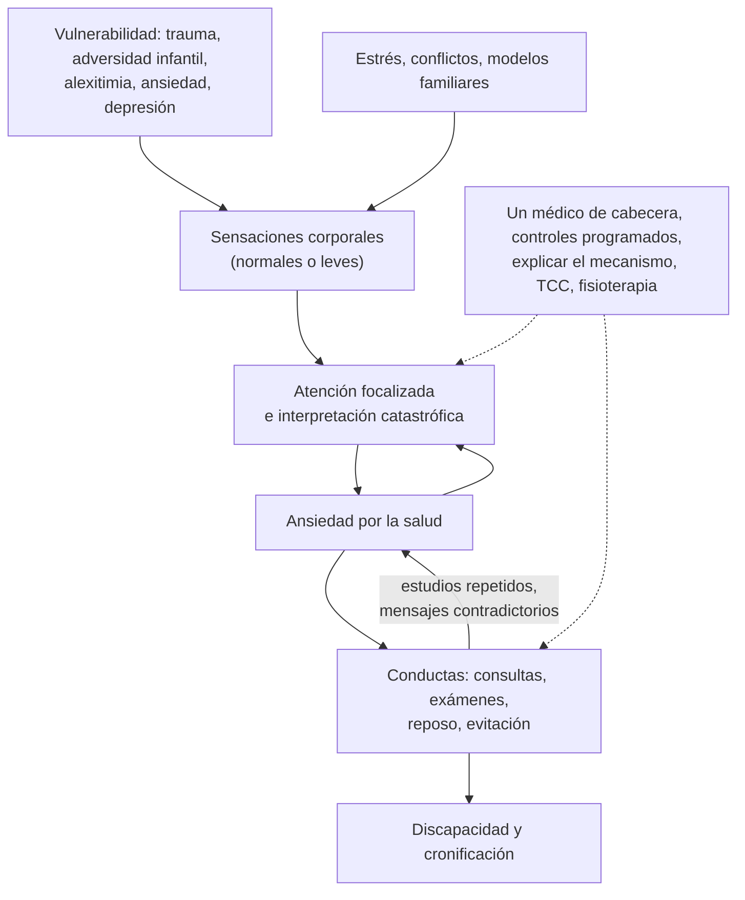

---
tags:
  - Psiquiatría
  - Frecuente en sala
---

# Trastornos de síntomas somáticos (somatomorfos), disociativos y facticios (incluida la somatización en niños)

**Subespecialidad**
Psiquiatría · Psiquiatría de enlace · Neurología · Medicina familiar · Pediatría

**Guías principales**
Criterios DSM-5-TR (2022) y CIE-11 (trastorno de distrés corporal) · Revisión de nuevos subtipos y mecanismos del trastorno neurológico funcional (Hallett, *Lancet Neurol* 2022)

**Otras fuentes**
Escala PHQ-15 (Kroenke 2002) · Revisión sistemática de 455 casos de trastorno facticio (Yates y Feldman 2016) · Trastornos disociativos en el DSM-5 (Spiegel 2011) · Ver [trastornos de ansiedad](trastornos-de-ansiedad-y-toc.md), [depresión](../geriatria/depresion.md), [trastornos relacionados con traumas](trastornos-relacionados-con-traumas-y-estres.md), [intestino irritable](../gastroenterologia/constipacion-intestino-irritable-y-diarrea-cronica.md) y [crisis epilépticas](../neurologia/crisis-epileptica-y-estado-epileptico.md)

**GES**
No.

**EUNACOM**
5.01.1.020 Trastornos somatomorfos (sospecha, inicial, derivar) · 5.01.1.021 Trastornos disociativos (sospecha, inicial, derivar) · 5.01.1.022 Trastornos facticios (sospecha, inicial, derivar) · 5.01.1.032 Trastorno somatización en niños (sospecha, inicial, completo)

**Revisado**
Octubre 2026

!!! abstract "Resumen en 60 segundos"
    - **Trastorno de síntomas somáticos** (DSM-5-TR; antes "somatización"): ≥ 1 síntoma somático **molesto** + pensamientos, emociones o conductas **excesivas** sobre él (preocupación, ansiedad, tiempo y energía) por **≥ 6 meses**. Los síntomas pueden tener o no una causa médica: lo central es la **respuesta desproporcionada**.
    - **Ansiedad por la enfermedad** (antes hipocondría): **miedo a tener** una enfermedad grave con **pocos o ningún síntoma**.
    - **Trastorno de síntomas neurológicos funcionales** (conversión): síntomas **motores o sensitivos** (debilidad, crisis no epilépticas, alteración de la marcha, ceguera) **incompatibles** con una enfermedad neurológica, con **signos positivos** al examen (signo de **Hoover**).
    - **Trastorno facticio**: el paciente **finge o provoca** síntomas para asumir el **rol de enfermo**, **sin** un incentivo externo (o lo **impone a otro**, como un niño: maltrato). **Simulación**: lo hace por una **ganancia externa** (dinero, licencias, evitar la cárcel); **no** es un trastorno mental.
    - **Trastornos disociativos**: alteración de la integración de la **conciencia, memoria, identidad y percepción** (amnesia disociativa, despersonalización y desrealización, trastorno de identidad disociativo), muy asociados al **trauma**.
    - **Manejo**: **un médico de cabecera**, controles **programados** (no por demanda), **validar** el malestar, explicar el mecanismo, **evitar estudios y procedimientos innecesarios**, TCC, fisioterapia en lo funcional y tratar la depresión y la ansiedad.
    - **Niños**: dolor abdominal recurrente, cefalea, fatiga; buscar **estrés escolar, bullying, problemas familiares y abuso**, sin dejar de descartar lo orgánico.

## Definición

- **Síntomas somáticos sin explicación médica suficiente**: muy frecuentes en la APS. El DSM-5 dejó de exigir que **no tengan explicación médica** y puso el foco en la **respuesta** cognitiva, emocional y conductual desproporcionada.
- **Trastorno de síntomas somáticos**: síntomas somáticos que causan malestar o alteran la vida diaria + **≥ 1** de: pensamientos **desproporcionados** y persistentes sobre su gravedad, **ansiedad** alta por la salud o los síntomas, **tiempo y energía excesivos** dedicados a ellos; **persistente** (en general **> 6 meses**).
- **Trastorno de ansiedad por la enfermedad**: **preocupación** por tener o contraer una enfermedad grave, **sin síntomas** o con síntomas leves; ansiedad por la salud; conductas de **comprobación** (consultas, exámenes) o de **evitación**; **≥ 6 meses**.
- **Trastorno de síntomas neurológicos funcionales** (trastorno de conversión): síntomas de alteración **motora o sensitiva voluntaria**, con hallazgos clínicos que demuestran **incompatibilidad** con una enfermedad neurológica o médica conocida. **No** se exige identificar un factor psicológico desencadenante.
- **Factores psicológicos que afectan a otras afecciones médicas**: por ejemplo, la ansiedad que empeora el asma o la negación que lleva a no tratar la diabetes.
- **Trastorno facticio**: **falsificación** de signos o síntomas físicos o psicológicos, o **inducción** de lesión o enfermedad, con **engaño**, presentándose como enfermo, **sin** recompensas externas evidentes. **Impuesto a sí mismo** o **impuesto a otro** (antes "Münchausen por poderes").
- **Simulación**: producción intencional de síntomas motivada por **incentivos externos**. Se codifica como "otro problema que puede ser objeto de atención clínica", **no** como trastorno.
- **Trastornos disociativos**: interrupción o discontinuidad de la integración normal de la conciencia, la memoria, la identidad, la emoción, la percepción, la representación corporal y la conducta.
- La **CIE-11** reúne el trastorno de síntomas somáticos bajo el nombre de **trastorno de distrés corporal**.

## Epidemiología

### Mundial

- Los **síntomas somáticos** sin una explicación médica suficiente son el motivo de **~ 20–30 %** de las consultas en la APS.
- **Trastorno de síntomas somáticos**: **5–7 %** de la población general; más en **mujeres**.
- **Ansiedad por la enfermedad**: 1–10 %.
- **Trastorno neurológico funcional**: una de las causas **más frecuentes** de consulta en neurología (~ 15 % de los pacientes nuevos); las **crisis funcionales** (no epilépticas) explican **20–30 %** de los pacientes derivados a unidades de epilepsia por crisis refractarias.
- **Trastorno facticio**: ~ 1 % de los hospitalizados; más en **mujeres** jóvenes que trabajan en **salud** (Yates y Feldman 2016).
- **Despersonalización y desrealización**: experiencias transitorias muy frecuentes; trastorno ~ 1–2 %.
- **Niños y adolescentes**: el **dolor abdominal funcional** y la cefalea recurrente afectan al **10–20 %** de los escolares.

### Chile

!!! chile "Datos nacionales"
    - Los síntomas somáticos son un motivo frecuente de consulta y de **licencia médica** en la APS; a menudo se asocian a **depresión y ansiedad** no diagnosticadas.
    - Los equipos de **psiquiatría de enlace** de los hospitales generales evalúan los cuadros funcionales y facticios en los hospitalizados.
    - En los niños con síntomas somáticos recurrentes y ausentismo escolar, el abordaje incluye a la **familia** y a la **escuela** (convivencia escolar, *bullying*).

## Etiología y factores de riesgo

- **Adversidad infantil**: **abuso** físico o sexual, negligencia, enfermedad grave de un familiar.
- **Trauma** (especialmente en los disociativos y en los trastornos funcionales).
- **Rasgos**: afectividad negativa (neuroticismo), **alexitimia** (dificultad para identificar y expresar emociones), sensibilidad a las sensaciones corporales.
- **Aprendizaje**: modelos familiares de enfermedad, ganancias **secundarias** (atención, eximirse de obligaciones).
- **Comorbilidad**: **depresión** y **ansiedad** (muy frecuentes), trastornos de personalidad.
- **Factores del sistema de salud**: estudios repetidos, mensajes contradictorios, diagnósticos "de exclusión" sin explicación (refuerzan la preocupación).
- **Niños**: estrés escolar, ***bullying***, conflictos familiares, padres ansiosos o con síntomas similares, separación, **abuso sexual**.

## Fisiopatología

- **Modelo de amplificación somatosensorial**: la atención y la ansiedad aumentan la percepción de sensaciones corporales normales o leves, que se interpretan como signos de enfermedad.
- **Procesamiento predictivo**: el cerebro "predice" síntomas a partir de expectativas y experiencias previas; la **atención** focalizada los mantiene.
- **Trastorno neurológico funcional**: alteración del **control y la agencia** del movimiento (red de la unión temporoparietal, corteza motora suplementaria) y de la **atención**; el síntoma **mejora con la distracción** (base de los signos positivos).
- **Disociación**: mecanismo de **defensa** ante un trauma abrumador (desconexión de la experiencia), que puede perpetuarse.
- **Facticio**: necesidad de cuidado y atención; relación con trastornos de personalidad y trauma.

*Figura 1. Círculo vicioso de los síntomas somáticos: amplificación, ansiedad por la salud y conductas que los mantienen. Esquema propio basado en Hallett (2022) y Kroenke (2002).*

## Clasificación

| Trastorno (DSM-5-TR) | Producción de los síntomas | Motivación | Claves |
|---|---|---|---|
| **Trastorno de síntomas somáticos** | **No intencional** | — | Respuesta desproporcionada a síntomas reales |
| **Ansiedad por la enfermedad** | No intencional | — | Miedo a **tener** una enfermedad, pocos síntomas |
| **Neurológico funcional** (conversión) | **No intencional** | — | Signos **incompatibles** y **positivos** |
| **Facticio** | **Intencional** | **Interna**: asumir el **rol de enfermo** | Engaño, sin ganancia externa |
| **Simulación** (no es trastorno) | **Intencional** | **Externa**: dinero, licencias, drogas, evitar responsabilidades | Contexto médico-legal, falta de cooperación |

**Trastornos disociativos (DSM-5-TR)**:

| Trastorno | Características |
|---|---|
| **Amnesia disociativa** | Incapacidad de recordar información **autobiográfica** importante, en general **traumática**, que no se explica por un olvido normal; con o sin **fuga** (viaje aparentemente intencionado con amnesia de la identidad) |
| **Despersonalización y desrealización** | Experiencias persistentes de **irrealidad**, de estar separado de uno mismo (despersonalización) o del entorno (desrealización), con **juicio de realidad conservado** |
| **Trastorno de identidad disociativo** | **≥ 2 estados de personalidad** distintos, con lagunas de memoria recurrentes; casi siempre con **trauma infantil grave** |

**Subtipos del trastorno neurológico funcional**: debilidad o parálisis, movimientos anormales (temblor, distonía, mioclonías, alteración de la marcha), **crisis funcionales** (no epilépticas), alteración de la deglución o del habla, anestesia o pérdida sensitiva, síntomas visuales o auditivos, síntomas mixtos.

## Clínica

### Trastorno de síntomas somáticos y ansiedad por la enfermedad

- Múltiples síntomas (dolor en distintos sitios, digestivos, fatiga, mareo), **largos historiales** de consultas y exámenes, insatisfacción con la atención.
- La **tranquilización** médica alivia **poco tiempo**.
- En la ansiedad por la enfermedad: búsqueda en internet, autoexámenes repetidos, consultas para que "le pidan otro examen".

### Trastorno neurológico funcional

- **Debilidad funcional**: **signo de Hoover** (al flexionar la cadera **sana** contra resistencia, la pierna "débil" **extiende** con fuerza normal), **debilidad que cede** (*give-way*), discrepancia entre lo que hace al examinar y fuera del examen.
- **Temblor funcional**: **variable**, se **arrastra** (*entrainment*) al ritmo que se le pide hacer con la otra mano, desaparece con la **distracción**.
- **Crisis funcionales** (no epilépticas): duración **prolongada**, **ojos cerrados** con resistencia a abrirlos, movimientos **asincrónicos** o pélvicos, fluctuación, **llanto**, recuerdo del episodio; sin mordedura lateral de lengua ni hipoxemia. El **video-EEG** confirma.
- **Alteración sensitiva** que no sigue territorios anatómicos (división exacta en la línea media).
- **"Belle indifférence"**: indiferencia aparente ante el síntoma; **poco útil** para el diagnóstico.

### Trastorno facticio

- Historias **dramáticas** pero inconsistentes, conocimientos médicos, **múltiples hospitalizaciones** en distintos centros, exigencia de procedimientos, visitas escasas, empeoramiento cuando se planea el alta, hallazgos **imposibles** (hipoglicemia por insulina con **péptido C bajo**, infecciones polimicrobianas por autoinyección, fiebre ficticia, sangre en la orina agregada).
- **Impuesto a otro**: un cuidador (casi siempre la madre) **induce o inventa** síntomas en un niño (intoxicaciones, sofocación, falsear muestras). Es **maltrato infantil grave**: proteger al niño y denunciar.

### Trastornos disociativos

- Lagunas de memoria, "despertar" en lugares sin saber cómo llegó, sensación de irrealidad, cambios bruscos de conducta, síntomas de **TEPT** asociados, **autolesiones** e intentos de suicidio.

### Niños y adolescentes

- **Dolor abdominal recurrente** funcional, **cefalea**, náuseas, fatiga, mareos, dolores musculares; empeoran los **días de colegio** y mejoran los fines de semana o en vacaciones.
- **Ausentismo escolar**, **ansiedad** de separación, rechazo escolar, depresión.
- Buscar **acoso escolar**, conflicto familiar, enfermedad de un familiar, **abuso sexual**.

!!! alarma "Signos de alarma (buscar una causa orgánica)"
    - **Síntomas de inicio** después de los **40–50 años**, **baja de peso**, fiebre, sangrado, **dolor nocturno** que despierta, síntomas que **progresan**.
    - **Signos objetivos** al examen (atrofia, reflejos asimétricos, Babinski, papiledema, alteración de laboratorio).
    - En los niños: **retraso del crecimiento**, vómitos biliosos, dolor **lejos del ombligo**, sangre en las deposiciones, despertar nocturno por dolor.
    - Recordar: el diagnóstico de un trastorno funcional **no protege** contra una enfermedad orgánica **nueva**; reevaluar si cambian los síntomas.
    - **Ideación suicida** (frecuente con la depresión comórbida y en los disociativos).
    - **Facticio impuesto a otro**: riesgo vital para el niño.

## Diagnóstico

!!! guia "Puntos clave (DSM-5-TR; Hallett 2022)"
    - El diagnóstico se basa en **criterios positivos**, **no solo** en la exclusión: la respuesta desproporcionada (síntomas somáticos), los **signos clínicos de incompatibilidad** (funcional) o la **evidencia de engaño** (facticio).
    - **Historia completa** y examen físico **cuidadoso** en la primera evaluación, con los **exámenes razonables** según la clínica; evitar repetirlos sin un cambio clínico.
    - **PHQ-15** para medir la carga de síntomas somáticos (≥ 15 alta). Buscar **depresión** (PHQ-9) y **ansiedad** (GAD-7).
    - **Crisis funcionales**: el **video-EEG** es el estándar; coexisten con la epilepsia en ~ 10–20 %.
    - **Facticio**: revisar registros de otros centros, observar, pruebas objetivas (péptido C, niveles de fármacos); **no** confrontar de forma hostil.
    - Explicar el diagnóstico de manera **positiva** y creíble ("su sistema nervioso no está funcionando bien, aunque no esté dañado; se puede mejorar").

## Laboratorio

- **Exámenes básicos razonables** según los síntomas (hemograma, VHS o PCR, TSH, perfil bioquímico, examen de orina) en la **primera** evaluación.
- **Facticio**: **insulina y péptido C** (hipoglicemia: insulina alta con **péptido C bajo** sugiere insulina exógena), niveles de fármacos, cultivos con flora inusual, análisis de la orina (sangre o sustancias agregadas).
- Evitar los paneles amplios sin orientación (los hallazgos incidentales **aumentan** la ansiedad y los estudios).

## Imágenes

- Solo según los **signos de alarma** o hallazgos al examen.
- **RM cerebral** o medular y **EEG** (video-EEG) en el trastorno neurológico funcional, cuando el cuadro lo justifique, para descartar diagnósticos alternativos o coexistentes.

## Diagnóstico diferencial

| Diagnóstico | Claves |
|---|---|
| **Enfermedad médica** no diagnosticada | Esclerosis múltiple, miastenia, lupus, porfiria, hipotiroidismo, epilepsia del lóbulo frontal: síntomas **fluctuantes** que pueden confundir; reevaluar |
| **Depresión** y **ansiedad** | Síntomas somáticos frecuentes en ellas; tratar el trastorno primario |
| **Trastorno de pánico** | Síntomas somáticos solo durante las crisis |
| **TOC** y **trastorno dismórfico corporal** | Preocupación centrada en el **aspecto** (dismórfico) |
| **Psicosis** | Ideas delirantes **somáticas** (convicción inamovible) |
| **Simulación** | Incentivo **externo** claro |
| **Epilepsia** (frente a crisis funcionales) | Video-EEG, prolactina posictal elevada (inespecífica), mordedura lateral de la lengua, ojos abiertos |
| **Delirium** y **demencia** | Alteración de la atención o cognitiva (frente a la amnesia disociativa, que es autobiográfica y selectiva) |
| **Intoxicación** o **epilepsia** | Frente a la amnesia y la despersonalización |

## Tratamiento

### Principios generales

- **Relación terapéutica**: un **médico de cabecera** que coordine, **validar** el sufrimiento ("sus síntomas son reales"), evitar los mensajes "no tiene nada" o "es psicológico".
- **Controles programados y regulares** (cada 2–6 semanas), no a demanda, con un **examen físico breve** en cada uno.
- **Explicar** el mecanismo de manera comprensible (amplificación, círculo vicioso, "el sistema nervioso como un software con fallas").
- **Limitar** los estudios y las **derivaciones** a los justificados por signos nuevos.
- **Objetivo**: mejorar la **función** y la calidad de vida, no eliminar todos los síntomas.
- **Terapia cognitivo-conductual** (la de mejor evidencia), actividad física **gradual**, técnicas de relajación, *mindfulness*.
- **Fármacos**: tratar la **depresión y la ansiedad** comórbidas (**ISRS** o **IRSN**; los **tricíclicos** en dosis bajas o la duloxetina ayudan en el **dolor**). Evitar los **opioides** y las **benzodiacepinas**.

### Trastorno neurológico funcional

- Comunicar el diagnóstico **con los signos positivos** (mostrarle el signo de Hoover), con material educativo.
- **Fisioterapia especializada** (reentrenamiento del movimiento con atención desviada), **terapia ocupacional**, **TCC** (sobre todo en las crisis funcionales).
- Retirar los **fármacos antiepilépticos** si no hay epilepsia coexistente.

### Trastorno facticio

- **Confrontación no punitiva** y de apoyo, en equipo (psiquiatría de enlace), ofreciendo ayuda; evitar procedimientos innecesarios; coordinar entre los centros.
- **Impuesto a otro**: **protección del niño** (hospitalizar, separar del cuidador si es necesario), **denuncia** y comunicación con los tribunales de familia.

### Trastornos disociativos

- **Psicoterapia** centrada en el **trauma** y en la estabilización; tratar el TEPT, la depresión y el riesgo suicida; no hay fármacos específicos.

### Niños y adolescentes

- **Validar** y explicar a los padres y al niño (por ejemplo, el dolor abdominal funcional como hipersensibilidad visceral).
- **Retorno escolar** precoz y gradual (no prolongar el ausentismo), coordinación con el colegio.
- Tratar la **ansiedad** y el estrés (TCC), abordar el *bullying* y los conflictos familiares, **descartar abuso**.
- Derivar a salud mental infantojuvenil si hay deterioro importante, comorbilidad o falta de respuesta.

!!! dosis "Fármacos (comorbilidad y dolor)"
    | Fármaco | Dosis | Indicación |
    |---|---|---|
    | **Sertralina** o **escitalopram** | 50–100 mg/día o 10–20 mg/día | Depresión o ansiedad comórbidas, ansiedad por la enfermedad |
    | **Duloxetina** | 30–60 mg/día | Dolor crónico con depresión |
    | **Amitriptilina** | 10–25 mg en la noche | Dolor crónico, dolor abdominal funcional (dosis bajas); cuidado en el adulto mayor |
    | Evitar | **Opioides**, **benzodiacepinas** | Dependencia y cronificación |

## Complicaciones

- **Iatrogenia**: estudios invasivos, **cirugías innecesarias**, efectos adversos de fármacos, dependencia de opioides o benzodiacepinas.
- **Discapacidad**, ausentismo laboral y escolar, licencias prolongadas.
- **Depresión** y **suicidio**.
- **Facticio**: lesiones autoinfligidas graves, infecciones, muerte; en el impuesto a otro, **daño o muerte del niño**.
- **Errores diagnósticos**: pasar por alto una enfermedad orgánica nueva.

## Pronóstico y seguimiento

- **Síntomas somáticos**: curso **crónico y fluctuante**; mejor pronóstico con inicio agudo, desencadenante claro, comorbilidad tratable y buena relación médico-paciente.
- **Trastorno neurológico funcional**: mejor pronóstico con diagnóstico **precoz**, aceptación del diagnóstico y tratamiento especializado; muchos persisten si no se tratan.
- **Niños**: la mayoría mejora con el abordaje familiar y escolar; algunos evolucionan a ansiedad o depresión.
- **Facticio**: mal pronóstico; pocos aceptan tratamiento.

## Perlas para el internado

!!! perla "Para recordar"
    - **Intencional + motivación interna** = **facticio**; **intencional + ganancia externa** = **simulación** (no es trastorno); **no intencional** = somatomorfos y funcional.
    - **Signo de Hoover** y temblor que se arrastra con la distracción: signos **positivos** de trastorno funcional.
    - Crisis con **ojos cerrados**, larga duración y movimientos asincrónicos: pensar en **crisis funcionales** y pedir **video-EEG**.
    - Hipoglicemia con **insulina alta y péptido C bajo** = insulina **exógena** (facticio o administrada por otro).
    - **Un médico de cabecera** y controles **programados**: menos consultas de urgencia y menos estudios.
    - En el niño con dolor abdominal recurrente, preguntar por el **colegio**, el **bullying** y la **familia**, y buscar **signos de alarma**.
    - El diagnóstico funcional **no inmuniza** contra una enfermedad nueva: reevaluar si cambian los síntomas.

## Preguntas de repaso

??? repaso "1. Mujer de 38 años con 3 años de dolores múltiples, fatiga, molestias digestivas y mareos, con exámenes y estudios repetidos normales, que pasa horas investigando sus síntomas y está convencida de tener una enfermedad grave. ¿Diagnóstico y manejo?"
    **Trastorno de síntomas somáticos** (síntomas molestos con pensamientos, ansiedad y conductas desproporcionadas por más de 6 meses). Manejo: **un médico de cabecera**, controles **programados** con examen breve, validar, explicar el mecanismo, **limitar los estudios**, actividad física gradual, **TCC** y tratar la depresión o ansiedad comórbidas (ISRS).

??? repaso "2. Mujer de 25 años con 'parálisis' de la pierna izquierda tras una discusión. Al pedirle que flexione la cadera derecha contra resistencia, la pierna izquierda extiende con fuerza normal. ¿Qué signo es y qué diagnóstico sugiere?"
    **Signo de Hoover** positivo, que sugiere una **debilidad funcional** (trastorno de síntomas neurológicos funcionales). Explicar el diagnóstico mostrando el signo, derivar a **fisioterapia** especializada y TCC, y descartar la patología orgánica según la clínica.

??? repaso "3. Enfermera de 30 años con hipoglicemias recurrentes inexplicables, insulina plasmática elevada y péptido C muy bajo. ¿Qué sospecha?"
    Administración de **insulina exógena**, compatible con un **trastorno facticio** (mujer joven del área de la salud, sin ganancia externa evidente). Manejo: confrontación **no punitiva** en equipo con psiquiatría de enlace, ofreciendo ayuda, y evitar procedimientos innecesarios (por ejemplo, una pancreatectomía por un "insulinoma").

??? repaso "4. Hombre de 45 años con lumbago que solicita licencias prolongadas y tiene un juicio laboral pendiente; los síntomas solo aparecen cuando lo examinan. ¿Cómo lo clasifica?"
    Sospecha de **simulación** (producción intencional de síntomas por un **incentivo externo**). No es un trastorno mental. Documentar los hallazgos objetivos, evitar la confrontación hostil y no otorgar beneficios injustificados; descartar igualmente una patología real.

??? repaso "5. Niño de 9 años con dolor abdominal periumbilical casi diario hace 4 meses, que empeora los días de colegio. Crece bien, sin signos de alarma. ¿Qué hace?"
    Probable **dolor abdominal funcional** con componente de **somatización**. Examen y exámenes básicos razonables, explicar y validar con la familia, explorar el **colegio**, el **bullying**, los conflictos familiares y un posible **abuso**; promover el **retorno escolar**, TCC para la ansiedad y seguimiento. Derivar si hay deterioro o falta de respuesta.

??? repaso "6. Niño de 3 años con episodios repetidos de apnea y cianosis que solo ocurren en presencia de su madre, quien trabaja en salud y pide más estudios. ¿Qué debe sospechar y hacer?"
    **Trastorno facticio impuesto a otro** (antes Münchausen por poderes), una forma grave de **maltrato infantil**. Hospitalizar para **proteger** al niño, observar (con resguardo), coordinar con psiquiatría, asistente social y el equipo de protección, y **denunciar** (tribunales de familia o Ministerio Público).

## Referencias

1. American Psychiatric Association. *Diagnostic and Statistical Manual of Mental Disorders, Fifth Edition, Text Revision (DSM-5-TR).* Washington, DC: APA; 2022.
2. Hallett M, Aybek S, Dworetzky BA, et al. Functional neurological disorder: new subtypes and shared mechanisms. *Lancet Neurol.* 2022;21(6):537–550. doi:[10.1016/S1474-4422(21)00422-1](https://doi.org/10.1016/S1474-4422(21)00422-1)
3. Kroenke K, Spitzer RL, Williams JBW. The PHQ-15: validity of a new measure for evaluating the severity of somatic symptoms. *Psychosom Med.* 2002;64(2):258–266. doi:[10.1097/00006842-200203000-00008](https://doi.org/10.1097/00006842-200203000-00008)
4. Yates GP, Feldman MD. Factitious disorder: a systematic review of 455 cases in the professional literature. *Gen Hosp Psychiatry.* 2016;41:20–28. doi:[10.1016/j.genhosppsych.2016.05.002](https://doi.org/10.1016/j.genhosppsych.2016.05.002)
5. Spiegel D, Loewenstein RJ, Lewis-Fernández R, et al. Dissociative disorders in DSM-5. *Depress Anxiety.* 2011;28(9):824–852. doi:[10.1002/da.20874](https://doi.org/10.1002/da.20874)
6. Organización Mundial de la Salud. *Clasificación Internacional de Enfermedades, 11.ª revisión (CIE-11): trastorno de distrés corporal.* Ginebra: OMS; 2022. [icd.who.int](https://icd.who.int/)
