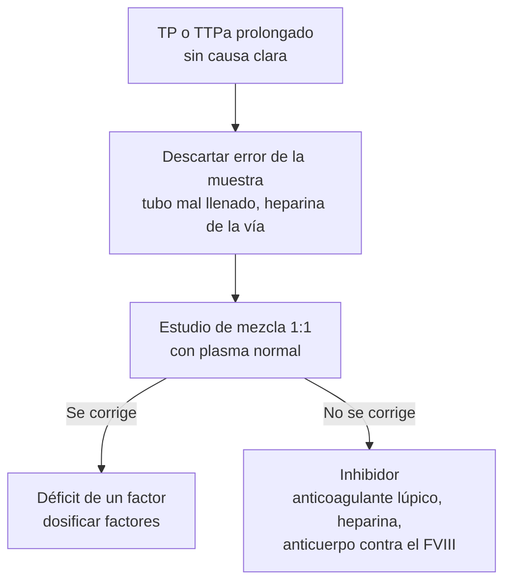

# Coagulación

**Exámenes**
Tiempo de protrombina (TP) e INR, tiempo de tromboplastina parcial activada (TTPa), fibrinógeno, dímero D, tiempo de trombina, estudio de mezcla y anti-Xa

**Fuentes principales**
ISTH 2025 (puntaje de CID) · ADJUST-PE 2014 (dímero D ajustado por edad) · MedlinePlus, rangos de referencia en adultos (revisados en 2025)

**Otras fuentes**
Ver [coagulopatías, CID y reversión de anticoagulantes](../hematologia/coagulopatias-cid-y-reversion-de-anticoagulantes.md), [tromboembolismo pulmonar](../respiratorio/tromboembolismo-pulmonar.md), [trombofilias](../hematologia/trombofilias.md) y [tromboprofilaxis y anticoagulación](../indicaciones/tromboprofilaxis.md)

**Revisado**
Octubre 2026

!!! abstract "Resumen en 60 segundos"
    - **Cuatro exámenes iniciales** ante un sangrado: **plaquetas**, **TP/INR**, **TTPa** y **fibrinógeno**. El **patrón** orienta la causa.
    - **TP/INR** mide la vía **extrínseca** (factor VII) y común: controla los **AVK** (meta habitual **2–3**) y se alarga primero en el **déficit de vitamina K** y la **hepatopatía**.
    - **TTPa** mide la vía **intrínseca** (VIII, IX, XI, XII) y común: controla la **heparina no fraccionada**; se alarga en la **hemofilia** y con el **anticoagulante lúpico** (que trombosa, no sangra).
    - **Plaquetas, TP, TTPa y fibrinógeno normales** no descartan un trastorno hemostático: von Willebrand, disfunción plaquetaria (aspirina, uremia) y púrpura vascular.
    - **Dímero D**: sirve para **descartar** TEP o TVP cuando la probabilidad clínica es baja; un valor alto es **poco específico**. Sobre 50 años usa el corte **edad × 10 µg/L**.
    - **CID**: puntaje ISTH 2025 **≥ 5** (plaquetas, dímero D, TP y fibrinógeno); lo que importa es la **tendencia**.

!!! guia "¿Qué respalda esta página?"
    Los **rangos** son los de **MedlinePlus** (Biblioteca Nacional de Medicina de EE. UU.) y **varían según el reactivo** de cada laboratorio, sobre todo el TTPa: manda el rango de tu informe. El **puntaje de CID** es el de la **ISTH 2025** y el **dímero D ajustado por edad**, el del estudio **ADJUST-PE (JAMA 2014)**. La interpretación por patrones es la de la página de [coagulopatías](../hematologia/coagulopatias-cid-y-reversion-de-anticoagulantes.md), con sus guías.

## Valores de referencia en adultos

| Examen | Rango habitual | Comentario |
|---|---|---|
| **TP** | **11–13,5 s** | Depende del reactivo; por eso se informa también el INR |
| **INR** | **0,8–1,1** sin anticoagulantes | Meta con AVK: **2–3** en la mayoría de las indicaciones |
| **TTPa** | **25–35 s** | Muy variable entre laboratorios; meta con heparina no fraccionada según el protocolo local (o anti-Xa) |
| **Fibrinógeno** | **200–400 mg/dL** (2–4 g/L) | Reactante de fase aguda: sube en la inflamación y el embarazo |
| **Dímero D** | Bajo el corte del laboratorio (habitualmente **< 500 µg/L FEU**) | Sobre 50 años: corte **edad × 10 µg/L** |
| **Plaquetas** | **150.000–400.000/µL** | Ver [hemograma](hemograma.md) |

!!! perla "INR solo para los AVK"
    El **INR** se diseñó para estandarizar el control de los **antagonistas de la vitamina K** (acenocumarol, warfarina). En la **cirrosis** el INR **no predice el sangrado** (la hemostasia está "rebalanceada") y con los **ACOD** no mide bien el efecto.

## Interpretación por patrón

| Plaquetas | TP/INR | TTPa | Pensar en |
|---|---|---|---|
| **↓** | N | N | **Trombocitopenia**; descartar la **pseudotrombocitopenia** por EDTA |
| N | **↑** | N | **AVK**, **déficit de vitamina K** inicial, **hepatopatía** inicial, déficit de **factor VII**, **ACOD** anti-Xa (sobre todo rivaroxabán) |
| N | N | **↑** | **Heparina no fraccionada**, **hemofilia A o B**, **von Willebrand** con FVIII bajo, déficit de **factor XI**, **inhibidor adquirido**, **anticoagulante lúpico** (trombosis, no sangrado), déficit de factor XII (no sangra), dabigatrán |
| N | **↑** | **↑** | **Déficit grave de vitamina K**, **AVK** en exceso, **hepatopatía avanzada**, déficit de factores X, V, II o de fibrinógeno, dosis altas de heparina o de ACOD |
| **↓** | **↑** | **↑** | **CID**, **hepatopatía** con hiperesplenismo, **transfusión masiva** (dilución) |
| N | N | N | **von Willebrand**, **disfunción plaquetaria** (aspirina, clopidogrel, uremia), **púrpura vascular**, déficit de factor XIII |

*Figura 1. Enfoque de un TP o un TTPa prolongado. Esquema propio.*

## Otros exámenes

| Examen | Para qué sirve |
|---|---|
| **Dímero D** | **Excluir** TEP o TVP con probabilidad clínica baja o improbable. Sube con la **edad**, el **cáncer**, el **embarazo**, las infecciones, la cirugía y la hospitalización. **Muy alto** en la CID |
| **Tiempo de trombina** | Prolongado con heparina, **dabigatrán** y fibrinógeno bajo o disfuncional. Un tiempo de trombina **normal** prácticamente descarta un efecto relevante del dabigatrán |
| **Anti-Xa calibrado** | Nivel de **HBPM** (obesidad, ERC, embarazo) o de un ACOD anti-Xa, si está disponible |
| **Estudio de mezcla** | Distingue un **déficit** (se corrige) de un **inhibidor** (no se corrige) |
| **Factores y von Willebrand** | Hemofilia (FVIII, FIX), von Willebrand (antígeno, actividad y FVIII) |

## CID: puntaje ISTH 2025

| Parámetro | Puntos |
|---|---|
| **Plaquetas** | **< 50.000/µL = 2** · 50.000–< 100.000 = 1 |
| **Dímero D** | **> 7 veces el límite superior = 3** · > 3 veces = 2 |
| **Prolongación del TP** | **≥ 6 s = 2** · ≥ 3 y < 6 s = 1 |
| **Fibrinógeno** | **< 1 g/L (100 mg/dL) = 1** |
| **Total** | **≥ 5 = CID manifiesta**; si es < 5, repetir en 1–2 días |

Solo se aplica a un paciente con una **enfermedad que pueda causar CID** (sepsis, trauma, cáncer, obstetricia). El fibrinógeno puede estar **normal** en la CID de la sepsis porque es un reactante de fase aguda: mira la **caída** en exámenes seriados.

## Errores de la muestra

| Problema | Qué produce | Cómo evitarlo |
|---|---|---|
| **Tubo de citrato mal llenado** | TP y TTPa falsamente prolongados (sobra citrato) | Llenar hasta la marca (relación **9:1** sangre-citrato) |
| Muestra tomada de una **vía con heparina** | TTPa muy prolongado | Tomar por punción periférica o descartar el volumen inicial según el protocolo |
| **Hematocrito muy alto** (> 55 %) | TP y TTPa falsamente prolongados (hay menos plasma para el mismo citrato) | Avisar al laboratorio para ajustar el citrato |
| **Muestra coagulada o hemolizada** | Resultados no válidos | Repetir |
| **Demora** en el procesamiento | Falsos resultados (sobre todo del TTPa) | Enviar pronto al laboratorio |

!!! alarma "Errores frecuentes de interpretación"
    - Pedir **plasma** para "corregir" un INR alto en un cirrótico **sin sangrado** antes de un procedimiento de bajo riesgo.
    - Interpretar un **TTPa prolongado** aislado como riesgo de sangrado, cuando puede ser un **anticoagulante lúpico** (riesgo de **trombosis**) o un déficit de factor XII.
    - Pedir **dímero D** a un paciente con **alta probabilidad** de TEP (debe ir directo a la imagen) o usarlo para "confirmar" una trombosis.
    - Creer que un **TP normal** descarta el efecto de un **ACOD**.
    - Tomar la muestra de la **vía con heparina**.

!!! perla "Para el internado"
    Antes de informar un TTPa prolongado, pregunta **de dónde se tomó la muestra** y **qué anticoagulante recibe el paciente y a qué hora**. Resuelve la mitad de los casos.

## Preguntas de repaso

??? repaso "1. Paciente con TTPa prolongado aislado, TP y plaquetas normales, sin sangrado, con dos abortos espontáneos. ¿Qué sospechas?"
    Un **anticoagulante lúpico** (síndrome antifosfolípidos): prolonga el TTPa **in vitro**, pero produce **trombosis** y pérdidas fetales. El estudio de mezcla **no corrige**. Ver [trombofilias](../hematologia/trombofilias.md).

??? repaso "2. ¿Qué examen se prolonga primero en el déficit de vitamina K y por qué?"
    El **TP/INR**, porque el **factor VII** (vía extrínseca) tiene la **vida media más corta** (~ 6 h) de los factores dependientes de vitamina K.

??? repaso "3. ¿Cuál es el corte del dímero D en un paciente de 72 años con probabilidad baja de TEP?"
    El ajustado por edad: **72 × 10 = 720 µg/L** (FEU). Bajo ese valor se descarta el TEP (ADJUST-PE).

??? repaso "4. Shock séptico con plaquetas de 45.000/µL, TP prolongado en 7 s, dímero D 10 veces sobre lo normal y fibrinógeno de 0,9 g/L. ¿Cuál es el puntaje ISTH?"
    Plaquetas 2 + dímero D 3 + TP 2 + fibrinógeno 1 = **8**: **CID manifiesta** (≥ 5).

??? repaso "5. Un TP y un TTPa salen muy prolongados en un paciente sin anticoagulantes y sin sangrado. ¿Qué haces primero?"
    Descartar un **error de la muestra** (tubo mal llenado, toma desde una vía con heparina, hematocrito muy alto) y **repetir** antes de estudiar.

## Referencias

1. Iba T, Levy JH, Maier CL, et al. Updated definition and scoring of disseminated intravascular coagulation in 2025: communication from the ISTH SSC Subcommittee on Disseminated Intravascular Coagulation. *J Thromb Haemost.* 2025;23:2356–2362. doi:[10.1016/j.jtha.2025.03.038](https://doi.org/10.1016/j.jtha.2025.03.038)
2. Righini M, Van Es J, Den Exter PL, et al. Age-adjusted D-dimer cutoff levels to rule out pulmonary embolism: the ADJUST-PE study. *JAMA.* 2014;311(11):1117–1124. doi:[10.1001/jama.2014.2135](https://doi.org/10.1001/jama.2014.2135)
3. Tomaselli GF, Mahaffey KW, Cuker A, et al. 2020 ACC Expert Consensus Decision Pathway on Management of Bleeding in Patients on Oral Anticoagulants. *J Am Coll Cardiol.* 2020;76:594–622. doi:[10.1016/j.jacc.2020.04.053](https://doi.org/10.1016/j.jacc.2020.04.053)
4. MedlinePlus. Prothrombin time (PT). Revisado en febrero de 2025. [medlineplus.gov](https://medlineplus.gov/ency/article/003652.htm)
5. MedlinePlus. Partial thromboplastin time (PTT). Revisado en febrero de 2025. [medlineplus.gov](https://medlineplus.gov/ency/article/003653.htm)
6. MedlinePlus. Fibrinogen blood test. Revisado en febrero de 2025. [medlineplus.gov](https://medlineplus.gov/ency/article/003650.htm)
