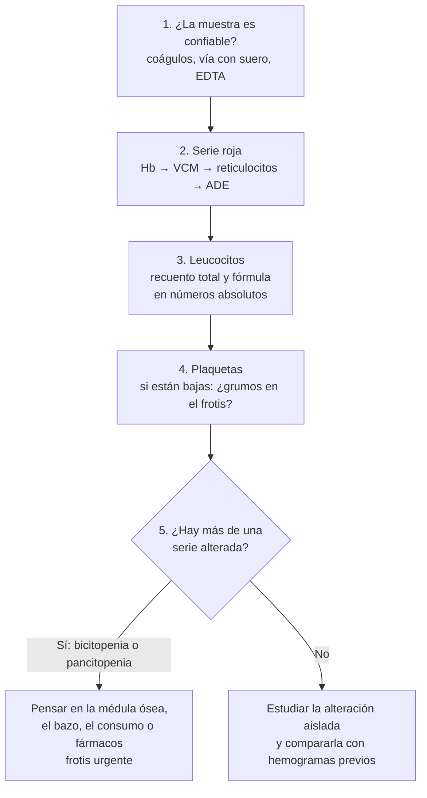

# Hemograma

**Exámenes**
Hemograma con recuento diferencial, índices eritrocitarios, reticulocitos, VHS y frotis de sangre periférica

**Fuentes principales**
OMS 2024 (puntos de corte de hemoglobina) · MedlinePlus, rangos de referencia en adultos (revisados en 2024–2026) · Valent 2012 (eosinofilia) · iwCLL 2018 (linfocitosis B)

**Otras fuentes**
Ver [anemias](../hematologia/anemias.md), [trombocitopenias](../hematologia/trombocitopenias.md), [leucemias y reacción leucemoide](../hematologia/leucemias-agudas-y-cronicas.md), [neoplasias mieloproliferativas](../hematologia/neoplasias-mieloproliferativas.md) y [neutropenia febril](../hematologia/urgencias-oncologicas.md)

**Revisado**
Octubre 2026

!!! abstract "Resumen en 60 segundos"
    - **Anemia** (OMS 2024): hemoglobina **< 13 g/dL en hombres**, **< 12 g/dL en mujeres no embarazadas** y **< 11 g/dL en el embarazo** (**< 10,5 g/dL en el segundo trimestre**).
    - Clasifica la anemia por el **VCM** (micro < 80, normo 80–100, macro > 100 fL) y por los **reticulocitos** (regenerativa o arregenerativa).
    - Lee los leucocitos en **números absolutos**, no en porcentaje: **recuento absoluto = leucocitos totales × porcentaje**.
    - **Neutropenia**: neutrófilos < **1.500/µL**; **grave** < **500/µL** (con fiebre, es una urgencia). **Eosinofilia** > **500/µL**; **hipereosinofilia** > **1.500/µL**.
    - **Trombocitopenia**: plaquetas < **150.000/µL**; antes de estudiarla, descarta la **pseudotrombocitopenia por EDTA** con un frotis.
    - **Mira el frotis** cuando hay citopenias, blastos o un resultado que no calza: los **esquistocitos** y los **blastos** son urgencias.

!!! guia "¿Qué respalda esta página?"
    Los **puntos de corte** que definen anemia vienen de la **guía de la OMS de 2024**; los de eosinofilia, del consenso de **Valent (2012)**, y el de linfocitosis B clonal, de las guías **iwCLL 2018**. Los **rangos de referencia** de la tabla son los de **MedlinePlus** (Biblioteca Nacional de Medicina de EE. UU.), que **varían entre laboratorios**: manda el rango de tu informe. La lectura en pasos y las causas de cada alteración son **práctica clínica habitual** basada en revisiones (Bain 2005, Kaferle 2009, Salvagno 2015).

## Valores de referencia en adultos

| Parámetro | Rango habitual | Comentario |
|---|---|---|
| **Hemoglobina** | Hombres **13–18 g/dL**; mujeres **12–16 g/dL** | Anemia según la OMS: < 13 (hombres), < 12 (mujeres), < 11 (embarazo; < 10,5 en el 2.º trimestre) |
| **Hematocrito** | Hombres **40–55 %**; mujeres **36–48 %** | Sube con la hemoconcentración (deshidratación) |
| **Glóbulos rojos** | Hombres **4,6–6,2 millones/µL**; mujeres **4,2–5,4 millones/µL** | Un recuento alto con VCM bajo orienta a talasemia |
| **VCM** (volumen corpuscular medio) | **80–100 fL** | Micro < 80 · macro > 100 |
| **HCM** (hemoglobina corpuscular media) | **27–32 pg** | Baja en la ferropenia y la talasemia |
| **CHCM** (concentración de HCM) | **32–36 g/dL** | Alta en la esferocitosis (y falsamente con aglutininas frías) |
| **ADE** (amplitud de distribución eritrocitaria, RDW) | Lo define cada laboratorio | Alta = **anisocitosis** (tamaños distintos) |
| **Reticulocitos** | **0,77–2,26 %** (adulto sin anemia) | Corregir por el hematocrito (índice reticulocitario) |
| **Leucocitos** | **4.500–11.000/µL** | Leer la fórmula en números absolutos |
| **Neutrófilos** | **40–60 %** | Neutropenia < 1.500/µL |
| **Baciliformes** | **0–3 %** | Aumentados = desviación a izquierda |
| **Linfocitos** | **20–40 %** | |
| **Monocitos** | **2–8 %** | |
| **Eosinófilos** | **1–4 %** | Eosinofilia > 500/µL |
| **Basófilos** | **0,5–1 %** | Basofilia: pensar en leucemia mieloide crónica |
| **Plaquetas** | **150.000–400.000/µL** | Trombocitosis persistente > 450.000/µL: estudiar |
| **VHS** (Westergren) | Hombres < 50 años **< 15 mm/h**, > 50 años **< 20**; mujeres < 50 años **< 20**, > 50 años **< 30** | Sube con la edad, la anemia y el embarazo |

!!! chile "Altura y tabaco"
    La OMS 2024 recomienda **ajustar la hemoglobina** por la altura de residencia (por ejemplo, restar **0,8 g/dL** entre 1.000 y 1.499 m y **1,4 g/dL** entre 2.000 y 2.499 m) y por el **tabaquismo** (restar **0,3 g/dL** si fuma menos de 10 cigarrillos al día y **0,6 g/dL** si fuma más de 20). Importa en el **norte de Chile** y en los **mineros** que trabajan en altura.

## Cómo leer un hemograma

*Figura 1. Lectura del hemograma en cinco pasos. Esquema propio.*

## Serie roja

### Hemoglobina baja: anemia

| VCM | Reticulocitos | Pensar en | Qué pedir |
|---|---|---|---|
| **Microcítica** (< 80 fL) | Bajos | **Ferropenia**, enfermedades crónicas, talasemia, sideroblástica | **Ferritina**, hierro, saturación de transferrina |
| **Normocítica** (80–100 fL) | **Altos** | **Hemólisis**, hemorragia aguda | LDH, bilirrubina indirecta, **haptoglobina**, Coombs directo, **frotis** |
| **Normocítica** | Bajos | Enfermedades crónicas, **ERC**, ferropenia precoz, mixta, médula ósea | Creatinina, ferritina, PCR, TSH |
| **Macrocítica** (> 100 fL) | Bajos | **Déficit de B12** o de folato, **alcohol**, hepatopatía, hipotiroidismo, **fármacos** (metotrexato, hidroxiurea, zidovudina), **mielodisplasia** | **B12**, folato, pruebas hepáticas, TSH, frotis |
| **Macrocítica** | Altos | **Reticulocitosis** (los reticulocitos son células grandes) | Estudio de hemólisis o hemorragia |

- **Índice reticulocitario** = reticulocitos (%) × (Hto del paciente / 45) ÷ factor de maduración (1 si el Hto es 45 %, 1,5 si es 35 %, 2 si es 25 %). **> 2 %**: la médula responde (pérdida o destrucción). **< 2 %**: falla de producción.
- **Índice de Mentzer** = VCM ÷ recuento de glóbulos rojos (en millones/µL). **< 13** orienta a **rasgo talasémico**; **> 13**, a **ferropenia**. Es solo una orientación: confirma con ferritina y electroforesis de hemoglobina.
- **ADE alta con VCM normal**: puede ser una **anemia mixta** (por ejemplo, ferropenia y déficit de B12 juntos) o una ferropenia que empieza. La ADE suele subir **antes** que el VCM.

!!! perla "Macrocitosis en Chile"
    La harina se fortifica con **ácido fólico desde el año 2000**, así que el **déficit de folato es raro**. Ante una macrocitosis, piensa primero en **alcohol**, **B12** (metformina, IBP, gastrectomía, adulto mayor) y **fármacos**. Ver [anemias](../hematologia/anemias.md).

### Hemoglobina alta: eritrocitosis

- Repite el examen y descarta la **hemoconcentración** (deshidratación, diuréticos).
- **Sospecha de policitemia vera**: Hb **> 16,5 g/dL** en hombres o **> 16 g/dL** en mujeres (o hematocrito > 49 % o > 48 %). Pide **eritropoyetina** y ***JAK2* V617F**.
- **Secundaria** (eritropoyetina normal o alta): hipoxia crónica (EPOC, apnea del sueño, altura), **tabaco**, **testosterona**, tumores que producen eritropoyetina, iSGLT2. Ver [neoplasias mieloproliferativas](../hematologia/neoplasias-mieloproliferativas.md).

## Serie blanca

!!! perla "Siempre en números absolutos"
    Un paciente con **2.000 leucocitos** y **60 % de neutrófilos** tiene **1.200 neutrófilos/µL**: tiene **neutropenia**, aunque el porcentaje sea "normal". Calcula: **leucocitos × porcentaje ÷ 100**.

| Alteración | Definición | Causas frecuentes | Qué hacer |
|---|---|---|---|
| **Leucocitosis** | > 11.000/µL | Infección, inflamación, estrés, **corticoides**, tabaco, esplenectomía; leucemias | Mirar **qué célula** aumenta y el frotis |
| **Neutrofilia con desviación a izquierda** | Baciliformes > 3 % | **Infección bacteriana**, sepsis | Buscar el foco |
| **Reacción leucemoide** | > 50.000/µL por una causa reactiva | Infección grave, ***C. difficile***, hemorragia, corticoides, tumores | Tratar la causa; descartar leucemia mieloide crónica |
| **Neutropenia** | < 1.500/µL · moderada 500–1.000 · **grave < 500** | **Fármacos** (metamizol, antitiroideos, quimioterapia), virus, sepsis, déficit de B12, médula ósea, autoinmune | Con fiebre y < 500: **neutropenia febril**, antibiótico en la primera hora |
| **Linfocitosis** | Linfocitos sobre el rango del laboratorio | **Virus** (mononucleosis), tos convulsiva, tabaco; **leucemia linfática crónica** | Si es persistente y **≥ 5.000 linfocitos B/µL**: citometría de flujo (iwCLL) |
| **Linfopenia** | Linfocitos bajo el rango | **Corticoides**, estrés agudo, sepsis, **VIH**, quimioterapia | Considerar VIH |
| **Eosinofilia** | > 500/µL | **Alergia**, asma, **parásitos**, fármacos (DRESS), insuficiencia suprarrenal, vasculitis | Si es > 1.500/µL en 2 controles con ≥ 1 mes de diferencia (**hipereosinofilia**): buscar daño de órgano y derivar |
| **Monocitosis** | Monocitos sobre el rango | Infecciones crónicas (**tuberculosis**, endocarditis), recuperación de una neutropenia, enfermedades inflamatorias; leucemia mielomonocítica crónica | Si persiste sin causa: frotis y hematólogo |
| **Basofilia** | Basófilos sobre el rango | **Leucemia mieloide crónica** y otras neoplasias mieloproliferativas | ***BCR::ABL1*** si hay leucocitosis o esplenomegalia |

!!! alarma "Blastos en el frotis"
    **Blastos** en sangre periférica, sobre todo con **anemia y trombocitopenia**, sugieren una **leucemia aguda**: hospitalizar, avisar al hematólogo y buscar **CID** y **lisis tumoral**. Ver [leucemias](../hematologia/leucemias-agudas-y-cronicas.md).

## Plaquetas

- **Trombocitopenia**: < **150.000/µL**. El sangrado espontáneo relevante es raro sobre **20.000–30.000/µL** si no hay otra alteración de la hemostasia.
- **Primero, confírmala**: la **pseudotrombocitopenia por EDTA** (las plaquetas se agrupan en el tubo) da recuentos falsamente bajos. Mira el **frotis** (grumos) y repite en un tubo con **citrato**.
- **Trombocitosis**: > **450.000/µL** persistentes. Lo más frecuente es que sea **reactiva** (ferropenia, inflamación, infección, cáncer, posoperatorio, esplenectomía). Sin causa, estudiar una **trombocitemia esencial** (*JAK2*, *CALR*, *MPL*).
- Ver [trombocitopenias](../hematologia/trombocitopenias.md).

## El frotis de sangre periférica

| Hallazgo | Qué sugiere |
|---|---|
| **Esquistocitos** (glóbulos rojos fragmentados) | **Microangiopatía trombótica** (PTT, SHU), **CID**, válvula mecánica: **urgencia** |
| **Esferocitos** | Anemia hemolítica **autoinmune**, esferocitosis hereditaria |
| **Dacriocitos** (en lágrima) | **Mielofibrosis**, infiltración de la médula ósea |
| **Células en diana** (dianocitos) | Talasemia, hepatopatía, esplenectomía |
| **Neutrófilos hipersegmentados** y macroovalocitos | **Déficit de B12 o de folato** |
| **Granulaciones tóxicas** y cuerpos de Döhle | **Infección bacteriana** grave, sepsis |
| **Blastos** | **Leucemia aguda** |
| **Eritroblastos** y mielocitos (leucoeritroblastosis) | Infiltración de la médula ósea (metástasis, mielofibrosis), hemorragia o sepsis graves |
| **Pilas de monedas** (rouleaux) | **Mieloma**, gammapatías, inflamación (proteínas plasmáticas altas) |
| **Grumos plaquetarios** | **Pseudotrombocitopenia** por EDTA |
| **Sombras de Gumprecht** (linfocitos rotos) | **Leucemia linfática crónica** |

## Errores de la muestra y falsos resultados

| Problema | Qué produce | Cómo evitarlo |
|---|---|---|
| **EDTA** que agrupa las plaquetas | Plaquetas falsamente bajas | Frotis y repetir en citrato |
| **Aglutininas frías** | VCM y CHCM falsamente altos, glóbulos rojos falsamente bajos | Calentar la muestra a 37 °C y repetir |
| Muestra tomada del **brazo con suero** | Hemoglobina y todos los recuentos falsamente bajos (dilución) | Tomar del brazo contrario o suspender la infusión |
| **Muestra coagulada** | Plaquetas falsamente bajas | Mezclar el tubo por inversión al tomarla |
| **Lipemia** o leucocitosis extrema | Hemoglobina falsamente alta | Avisar al laboratorio |
| **Hemoconcentración** (deshidratación) | Hemoglobina y hematocrito falsamente "normales" o altos | Repetir tras hidratar; comparar con previos |

!!! alarma "Errores frecuentes de interpretación"
    - Leer la fórmula en **porcentaje** y pasar por alto una **neutropenia** o una **linfopenia**.
    - Estudiar una trombocitopenia sin **mirar el frotis**.
    - Pedir **ácido fólico** antes que la **B12** en una macrocitosis: el folato puede empeorar el daño neurológico del déficit de B12.
    - Interpretar un **VCM normal** como "sin problema" cuando la **ADE** está alta (anemia mixta).
    - Olvidar que una **hemorragia aguda** al inicio puede tener una **hemoglobina normal**: la hemoglobina baja cuando el plasma se repone.
    - No comparar con los **hemogramas previos**.

!!! perla "Para el internado"
    Cuando presentes un hemograma, di **qué serie está alterada, cuánto y desde cuándo**: "anemia microcítica de 9,1 g/dL, que bajó de 11 en tres meses, con plaquetas normales". En una sola frase queda claro qué estudiar.

## Preguntas de repaso

??? repaso "1. ¿Qué hemoglobina define anemia en un hombre adulto, en una mujer no embarazada y en una embarazada en el segundo trimestre?"
    Según la OMS 2024: **< 13 g/dL** en el hombre, **< 12 g/dL** en la mujer no embarazada y **< 10,5 g/dL** en el segundo trimestre del embarazo (< 11 g/dL en el primero y el tercero).

??? repaso "2. Un paciente tiene 2.500 leucocitos/µL con 16 % de neutrófilos y fiebre de 38,6 °C tras quimioterapia. ¿Qué tiene y qué haces?"
    **400 neutrófilos/µL** (2.500 × 0,16): **neutropenia grave con fiebre**, es decir, una **neutropenia febril**. Hemocultivos y **antibiótico de amplio espectro en la primera hora**.

??? repaso "3. Hemoglobina 10,8 g/dL, VCM 66 fL y 5,8 millones de glóbulos rojos/µL. ¿Qué sugiere el índice de Mentzer?"
    Mentzer = 66 ÷ 5,8 ≈ **11,4** (< 13): orienta a **rasgo talasémico** más que a ferropenia. Confirmar con **ferritina** y **electroforesis de hemoglobina**.

??? repaso "4. Te informan plaquetas de 40.000/µL en un paciente asintomático sin sangrado. ¿Qué haces primero?"
    **Mirar el frotis** (grumos plaquetarios) y repetir en **tubo con citrato** para descartar la **pseudotrombocitopenia por EDTA**.

??? repaso "5. ¿Qué hallazgo del frotis obliga a actuar de urgencia en un paciente con anemia y trombocitopenia?"
    Los **esquistocitos** (microangiopatía trombótica: PTT, SHU o CID) y los **blastos** (leucemia aguda).

??? repaso "6. ¿Cuándo se habla de hipereosinofilia?"
    Con eosinófilos **> 1.500/µL** en **2 controles separados por al menos 1 mes** (o antes si hay daño de órgano grave). La **eosinofilia** simple es > 500/µL.

## Referencias

1. World Health Organization. Guideline on haemoglobin cutoffs to define anaemia in individuals and populations. Ginebra: OMS; 2024. [who.int](https://www.who.int/publications/i/item/9789240088542)
2. MedlinePlus. Complete blood count (CBC). Biblioteca Nacional de Medicina de EE. UU.; revisado en octubre de 2024. [medlineplus.gov](https://medlineplus.gov/ency/article/003642.htm)
3. MedlinePlus. Blood differential test. Revisado en febrero de 2025. [medlineplus.gov](https://medlineplus.gov/ency/article/003657.htm)
4. MedlinePlus. Platelet count. Revisado en febrero de 2025. [medlineplus.gov](https://medlineplus.gov/ency/article/003647.htm)
5. MedlinePlus. Reticulocyte count. Revisado en febrero de 2026. [medlineplus.gov](https://medlineplus.gov/ency/article/003637.htm)
6. MedlinePlus. Sed rate (erythrocyte sedimentation rate). Revisado en julio de 2025. [medlineplus.gov](https://medlineplus.gov/ency/article/003638.htm)
7. Valent P, Klion AD, Horny HP, et al. Contemporary consensus proposal on criteria and classification of eosinophilic disorders and related syndromes. *J Allergy Clin Immunol.* 2012;130(3):607–612.e9. doi:[10.1016/j.jaci.2012.02.019](https://doi.org/10.1016/j.jaci.2012.02.019)
8. Hallek M, Cheson BD, Catovsky D, et al. iwCLL guidelines for diagnosis, indications for treatment, response assessment, and supportive management of CLL. *Blood.* 2018;131(25):2745–2760. doi:[10.1182/blood-2017-09-806398](https://doi.org/10.1182/blood-2017-09-806398)
9. Gibson C, Berliner N. How we evaluate and treat neutropenia in adults. *Blood.* 2014;124(8):1251–1258. doi:[10.1182/blood-2014-02-482612](https://doi.org/10.1182/blood-2014-02-482612)
10. Bain BJ. Diagnosis from the blood smear. *N Engl J Med.* 2005;353(5):498–507. doi:[10.1056/NEJMra043442](https://doi.org/10.1056/NEJMra043442)
11. Kaferle J, Strzoda CE. Evaluation of macrocytosis. *Am Fam Physician.* 2009;79(3):203–208. [PubMed](https://pubmed.ncbi.nlm.nih.gov/19202968/)
12. Salvagno GL, Sanchis-Gomar F, Picanza A, Lippi G. Red blood cell distribution width: a simple parameter with multiple clinical applications. *Crit Rev Clin Lab Sci.* 2015;52(2):86–105. doi:[10.3109/10408363.2014.992064](https://doi.org/10.3109/10408363.2014.992064)
13. Mentzer WC Jr. Differentiation of iron deficiency from thalassaemia trait. *Lancet.* 1973;1(7808):882. [PubMed](https://pubmed.ncbi.nlm.nih.gov/4123424/)
