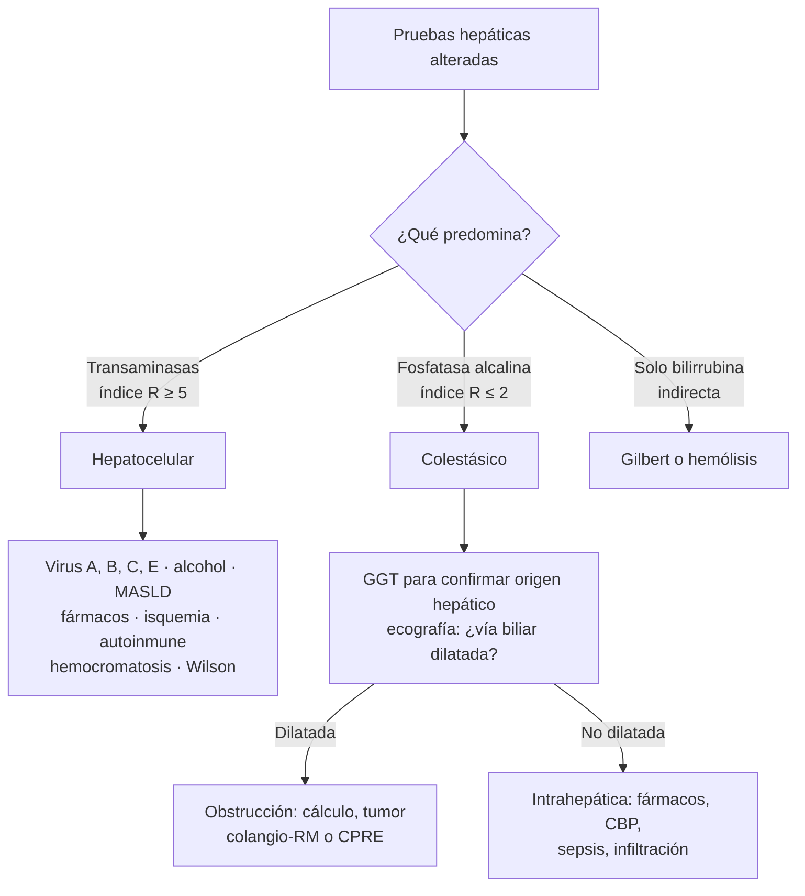

# Pruebas hepáticas y pancreáticas

**Exámenes**
Transaminasas (ALT o GPT, AST o GOT), fosfatasa alcalina, GGT, bilirrubina total y directa, albúmina, proteínas totales, LDH, amilasa y lipasa

**Fuentes principales**
ACG 2017 (evaluación de las pruebas hepáticas alteradas, Kwo) · ACG 2024 y Atlanta 2012 (pancreatitis aguda) · MedlinePlus, rangos de referencia en adultos

**Otras fuentes**
Ver [hepatitis aguda e insuficiencia hepática aguda](../gastroenterologia/hepatitis-aguda-e-insuficiencia-hepatica-aguda.md), [colestasia](../gastroenterologia/colestasia.md), [hepatitis crónica](../gastroenterologia/hepatitis-cronica-e-insuficiencia-hepatica-cronica.md), [cirrosis](../gastroenterologia/cirrosis-y-complicaciones.md) y [pancreatitis aguda](../gastroenterologia/pancreatitis-aguda.md)

**Revisado**
Octubre 2026

!!! abstract "Resumen en 60 segundos"
    - Las "pruebas hepáticas" miden **daño** (transaminasas), **colestasia** (fosfatasa alcalina, GGT, bilirrubina) y **función** (albúmina, INR, bilirrubina). Solo las últimas dicen cuánto hígado funciona.
    - **Patrón**: **hepatocelular** si predominan las transaminasas; **colestásico** si predomina la fosfatasa alcalina. El **índice R** = (ALT/límite) ÷ (FA/límite): **≥ 5 hepatocelular**, 2–5 mixto, **≤ 2 colestásico**.
    - **ALT de miles**: hepatitis **isquémica**, **viral** aguda, **tóxica** (paracetamol) o un cálculo en el colédoco recién impactado.
    - **AST/ALT > 2** con AST rara vez sobre 300–400: **hepatitis alcohólica**.
    - **Fosfatasa alcalina alta aislada**: confirma el origen hepático con la **GGT**; si la GGT es normal, piensa en el **hueso**.
    - **Bilirrubina indirecta aislada**: **Gilbert** o **hemólisis**, no colestasia.
    - **Pancreatitis aguda**: **lipasa (o amilasa) ≥ 3 veces** el límite normal más dolor típico. El nivel **no** se relaciona con la gravedad.

!!! guia "¿Qué respalda esta página?"
    El enfoque de las pruebas alteradas es el de la guía **ACG 2017 (Kwo)**, que además define el **rango "sano" de la ALT** en **29–33 UI/L en hombres y 19–25 UI/L en mujeres**: valores más altos merecen estudio aunque el laboratorio los informe "normales". El criterio de **pancreatitis** es el de **Atlanta 2012** y la guía **ACG 2024**. Los **rangos de referencia** son los de **MedlinePlus** y varían entre laboratorios.

## Valores de referencia en adultos

| Examen | Rango habitual | Comentario |
|---|---|---|
| **ALT** (GPT) | **4–36 U/L** | Más específica del hígado. Rango "sano" según ACG: 29–33 (hombres), 19–25 (mujeres) |
| **AST** (GOT) | **8–33 U/L** | También en el músculo, el corazón y los glóbulos rojos |
| **Fosfatasa alcalina** | **40–129 U/L** | Más alta en la adolescencia (hueso) y el embarazo (placenta) |
| **GGT** | **5–40 U/L** | Confirma el origen hepático de una FA alta; sube con el alcohol y fármacos inductores |
| **Bilirrubina total** | **0,1–1,2 mg/dL** | Ictericia visible sobre ~ 2,5–3 mg/dL |
| **Bilirrubina directa** (conjugada) | **< 0,3 mg/dL** | Alta: daño hepatocelular u obstrucción biliar |
| **Albúmina** | **3,4–5,4 g/dL** | Baja en la cirrosis, la desnutrición, el síndrome nefrótico y la inflamación |
| **Proteínas totales** | **6,5–8,1 g/dL** | Brecha (proteínas − albúmina) alta: gammapatía, inflamación crónica |
| **LDH** | **125–220 U/L** | Hemólisis, hepatitis isquémica, linfoma, daño tisular |
| **Amilasa** | **40–140 U/L** | Menos específica que la lipasa |
| **Lipasa** | **0–160 U/L** | Pancreatitis: ≥ 3 veces el límite superior |

## Cómo leer el perfil hepático

*Figura 1. Lectura del perfil hepático por patrón. Esquema propio basado en ACG 2017.*

### Según la magnitud de las transaminasas

| Elevación | Pensar en |
|---|---|
| **Leve** (< 5 veces el límite) | **MASLD** (hígado graso metabólico), alcohol, fármacos, hepatitis crónica B o C, hemocromatosis, celíaca, hipotiroidismo, **músculo** (ejercicio, miopatía: mirar la CK) |
| **Moderada** (5–15 veces) | Hepatitis viral aguda, fármacos, hepatitis autoinmune, alcohol |
| **Muy alta** (> 15 veces; miles) | **Hepatitis isquémica** (shock, IC: cae rápido y la LDH es muy alta), **viral aguda** (A, B, E), **paracetamol** y otros tóxicos, **coledocolitiasis** recién impactada, hepatitis autoinmune grave |

!!! alarma "La función, no las transaminasas, define la gravedad"
    Una ALT de miles con **INR normal** y sin encefalopatía es una hepatitis aguda; una ALT que **cae** mientras sube la **bilirrubina** y el **INR** puede ser una **insuficiencia hepática aguda** (pérdida de hepatocitos). Ante un **INR > 1,5** con **encefalopatía** en un paciente sin hepatopatía previa, deriva a un centro con trasplante. Ver [insuficiencia hepática aguda](../gastroenterologia/hepatitis-aguda-e-insuficiencia-hepatica-aguda.md).

### Fosfatasa alcalina y bilirrubina

| Hallazgo | Interpretación |
|---|---|
| **FA alta + GGT alta** | Origen **hepático** (colestasia) |
| **FA alta + GGT normal** | Origen **óseo** (Paget, metástasis óseas, fractura en consolidación, osteomalacia), adolescencia, embarazo |
| **Bilirrubina indirecta alta aislada**, sube con el ayuno o una enfermedad | **Síndrome de Gilbert** (benigno) o **hemólisis** (mirar hemoglobina, reticulocitos, LDH, haptoglobina) |
| **Bilirrubina directa alta** | Daño hepatocelular u **obstrucción biliar**: ecografía |
| **Ictericia indolora con baja de peso** en un mayor | **Cáncer periampular** (páncreas, vía biliar) hasta demostrar lo contrario |

## Páncreas

- **Diagnóstico de pancreatitis aguda** (2 de 3): **dolor epigástrico** típico, **lipasa o amilasa ≥ 3 veces** el límite superior y una **imagen** compatible.
- Prefiere la **lipasa**: es más específica y se mantiene alta más tiempo.
- El **nivel de la lipasa no se correlaciona con la gravedad** y no se mide a diario.
- **Amilasa normal** con pancreatitis: alcohol o **hipertrigliceridemia** (interferencia).
- **Amilasa alta sin pancreatitis**: úlcera perforada, isquemia intestinal, parotiditis, embarazo ectópico roto, **macroamilasemia**, insuficiencia renal.
- **ALT > 150 U/L** en las primeras 48 h orienta a pancreatitis **biliar**.

## Errores de la muestra y falsos resultados

| Problema | Qué produce |
|---|---|
| **Hemólisis** | AST y LDH falsamente altas |
| **Ejercicio intenso**, convulsiones, inyecciones IM | AST (y ALT) altas de origen **muscular**: mirar la **CK** |
| **Lipemia** | Interfiere con la amilasa y otros exámenes |
| Exposición prolongada de la muestra a la **luz** | Bilirrubina falsamente baja |

!!! alarma "Errores frecuentes de interpretación"
    - Tranquilizarse con transaminasas "normales" en un **cirrótico** (pueden estar normales con poca masa hepática).
    - Estudiar una AST alta aislada como hepatopatía sin pedir la **CK**.
    - Pedir amilasa y lipasa **a diario** en una pancreatitis.
    - Diagnosticar colestasia con una **bilirrubina indirecta** aislada.
    - Olvidar el **paracetamol** (y su nivel) ante una hepatitis aguda grave.

!!! perla "Para el internado"
    Ante cualquier perfil hepático alterado, pregunta tres cosas: **¿qué patrón es?**, **¿cuánto subió?** y **¿está bien la función (INR, albúmina, bilirrubina, conciencia)?** Las dos primeras dicen la causa; la tercera, la gravedad.

## Preguntas de repaso

??? repaso "1. ALT 480 U/L (límite 40) y fosfatasa alcalina 520 U/L (límite 120). ¿Qué patrón es?"
    R = (480/40) ÷ (520/120) = 12 ÷ 4,3 ≈ **2,8**: patrón **mixto**.

??? repaso "2. Paciente que estuvo en shock séptico hace 48 h con ALT de 3.200 U/L y LDH muy alta, que al día siguiente cae a 1.400. ¿Qué es?"
    Una **hepatitis isquémica** (hepatitis hipóxica): transaminasas de miles que **caen rápido**, con LDH muy alta.

??? repaso "3. Fosfatasa alcalina de 310 U/L con GGT normal en un hombre de 70 años con dolor lumbar. ¿Qué piensas?"
    Que la FA es de origen **óseo**: metástasis (próstata), enfermedad de Paget o fractura. Con GGT normal no es colestasia.

??? repaso "4. Hombre de 24 años con ictericia leve después de un ayuno, bilirrubina total 2,8 mg/dL y directa 0,3, hemograma normal. ¿Diagnóstico?"
    **Síndrome de Gilbert**: hiperbilirrubinemia **indirecta** aislada que sube con el ayuno, sin hemólisis ni daño hepático. Es benigno.

??? repaso "5. ¿Qué rango de ALT considera "sano" la guía ACG 2017?"
    **29–33 UI/L en hombres** y **19–25 UI/L en mujeres**; valores sobre esto merecen estudio aunque el laboratorio los informe dentro del rango.

??? repaso "6. Dolor epigástrico en faja, lipasa de 2.100 U/L (límite 160). ¿Necesita una TC para el diagnóstico?"
    **No**: cumple 2 de 3 criterios (dolor típico y lipasa ≥ 3 veces). La TC se reserva para dudas diagnósticas o la sospecha de complicaciones después de 72 h.

## Referencias

1. Kwo PY, Cohen SM, Lim JK. ACG clinical guideline: evaluation of abnormal liver chemistries. *Am J Gastroenterol.* 2017;112(1):18–35. doi:[10.1038/ajg.2016.517](https://doi.org/10.1038/ajg.2016.517)
2. Tenner S, Vege SS, Sheth SG, et al. American College of Gastroenterology Guidelines: Management of Acute Pancreatitis. *Am J Gastroenterol.* 2024;119:419–437.
3. Banks PA, Bollen TL, Dervenis C, et al. Classification of acute pancreatitis—2012: revision of the Atlanta classification and definitions by international consensus. *Gut.* 2013;62:102–111.
4. European Association for the Study of the Liver; Wendon J, Cordoba J, Dhawan A, et al. EASL Clinical Practical Guidelines on the management of acute (fulminant) liver failure. *J Hepatol.* 2017;66:1047–1081. doi:[10.1016/j.jhep.2016.12.003](https://doi.org/10.1016/j.jhep.2016.12.003)
5. MedlinePlus. ALT; AST; ALP; GGT; bilirubin; albumin; total protein; lactate dehydrogenase; amylase; lipase. Biblioteca Nacional de Medicina de EE. UU.; revisados en 2025–2026. [medlineplus.gov](https://medlineplus.gov/ency/article/003473.htm)
