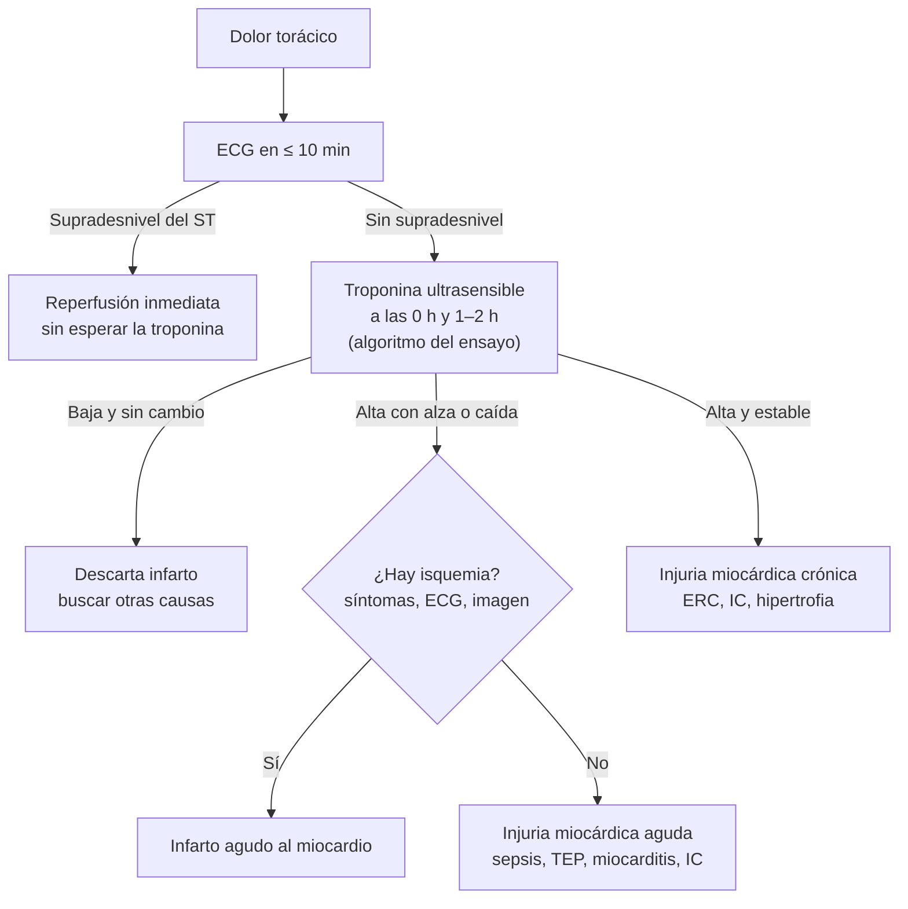

# Marcadores cardíacos e inflamatorios

**Exámenes**
Troponina ultrasensible, BNP y NT-proBNP, CK total, proteína C reactiva (PCR), VHS, procalcitonina y lactato

**Fuentes principales**
Quinta definición universal del infarto (2026) · ESC 2023 (SCA) · ESC 2026 (insuficiencia cardíaca) · Surviving Sepsis Campaign 2026 · ATS 2025 (neumonía) · MedlinePlus, rangos de referencia en adultos

**Otras fuentes**
Ver [síndrome coronario agudo](../cardiologia/sindrome-coronario-agudo.md), [insuficiencia cardíaca](../cardiologia/insuficiencia-cardiaca.md), [sepsis y shock séptico](../infectologia/sepsis-y-shock-septico.md), [neumonía adquirida en la comunidad](../respiratorio/neumonia-adquirida-en-la-comunidad.md) y [debilidad muscular y rabdomiólisis](../neurologia/debilidad-miastenia-y-miopatias.md)

**Revisado**
Octubre 2026

!!! abstract "Resumen en 60 segundos"
    - **Troponina**: el infarto requiere **alza y/o caída** con al menos un valor sobre el **percentil 99 específico por sexo** **más** evidencia de isquemia. Una troponina alta **sin** cuadro isquémico es **injuria miocárdica** (sepsis, ERC, TEP, IC, miocarditis).
    - **El supradesnivel del ST no espera la troponina**: se reperfunde de inmediato.
    - **NT-proBNP < 125 pg/mL** (ambulatorio) o **< 300 pg/mL** (urgencia) hace **improbable** la IC; para confirmarla, los cortes **suben con la edad**.
    - **Lactato > 2 mmol/L**: hipoperfusión o disfunción celular; en la sepsis, repítelo a las **2–4 h**. **> 4 mmol/L**: mayor mortalidad.
    - **PCR y VHS** son **inespecíficas**: sirven para seguir la evolución, no para diagnosticar.
    - **Procalcitonina**: **no** decide si iniciar antibióticos en una neumonía confirmada; sí ayuda a **acortar** la duración.

!!! guia "¿Qué respalda esta página?"
    El uso de la **troponina** sigue la **quinta definición universal del infarto (2026)** y la guía **ESC 2023** de SCA; los cortes de **péptidos natriuréticos**, la guía **ESC 2026** de insuficiencia cardíaca; el **lactato**, la **Surviving Sepsis Campaign 2026**; y la **procalcitonina**, la guía **ATS 2025** de neumonía. Son las mismas cifras de las páginas clínicas del sitio. Los **rangos** de CK, PCR, VHS y lactato son los de **MedlinePlus** y **varían entre laboratorios**; los cortes de la troponina dependen del **ensayo** de tu hospital.

## Valores de referencia en adultos

| Examen | Rango habitual | Comentario |
|---|---|---|
| **Troponina ultrasensible** (I o T) | Bajo el **percentil 99** del ensayo (específico por sexo) | Cada laboratorio informa su corte; lo que importa es la **curva** |
| **NT-proBNP** | Ambulatorio **< 125 pg/mL** · urgencia **< 300 pg/mL** | Sube con la edad, la ERC y la FA; baja con la obesidad |
| **BNP** | Ambulatorio **< 35 pg/mL** · urgencia **< 100 pg/mL** | **Sube** con sacubitrilo-valsartán (inhibe su degradación): en esos pacientes, sigue el NT-proBNP |
| **CK total** | **10–120 µg/L** (el rango en U/L depende del laboratorio) | Más alta en hombres, en personas musculosas y tras el ejercicio |
| **PCR** | **< 0,3 mg/dL** (< 3 mg/L) en la mayoría de los adultos sanos | Ojo con la unidad: unos laboratorios informan en mg/L y otros en mg/dL |
| **VHS** | Hombres < 50 años **< 15 mm/h**; mujeres < 50 años **< 20 mm/h** | Sube con la edad, la anemia y el embarazo |
| **Lactato** | **0,5–2,2 mmol/L** (4,5–19,8 mg/dL) | **> 2 mmol/L**: hiperlactatemia |

## Troponina

*Figura 1. Interpretación de la troponina en el dolor torácico. Esquema propio basado en la quinta definición universal del infarto (2026) y ESC 2023.*

- Usa el **algoritmo 0/1 h o 0/2 h** validado para **el ensayo** de tu hospital: los cortes no son intercambiables entre marcas.
- **Causas de troponina alta sin infarto**: **sepsis**, **ERC**, **TEP**, **IC**, miocarditis, **Takotsubo**, taquiarritmias, ACV, quimioterapia cardiotóxica, contusión cardíaca.
- La **CK-MB** ya no se usa para diagnosticar el infarto cuando hay troponina ultrasensible.

## Péptidos natriuréticos

| Contexto | Descarta IC | Apoya el diagnóstico (NT-proBNP por edad) |
|---|---|---|
| **Ambulatorio**, inicio gradual | NT-proBNP **< 125** · BNP **< 35 pg/mL** | **≥ 125** (< 50 años) · **≥ 250** (50–75) · **≥ 500 pg/mL** (> 75) |
| **Urgencia**, inicio agudo | NT-proBNP **< 300** · BNP **< 100 pg/mL** | **> 450** (< 50 años) · **> 900** (50–75) · **> 1.800 pg/mL** (> 75) |

- **Suben** con la edad, la **ERC**, la **FA**, el **TEP**, la sepsis y la hipertensión pulmonar. **Bajan** con la **obesidad** (puede haber IC con valores "normales").
- Un valor alto **no reemplaza** al ecocardiograma: lo indica.

## Inflamación, infección y perfusión

| Marcador | Para qué sirve | Límites |
|---|---|---|
| **PCR** | Seguir la **evolución** de una infección o inflamación (sube en 6–8 h, máximo a las 48 h) | Inespecífica; puede estar poco elevada en el **lupus** activo |
| **VHS** | Arteritis de células gigantes, polimialgia reumática, **tiroiditis subaguda**, osteomielitis, mieloma | Lenta: cambia en días a semanas |
| **Procalcitonina** | **Acortar** el antibiótico cuando es baja y el paciente está estable | **No** decide si iniciar el antibiótico en una NAC confirmada (ATS) |
| **Lactato** | **Gravedad** y guía de la reanimación en la sepsis y el shock | Sube también por **adrenérgicos** (salbutamol, adrenalina), **metformina**, convulsiones, hepatopatía e isquemia intestinal |
| **CK** | **Rabdomiólisis**, miopatías (estatinas, hipotiroidismo, miositis) | Sube tras el **ejercicio**, las convulsiones, las caídas y las inyecciones IM |

!!! alarma "Lactato alto"
    En un paciente con infección, **lactato > 2 mmol/L** es un signo de **hipoperfusión o disfunción orgánica**: hemocultivos, **antibiótico en la primera hora** si hay shock o sepsis probable, volumen si hay hipoperfusión y repetir el lactato a las **2–4 h**. El **shock séptico** requiere vasopresores para una PAM ≥ 65 mmHg **y** lactato > 2 mmol/L pese a un volumen adecuado. Ver [sepsis](../infectologia/sepsis-y-shock-septico.md).

!!! alarma "Errores frecuentes de interpretación"
    - Esperar la troponina en un **infarto con supradesnivel del ST**.
    - Diagnosticar un infarto con **una sola** troponina alta y estable en un paciente con ERC, sin cuadro isquémico.
    - Comparar troponinas de **ensayos distintos** o de otro hospital.
    - Descartar la IC con un NT-proBNP "bajo" en un paciente con **obesidad** importante.
    - Usar la **PCR** para decidir si una fiebre es bacteriana o viral.
    - Tomar el lactato con **ligadura prolongada** o demorar su procesamiento (sube en el tubo).

!!! perla "Para el internado"
    Las troponinas se leen **en pares**: informa la **hora** de cada muestra, la **diferencia** entre ellas y el **corte** del ensayo de tu hospital. "Troponina de 0 h 18 y de 1 h 41 ng/L, corte 14" se entiende de inmediato.

## Preguntas de repaso

??? repaso "1. Paciente con ERC etapa 4, sin dolor torácico, con troponina estable en 45 ng/L en dos muestras (corte 14). ¿Tiene un infarto?"
    **No**: es una **injuria miocárdica crónica** (troponina alta **estable**, sin isquemia). El infarto requiere una **curva** (alza y/o caída) más evidencia de isquemia.

??? repaso "2. Mujer de 80 años con disnea de semanas y NT-proBNP de 380 pg/mL en el policlínico. ¿Confirma la IC?"
    **No la confirma ni la descarta del todo**: está sobre 125 (no descarta), pero bajo el corte por edad para confirmar (≥ 500 pg/mL en > 75 años). Pide un **ecocardiograma**.

??? repaso "3. ¿Qué lactato define el shock séptico?"
    **> 2 mmol/L** pese a una reanimación adecuada con volumen, junto con la necesidad de **vasopresores** para una PAM ≥ 65 mmHg.

??? repaso "4. Paciente con NAC confirmada por radiografía y procalcitonina baja. ¿Le quitas el antibiótico?"
    **No**: la procalcitonina **no** debe usarse para decidir si iniciar el antibiótico en una NAC confirmada. Sí puede ayudar a **acortar** la duración si el paciente está estable.

??? repaso "5. Asmático en crisis tratado con salbutamol en nebulización continua tiene lactato de 4,1 mmol/L sin hipotensión. ¿Qué piensas?"
    Puede ser una **hiperlactatemia por β-agonistas** (estimulación adrenérgica), no necesariamente hipoperfusión. Evalúa la perfusión clínica y repite.

## Referencias

1. Mills NL, Newby LK, Zaman S, et al. Fifth Universal Definition of Myocardial Infarction (2026). *Eur Heart J.* 2026. doi:[10.1093/eurheartj/ehag101](https://doi.org/10.1093/eurheartj/ehag101)
2. Byrne RA, et al. 2023 ESC Guidelines for the management of acute coronary syndromes. *Eur Heart J.* 2023;44:3720–3826.
3. 2026 ESC Guidelines for the management of heart failure. *Eur Heart J.* 2026. doi:[10.1093/eurheartj/ehag100](https://doi.org/10.1093/eurheartj/ehag100)
4. Prescott HC, Antonelli M, Alhazzani W, et al. Surviving Sepsis Campaign: International Guidelines for Management of Sepsis and Septic Shock 2026. *Crit Care Med.* 2026;54:725–812.
5. Singer M, Deutschman CS, Seymour CW, et al. The Third International Consensus Definitions for Sepsis and Septic Shock (Sepsis-3). *JAMA.* 2016;315:801–810.
6. Diagnosis and Management of Community-acquired Pneumonia: An Official American Thoracic Society Clinical Practice Guideline. *Am J Respir Crit Care Med.* 2025;212(1):24. [Texto en la revista](https://academic.oup.com/ajrccm/article/212/1/24/8435770)
7. MedlinePlus. Creatine phosphokinase test; C-reactive protein; sed rate; lactic acid test; brain natriuretic peptide test. Biblioteca Nacional de Medicina de EE. UU.; revisados en 2024–2025. [medlineplus.gov](https://medlineplus.gov/ency/article/003356.htm)
